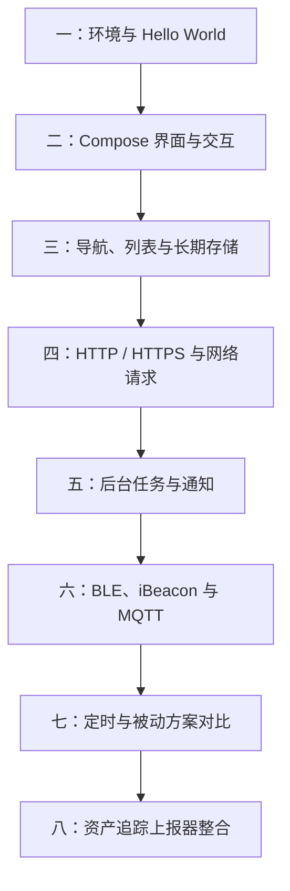

# 安卓开发课程计划与新会话续接指南

> 更新时间：2026-11-13  
> 教学对象：零基础学员  
> 工程目录：`/Users/wl/AndroidStudioProjects/My_Application`  
> 笔记根目录：`/Users/wl/web/web/notes`  
> 教案交付目录：`/Users/wl/web/web/notes/docs/安卓开发`  
> 当前进度：用户已明确启动阶段三；阶段三代码与教案已编写，未构建、未测试、未提交；阶段二验收欠项仍保留。

这份文件是八阶段课程的执行计划，不是所有阶段已完成的证明。新会话应先读本文件，再读阶段交接记录和当前源码，不能仅凭旧聊天摘要重建工程。

## 一、课程目标与固定约定

从 Hello World 开始，逐步完成「iBeacon 资产追踪上报器」：扫描 iBeacon、解析设备字段、通过 MQTT 上报、发送关键事件通知，并可选使用 HTTPS 查询云端数据。

- 全程中文，代码示例含中文注释。
- 主线为 Kotlin + Jetpack Compose + Material 3，沿用实际工程，不另起一套 XML 入门工程。
- 保留 Views、XML 布局和 RecyclerView 的对照教学，不混淆两套 UI 的入口和依赖。
- 保持包名 `com.example.my_application`、入口 `ComponentActivity + setContent` 和主题 `My_ApplicationTheme`，除非后续有明确迁移理由。
- 当前工程 `minSdk = 24`、`compileSdk = 36`、`targetSdk = 36`。这是当前工程值，不代表后续最新推荐值；新 API 要讲清版本条件。
- 每次只推进一个阶段；教案和对应代码交付后暂停，由用户启动下一阶段。
- 本课程“后台能力”指 Android 后台任务与执行限制；MQTT Broker、HTTPS 服务属于外部配套，不把客户端误写成服务器。

## 二、八阶段路线与产物

这张图在讲什么：先建立可操作、可保存的界面，再接入网络和后台能力，最后验证物联网链路并整合项目。

| 阶段 | 文档文件名 | 教学与项目增量 | 当前状态 |
|---|---|---|---|
| 一 | `01-环境搭建与第一个程序.md` | Android Studio、SDK、模拟器或真机、目录结构、Compose Hello World、日志与文档入口 | 外部教案已存在；有入门基线提交 |
| 二 | `02-界面与布局.md` | 生命周期、布局、控件、事件和状态；资产登记、校验、搜索、删除与统计 | 代码与教案已产出并同步；部分校对与验证未完成；未提交 |
| 三 | `03-数据与交互.md` | Intent 跳转传参、列表专题、SharedPreferences / 文件 / Room 选型；资产记录长期保存 | 代码与教案已编写；未构建、未测试、未提交；见阶段三验证记录 |
| 四 | `04-网络请求与HTTP-HTTPS.md` | HTTP 基础、TLS 概念、网络安全配置；Retrofit / OkHttp GET、JSON 与错误处理 | 未开始 |
| 五 | `05-后台能力与通知.md` | 后台限制、WorkManager / 前台服务 / AlarmManager、通知渠道与权限 | 未开始 |
| 六 | `06-蓝牙与MQTT链路.md` | BLE 扫描、iBeacon 解析、Eclipse Paho 连接发布断开；串联上报 | 未开始 |
| 七 | `07-定时与被动后台对比.md` | 两种触发版本、锁屏和最小化实测方案、限制与结论 | 未开始 |
| 八 | `08-实战项目整合.md` | 分 5～6 步整合资产追踪上报器；附全部总览表和进阶建议 | 未开始 |

阶段四至八文件名为计划，不要向用户声称文件已经存在。阶段一可从 Git 基线回顾，但不要直接切换或重置当前有修改的工作区。

## 三、每份阶段教案的固定模板

每个阶段单独一份完整 Markdown，可独立阅读：

1. 文档标题、所属阶段、前置要求与本阶段范围。
2. `🎓 阶段目标`：3～5 条可验收的能力。
3. `📚 核心知识点逐条讲解`：每项采用“是什么 → 为什么需要 → 怎么用 → 注意什么”四段式。
4. `💻 代码逐行讲解`：代码块标注语言，示例带中文注释，下方附“代码行或代码块 → 作用 → 为什么这样写”表格；关键 API 说明参数与返回值。
5. `📄 配置文件/清单文件逐项讲解`：解释相关 Manifest、Gradle、XML 节点，附“配置项 → 作用 → 不写会怎样”表格。不需要某项配置时明确说明不需要的原因。
6. `📖 官方文档查阅指引`：给具体 URL 或导航路径，每条说明讲什么、何时查、重点章节；强调不要背 API，要学会查文档。
7. `✍️ 动手练习`：2～3 个，由易到难，写清目标与验收标准。
8. `✅ 阶段检验`：学员能做到哪些事项才过关。
9. `本阶段小结` 与 `下一阶段预告`。

凡涉及流程、架构、链路和对比，配 Mermaid 图，并在图下写一句“这张图在讲什么”。多阶段合并展示时用分隔线；磁盘文件仍独立保存。

## 四、后续阶段不可遗漏的内容

### 阶段二的控件教学约定

以 Compose 分类为主，覆盖文本、按钮、输入、选择、列表、容器及常见反馈组件。主要类别给 1～2 个代表控件的逐行示例，其余给官方文档自学入口。

附“控件名 → 一句话作用 → 官方链接”速查索引；Views 对照项标清属于另一套 UI，不要求给 Compose 工程无故引入 AppCompat。

### 阶段三：实施拆解

1. 先阅读阶段二的登记规则、页面状态和 Saver，保留已有交互与唯一编号规则。
2. 用独立详情 Activity 的最小示例讲清显式 Intent、传参与参数缺失处理；页面仍使用 Compose。Compose 导航可作为拓展，不同时堆入多套导航框架。
3. 讲清 LazyColumn 的稳定键、数据更新，并用独立专题对照 RecyclerView 的 Adapter、ViewHolder 和依赖。
4. 用对照表说明 SharedPreferences、应用私有文件与 Room 的用途；偏好设置与结构化资产记录分开讲。
5. 资产记录计划迁移到 Room，按复杂度需要引入 DAO、Repository、ViewModel 与协程状态观察。不要让数据库读写混进 Composable 绘制过程。
6. 明确临时草稿恢复与长期资产存储的边界，避免 Saver 与数据库各自维护一份不同步的资产真相；处理加载、空态与保存失败。
7. 输出完整阶段三教案和对应代码，记录尚未验证的项目，再暂停。

阶段三不包含网络、BLE、MQTT 和后台服务。依赖及 API 用法实施前核对官方文档，不在计划中锁定未经检查的新版本。

### 阶段四：独立 HTTP / HTTPS 模块

- 请求方法、状态码、请求头与响应头、Content-Type。
- TLS 加密、证书与中间人攻击的入门解释；说明 HTTPS 的保护范围。
- `network_security_config.xml` 逐项解释，结合目标版本说明明文策略。
- 自签名证书仅讲受控调试信任方案与风险，不使用“信任所有证书”或关闭主机名校验。
- HttpURLConnection 作为了解；Retrofit / OkHttp 为实战，演示 GET、JSON 解析、错误处理与请求取消。
- 说明正常证书链与系统信任条件下的 HTTPS 使用方式；排查证书失败、明文拦截、主线程网络异常。
- 逐条解释 Android Network security、Retrofit、OkHttp 官方文档用途。
- 配网络请求生命周期 Mermaid 图及 HTTP / HTTPS 对比表。

### 阶段五：后台与通知

- 讲清 Doze、后台服务限制和前台服务类型的演进及版本条件。
- 对 WorkManager、前台服务和 AlarmManager 分别说明场景、约束与选型理由，不承诺保活。
- 通知渠道、基础通知、Android 13+ `POST_NOTIFICATIONS` 及通知与后台任务配合。
- 权限、组件和服务类型配置逐项解释；适用时讲清启动前提和被拒绝处理。
- 引导查阅 Background work 总览、WorkManager、前台服务与通知官方指南。

### 阶段六：BLE 与 MQTT

- 按系统版本说明 BLE 扫描权限、授权流程、设备发现、回调及停止扫描。
- 最小示例解析 iBeacon UUID / Major / Minor，逐字段解释，先做长度与格式校验。
- 使用 Eclipse Paho 前核对库维护情况、API 与 Android 兼容边界；客户端、Broker 和协议概念分开讲。
- 演示连接、发布、断开和失败处理，将 iBeacon 信息编码成 payload。
- 不硬编码实际凭据；讲清消息格式、去重、连接与界面生命周期的边界。
- 提供 BLE 与 MQTT 库官方查阅指南，以及“扫描 → 解析 → MQTT 上报”时序图。

### 阶段七：定时与被动获取对比

- 定时版：选择 WorkManager 或适用的 AlarmManager，串联扫描、解析和发送。
- 被动版：BLE 扫描 PendingIntent；CompanionDeviceManager 作为条件适配方案，不假定所有广播设备都适用。
- 官方核实 WorkManager 周期下限、Doze、后台启动限制、权限、进程与系统唤醒条件，以及厂商省电影响。
- 分别记录前台、最小化、锁屏、进程回收和强制停止；不能把这些条件写成同一种“后台”。
- 未获得设备数据的表格标记“未测”，不能用预期现象冒充实测。
- 对比表必须含：锁屏时能否运行、最小化后能否运行、耗电、复杂度、推荐场景。
- 必要时明确写出“标准 Android 系统上，某场景下无法保证某行为”，不夸大可靠性。
- 配触发机制对比图，逐条引用 BLE 后台指南与后台任务限制页。

### 阶段八：项目整合

项目为「iBeacon 资产追踪上报器」，学员选择定时或被动方案并说明理由。

按 5～6 步拆解；每一步包含目标、中文注释关键代码、说明表、常见错误和自测清单。覆盖扫描解析、去重与记录、MQTT、关键事件通知、可选 HTTPS 查询及整体排错。

附项目目录与模块结构 Mermaid 图。结尾统一汇总：

- 控件速查索引表。
- 后台方案选型速查表。
- 定时 vs 被动对比总结表。
- HTTP vs HTTPS 对比表。
- 学习路线总结表。
- 进阶方向建议。

## 五、当前真实进度与未完成事项

- 阶段一笔记已在笔记交付目录；已有提交 `14568e4 chore: 保存阶段一 Compose 入门基线`。
- 阶段二教案与 `阶段二验证记录.md` 已同步到笔记交付目录；项目 `docs/` 保留副本。
- 阶段二代码包含登记、校验、搜索、删除、统计和少量页面状态恢复，不含长期存储与真实上报。
- 阶段二教案尚待最终校对，部分最新页面场景未验证。具体结果以 `阶段二验证记录.md` 为准，不把“文件已产出”写成“全部验收通过”。
- 阶段二修改尚未 Git 提交。之前的阶段提交请求被拒绝，后续需重新获得用户授权。
- 用户已要求停止测试；模拟器已关闭。不要自行启动测试、Gradle 或模拟器。
- 用户于 2026-11-13 明确要求“开始第三阶段”；阶段三已实现 Room 数据层、ViewModel 与 Intent 详情页，并编写完整教案。运行效果尚未验证，详见 `阶段三验证记录.md`。
- 主工程仍是 Compose；RecyclerView、SharedPreferences 与文件是教案对照练习，不声称主界面已接入这些功能。
- 阶段三移除了临时资产 Saver；数据库版本 JSON 尚未生成。先前模板没有持久资产数据库，不保证临时记录自动转存。
- 阶段三教案、总计划与交接记录以笔记交付目录为交付位置，项目 `docs/` 保留副本。
- 本阶段产出后暂停，不自动开始阶段四；此前停止测试和暂不提交状态继续有效。

## 六、新会话操作顺序

1. 在 Codex 中选择同一个工程目录，而不是只打开笔记站点。
2. 阅读本文件、`docs/阶段三验证记录.md` 和必要的阶段二历史记录，再查看当前源码与 `git status`。
3. 保留工作区修改和未跟踪文件，不清理、重置或把旧基线覆盖到当前代码。
4. 确认用户是要求收尾阶段三，还是明确启动阶段四；按其最新指令推进。
5. 阶段三必须建立在现有资产页面上；文案与实现一起更新。
6. 后续教案先保留项目 `docs/` 副本，再同步到笔记交付目录。修改外部目录时正常申请所需文件权限。
7. 测试、构建和提交遵守当前停止或拒绝状态；只有用户重新明确授权后再恢复。
8. 每阶段结束更新本计划的状态表与对应交接记录，列清代码、文档、验证和 commit 状态，然后暂停。

新会话不会自动拥有旧会话完整对话。磁盘文件和当前 Git 工作区是主要交接依据；Git commit 不是保存本地文件的前提，但未提交文件必须保留。

### 回顾阶段二的提示词（只在明确回顾时使用）

> 回顾工程 `/Users/wl/AndroidStudioProjects/My_Application` 的阶段二教学。先读总计划和阶段二历史记录，校对教案，不回退当前阶段三代码。笔记输出到 `/Users/wl/web/web/notes/docs/安卓开发/`。保持停止测试，暂不执行 Git commit。

### 续接阶段三的提示词

> 继续阶段三收尾。工程为 `/Users/wl/AndroidStudioProjects/My_Application`，先读 `docs/00-课程计划与续接指南.md`、`docs/阶段三验证记录.md` 和当前源码，再按现有进度校对代码与教案。笔记输出到 `/Users/wl/web/web/notes/docs/安卓开发/`。保留全部现有修改，保持停止测试，暂不执行 Git commit，不开始阶段四。

### 明确开始阶段四的提示词

> 开始阶段四。工程为 `/Users/wl/AndroidStudioProjects/My_Application`，先读 `docs/00-课程计划与续接指南.md`、`docs/阶段三验证记录.md` 和当前源码，按计划实现 HTTP / HTTPS 独立模块并产出完整教案。保留前两阶段的未提交修改和未验收事项。笔记输出到 `/Users/wl/web/web/notes/docs/安卓开发/`。保持停止测试，暂不执行 Git commit。阶段四完成后暂停。

如果用户要恢复测试或阶段性提交，须在新指令中另外明确授权；上述提示词没有包含恢复授权。
