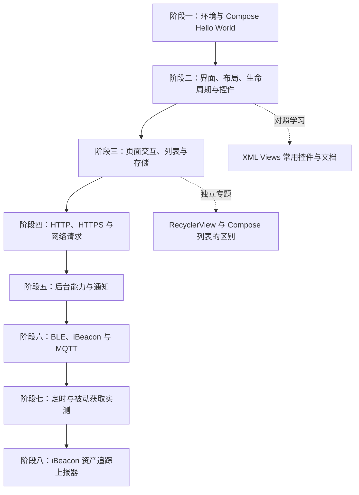
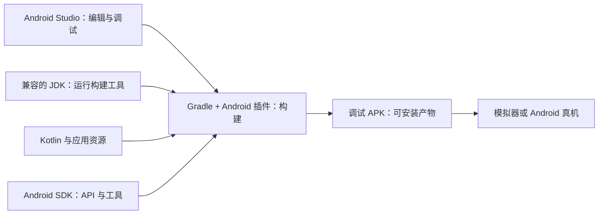
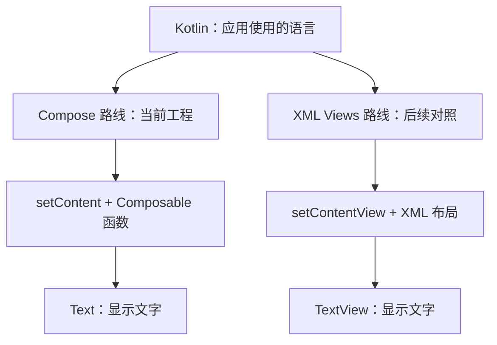
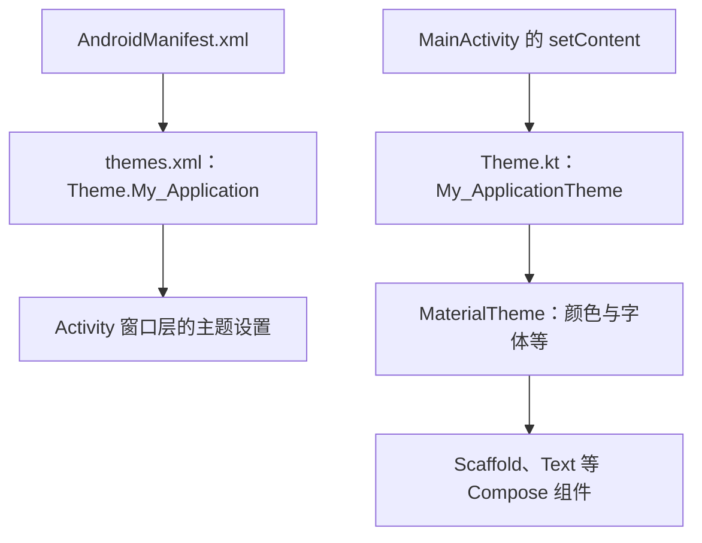
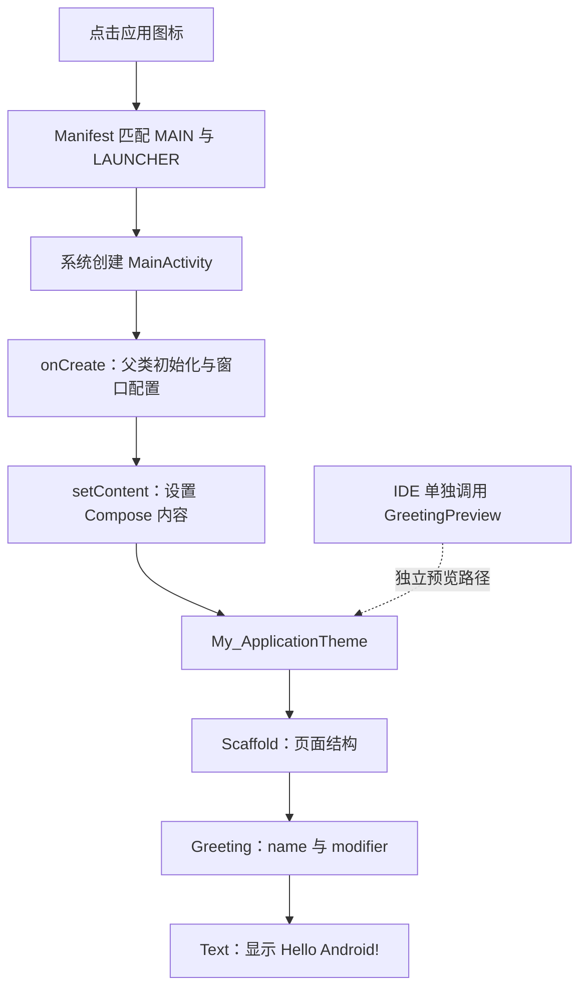
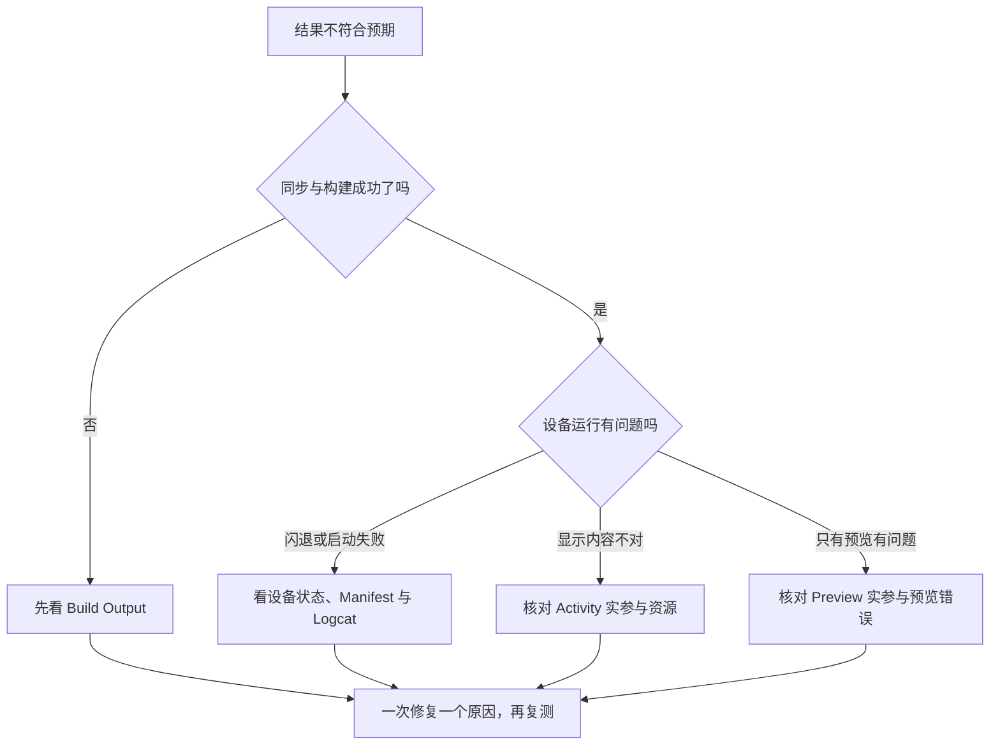

# 阶段一：环境搭建与第一个程序（Jetpack Compose）

> 所属阶段：1 / 8  
> 教学对象：零基础学员  
> 前置要求：会安装软件、管理文件；有可使用 Android Studio 的电脑和可用网络。已有工程的学员直接打开工程即可。  
> 实践设备：Android 模拟器或 Android 真机，二者有其一即可。本阶段不需要蓝牙硬件、服务器或 MQTT Broker。  
> 建议课时：讲解与演示 2 小时，安装、练习与排错 2～4 小时，按基础和下载速度调整。  
> 教学基线：现有 `My_Application` 工程；Kotlin + Jetpack Compose + Material 3。  
> 核对日期：2026-11-13。本文中的依赖版本是现有工程的版本记录，不代表最新版本。

本阶段的结果是：运行你现有的工程，看到 `Hello Android!`，找到产生这行文字的 `Greeting()`，修改它的参数并验证显示结果。

**本课程沿用现有的 Compose 工程，不要求创建另一个 XML Views 工程。** 当前入口是 `ComponentActivity + setContent {}`，下面的包名、主题函数和主要代码均与它对齐。

后续界面阶段以 Compose 控件和布局为主，同时介绍 XML Views 的控件分类、官方文档及与 Compose 的对应关系；数据阶段分别讲 Compose 列表和原定的 RecyclerView 专题。网络、后台、通知、BLE 与 MQTT 仍按原来的阶段安排学习。

已有项目与新建项目的使用方式：

| 你的情况 | 本阶段怎么做 |
|---|---|
| 已有 `My_Application` 工程 | 从“认识项目目录”开始，对照现有文件阅读，不必重新创建 |
| 完全没有工程 | 先安装工具并创建 Compose 工程，再对照阅读 |
| 新建工程的名字、包名或主题名不同 | 保留自己的实际名称；本文的 `My_ApplicationTheme` 不是所有工程都通用的内置名称 |

---

## 1. 🎓 阶段目标

完成本阶段后，你应该能够：

1. 说明 Android Studio、SDK、JDK、Gradle 与运行设备各自的用途。
2. 找到现有工程的入口、Compose 界面函数、主题、清单与构建配置。
3. 读懂 `onCreate → setContent → 主题 → Scaffold → Greeting → Text` 的启动关系。
4. 修改 Hello World 的显示内容，并区分 Preview、构建与设备运行。
5. 根据 Build Output 或 Logcat 定位基本问题，通过官方文档确认方法参数与返回值。

### 整体学习路线



这张图在讲什么：先沿现有 Compose 工程完成入门，再逐步接入交互、网络、后台与物联网能力；Views 和 RecyclerView 在对应阶段学习。

---

## 2. 📚 核心知识点逐条讲解

### 2.1 工具链：IDE、SDK、JDK 与 Gradle

**是什么：** Android Studio 是开发环境；Android SDK 提供平台 API 和工具；JDK 提供运行构建工具等所需的 Java 环境；Gradle 配合 Android Gradle Plugin 构建 Android 应用。

**为什么需要：** 写好源代码还不等于有了可以安装的应用。构建工具要编译代码、处理资源并打包，设备才可以安装和运行。

**怎么用：** 用 Android Studio 编辑和运行工程，用 SDK Manager 管理 SDK，用 Gradle 设置查看构建使用的 JDK，用 Device Manager 管理模拟器。

**注意什么：** Gradle JDK、Gradle 与 Android Gradle Plugin 必须兼容。工程中 `jvmTarget = "11"` 不等于“必须使用 JDK 11 运行 Gradle”，两者用途不同。[查阅：安装、构建与 JDK][D1] [D3] [D5]



这张图在讲什么：IDE 发起操作，构建工具结合源码和 SDK 生成安装包，设备负责运行；这些环节发生的错误需要分别诊断。

### 2.2 Kotlin、Compose 与 XML Views

**是什么：** Kotlin 是编程语言；Compose 是用 Kotlin 函数描述界面的工具体系；XML Views 是通过 XML 布局等方式组织传统 View 控件的界面体系。

**为什么需要：** `setContent {}` 与 `setContentView(...)` 并不是同一个方法的两种写法。区分它们，才不会在 Compose 工程中寻找本来就没有的 `activity_main.xml`。

**怎么用：** 你的工程在 `setContent {}` 中调用可组合函数，最终由 `Text()` 显示文字。本阶段沿这条路线学习。[查阅：Compose 入门与思维方式][D2] [D7]

**注意什么：** 单凭 Activity 的父类，不能判断一个应用是否只能使用某一种 UI；两套体系也可以互操作。这里是根据工程实际的插件、依赖、`setContent` 与 `@Composable` 确认教学路线，而非只看类名。



这张图在讲什么：两条路线都能显示文字，但布局表达方式和相关 API 不同；当前工程沿 Compose 路线运行。

### 2.3 Activity、onCreate 与 setContent

**是什么：** Activity 是 Android 应用组件；`onCreate()` 是创建 Activity 时的生命周期回调；`setContent {}` 为当前 Activity 设置 Compose 内容。

**为什么需要：** Android 系统要先找到应用声明的入口，创建 Activity，再让它提供要显示的界面。

**怎么用：** 在 `MainActivity : ComponentActivity()` 中重写 `onCreate()`，先调用父类方法，再设置窗口行为与 Compose 界面。[查阅：Activity 与 Compose 设置][D8] [D2]

**注意什么：** `onCreate()` 不是应用整个生命周期只执行一次。Activity 因配置变化等原因重建时，可能再次调用。Compose 重组也不等于 Activity 重建。

### 2.4 @Composable、组合与重组

**是什么：** `@Composable` 标记函数可以参与 Compose 界面描述。Compose 执行这些函数建立界面描述；状态变化时，可能重新执行相关函数更新界面，这称为重组。

**为什么需要：** 页面会随着数据改变，Compose 需要知道应该显示什么，而不是要求你手动找到每个控件再逐个修改。

**怎么用：** 本例把显示逻辑封装在 `Greeting(name, modifier)` 中，再从 `setContent` 的可组合内容里调用。

**注意什么：** 可组合函数可能执行多次，也可能被跳过。不要直接在 `Greeting()` 函数体内连接 MQTT、发 HTTP 请求或启动 BLE 扫描；后续学习状态、副作用与生命周期后再放置这些操作。[查阅：Compose 思维方式][D7]

### 2.5 两层主题：窗口主题与 Compose 主题

**是什么：** `res/values/themes.xml` 中的 `Theme.My_Application` 是 Manifest 可引用的 Android 主题资源；`ui/theme/Theme.kt` 中的 `My_ApplicationTheme()` 是本工程定义的 Compose 函数。

**为什么需要：** Activity 窗口和 Compose 组件的样式分别有对应的配置入口。两个名字相似，但不是同一个东西。

**怎么用：** Manifest 使用 `@style/Theme.My_Application`；界面代码使用 `My_ApplicationTheme { ... }`，由它调用 Material 3 的 `MaterialTheme` 提供颜色、字体等设置。

**注意什么：** `My_ApplicationTheme` 不是 Android SDK 内置方法，改了工程名并不意味着所有主题引用会自动改好。当前主题还支持按条件使用动态配色，具体颜色要以运行系统和主题逻辑为准。[查阅：Compose 主题][D9]



这张图在讲什么：Manifest 引用 XML 主题资源，Compose 内容调用 Kotlin 主题函数；读懂项目时需要同时认识这两个入口。

### 2.6 enableEdgeToEdge、Scaffold 与 innerPadding

**是什么：** `enableEdgeToEdge()` 配置窗口的边缘到边缘显示；`Scaffold` 是 Material 3 的页面结构组件；它把内容应考虑的留白以 `PaddingValues` 传给内容 lambda。

**为什么需要：** 应用内容可能延伸到状态栏、导航栏区域；页面有顶栏或底栏时也需要留出相应空间，避免正文被遮挡。

**怎么用：** 当前代码让 `Scaffold` 填充父级可用空间，并把 `innerPadding` 传给 `Modifier.padding(innerPadding)`，最终由 `Greeting()` 应用到 `Text()` 上。

**注意什么：** `Scaffold` 不会自动把这份留白应用到正文，你需要使用它；`enableEdgeToEdge()` 也不等于自动完成所有避让。实际留白受系统、组件和窗口配置影响，不是一个固定的“顶部高度”。[查阅：Scaffold 与边衬处理][D10] [D11] [D12]

### 2.7 Modifier：怎样描述布局和行为

**是什么：** `Modifier` 是 Compose 中组合布局、绘制、交互等修饰规则的对象；例如 `fillMaxSize()` 与 `padding(...)` 返回带有相应规则的 Modifier。

**为什么需要：** 同一个界面函数应能由调用者决定外部尺寸、留白和其他行为，而不是把所有布局规则写死在内部。

**怎么用：** `Greeting()` 接收 `modifier: Modifier = Modifier`，再把它传给内部的 `Text()`。

**注意什么：** 只接收参数但不把它应用到实际组件，调用者传入的布局规则就不会生效。修饰规则的先后顺序也可能改变结果；完整布局实验放到阶段二。[查阅：Compose modifiers][D13]

### 2.8 Kotlin 语法：命名参数、默认参数与 lambda

**是什么：** `name = "Android"` 是命名参数；`modifier: Modifier = Modifier` 声明参数类型并提供默认值；`{ innerPadding -> ... }` 是带参数的 lambda。

**为什么需要：** 模板大量使用这些语法。如果不先认识它们，容易把 `{}` 当成普通排版，把 `innerPadding` 当成关键字。

**怎么用：** `Greeting(name = "Android")` 把字符串传给 `name`；`Scaffold { innerPadding -> ... }` 接收 Scaffold 传入的内容留白；`"Hello $name!"` 把变量嵌入字符串。

**注意什么：** `innerPadding` 是局部参数名，可以重命名；`->` 左侧是 lambda 参数，右侧是执行内容。命名参数中的 `name` 必须匹配被调用函数的参数名称。[查阅：Android 的 Kotlin 学习入口][D14]

### 2.9 资源、Preview 与运行证据

**是什么：** `R` 是构建生成的资源索引；`@Preview` 为 IDE 预览标记界面入口；Build Output 反映构建问题，Logcat 反映设备日志与运行异常。

**为什么需要：** Compose 不要求用 XML 写页面，但仍然会用到 `strings.xml`、图片、清单等资源。能预览也不代表应用已经在设备上正确启动。

**怎么用：** 通过 `stringResource(R.string.xxx)` 在 Compose 中读取文字资源；用 Preview 观察局部界面；用 Run 安装应用；启动异常时查看 Logcat。

**注意什么：** Preview 是独立预览入口，修改预览参数不会自动修改 Activity 中的实参。资源索引不要手改；Compose 中不要误导入 `android.R`。[查阅：资源、预览与日志][D15] [D16] [D17]

---

## 3. 安装、项目目录与首次运行

### 3.1 安装开发环境

已有可正常同步的 Android Studio 工程时，不必重装，检查工具配置即可。

1. 从 [Android Studio 官方入口](https://developer.android.com/studio) 下载适合操作系统和处理器架构的版本。
2. 阅读[官方安装说明][D1]的系统要求，完成安装向导和必要组件下载。
3. 在 SDK Manager 确认工程所需平台 SDK、Platform-Tools 和 Build-Tools 可用。
4. 本工程编译目标为 API 36，需要相应 SDK；模拟器或真机系统不必与编译目标完全一致，但不能低于 `minSdk`。
5. 在 Gradle 设置查看 Gradle JDK，按当前 Android 插件与 Gradle 的兼容要求选择。
6. 使用模拟器时，通过 Device Manager 安装 Emulator 与适合主机架构的系统镜像。

**安装验收：** 能打开工程、找到有效 SDK 路径、完成 Gradle Sync。首次下载依赖需要网络，不代表 Hello World 的运行需要网络权限。

### 3.2 需要从零创建工程时

| 向导项目 | 建议选择 | 为什么这样选 |
|---|---|---|
| 模板 | `Empty Activity`，并确认模板说明为 Compose | 对齐当前项目的 `setContent` 和可组合函数 |
| Name | `My_Application` 或你自己的工程名 | 当前文档主题名来自已有工程名，不要求所有人照抄 |
| Package name | 本工程为 `com.example.my_application` | 对齐源码包、资源命名空间和入口声明 |
| Language | Kotlin；部分 Compose 向导可能不再提供语言选择 | Compose 使用 Kotlin 编写界面 |
| Minimum SDK | 本课程已有工程为 API 24 | 作为课程的安装下限，并非所有功能的最低 API |
| 插件、依赖与其他 SDK 设置 | 新工程保留向导生成的兼容组合 | 不把本文的既有版本快照当成新工程升级方案 |

创建后检查 `ComponentActivity`、`setContent`、`@Composable` 与主题文件。模板名称可能变化，以[Compose 设置指南][D2]为准；不要选择本课程当前不使用的 `Empty Views Activity`。

### 3.3 认识现有项目目录

Android Studio 的 Android 视图会按用途分组；切换到 Project 视图可以更直接地查看实际目录。[查阅：工程概览][D18]

```text
My_Application/                             # 现有工程根目录
├── settings.gradle.kts                     # 模块、插件仓库与依赖仓库
├── build.gradle.kts                        # 工程级插件声明
├── gradle.properties                       # 工程级构建属性
├── local.properties                        # 当前电脑的 SDK 路径等本机配置
├── gradlew                                 # macOS、Linux 的 Gradle Wrapper 入口
├── gradlew.bat                             # Windows 的 Gradle Wrapper 入口
├── gradle/
│   ├── libs.versions.toml                  # 依赖、插件版本及别名
│   └── wrapper/gradle-wrapper.properties   # Gradle 发行版与下载相关配置
├── app/
│   ├── build.gradle.kts                    # 应用模块的构建配置
│   ├── proguard-rules.pro                  # 压缩与混淆的补充规则
│   ├── src/
│       ├── main/
│       │   ├── AndroidManifest.xml         # 应用与组件声明
│       │   ├── java/com/example/my_application/
│       │   │   ├── MainActivity.kt         # Activity、Greeting 和预览函数
│       │   │   └── ui/theme/
│       │   │       ├── Theme.kt            # My_ApplicationTheme 与配色选择
│       │   │       ├── Color.kt            # 颜色定义
│       │   │       └── Type.kt             # 排版样式定义
│       │   └── res/
│       │       ├── values/strings.xml      # 字符串资源
│       │       ├── values/themes.xml       # Android 窗口主题资源
│       │       ├── values/colors.xml       # 现有 XML 颜色资源
│       │       ├── drawable/              # 图形资源
│       │       ├── mipmap-*/              # 启动图标资源
│       │       └── xml/                   # 备份、数据提取等 XML 规则
│       ├── test/                          # 本地测试源码
│       └── androidTest/                   # 设备测试源码
│   └── build/                             # 应用模块的构建输出，按需生成
├── .gradle/                               # 本地 Gradle 缓存，按需生成
└── .idea/                                 # IDE 工程元数据
```

**逐块说明表：**

| 目录／文件块 | 作用 | 为什么这样组织 |
|---|---|---|
| 工程级 Gradle 文件 | 组织模块、插件和仓库 | 多模块共享构建基础配置 |
| `gradle/` 与 Wrapper | 记录版本、别名和构建工具入口 | 尽量让不同电脑使用工程约定的工具 |
| `app/src/main/` | 保存正式应用代码、资源和清单 | 与测试源码、生成结果区分 |
| `MainActivity.kt` | 提供启动入口与本阶段界面 | 入门模板把少量界面代码放在一起，便于开始 |
| `ui/theme/` | 集中存放 Compose 外观配置 | 多个界面可以共用同一套颜色与字体 |
| `res/values/` 与 `res/xml/` | 保存 Android 资源与规则 | Compose 依然使用 Android 资源系统 |
| `test/` 与 `androidTest/` | 保存不同运行环境的测试 | 部分验证无需设备，另一些需要 Android 环境 |
| 缓存、IDE 设置与构建目录 | 保存工具状态和生成产物 | 不应把它们当作手写应用逻辑的地方 |

`app/build/` 是应用模块的生成目录，不是手写源码目录。当前界面没有 `res/layout/activity_main.xml` 是正常的。

### 3.4 运行到设备

**模拟器：**

1. 打开 Device Manager，创建或选择一个手机虚拟设备。
2. 选择适合电脑架构且 API 级别不低于 24 的系统镜像。
3. 启动模拟器，等待进入系统。
4. 在 Android Studio 工具栏选择 `app` 和该模拟器，点击 Run。

镜像创建与主机要求见[虚拟设备指南][D19]。

**真机：**

1. 启用手机的开发者选项与 USB 调试。
2. 使用支持数据传输的 USB 线连接电脑。
3. 解锁手机，核对并接受电脑的调试授权。
4. Windows 如需要，按厂商说明配置驱动。
5. 在 Android Studio 选择该手机，点击 Run。

设备显示 `unauthorized` 时检查手机授权，显示 `offline` 时检查连接状态。[查阅：真机运行][D20]

**首次验收：** 设备实际显示 `Hello Android!`。当前模板未指定居中布局，不要把文字没有居中当成运行失败。

---

## 4. 💻 代码逐行讲解

### 4.1 与现有 MainActivity.kt 对齐的完整示例

文件：`app/src/main/java/com/example/my_application/MainActivity.kt`。

下面代码与现有模板的结构一致，新增的是中文注释，不要求你改成其他 Activity 基类。

```kotlin
package com.example.my_application // 声明代码包，与当前工程保持一致

import android.os.Bundle // Activity 创建回调使用的状态容器
import androidx.activity.ComponentActivity // 当前 Activity 使用的 AndroidX 基类
import androidx.activity.compose.setContent // 给 Activity 设置 Compose 内容的扩展函数
import androidx.activity.enableEdgeToEdge // 配置边缘到边缘显示的扩展函数
import androidx.compose.foundation.layout.fillMaxSize // 填充父级可用空间的 Modifier 扩展
import androidx.compose.foundation.layout.padding // 设置留白的 Modifier 扩展
import androidx.compose.material3.Scaffold // Material 3 页面结构组件
import androidx.compose.material3.Text // Material 3 文本组件
import androidx.compose.runtime.Composable // 标记可组合函数的注解
import androidx.compose.ui.Modifier // 布局、绘制与交互修饰规则的入口
import androidx.compose.ui.tooling.preview.Preview // Android Studio 预览注解
import com.example.my_application.ui.theme.My_ApplicationTheme // 本工程自己定义的主题函数

class MainActivity : ComponentActivity() { // 页面组件，继承当前模板的 Activity 基类
    override fun onCreate(savedInstanceState: Bundle?) { // 系统创建页面时调用，状态参数可以为空
        super.onCreate(savedInstanceState) // 先完成父类必要的创建流程
        enableEdgeToEdge() // 允许窗口内容采用边缘到边缘显示
        setContent { // 设置 Compose 内容，花括号中是可组合内容
            My_ApplicationTheme { // 为内部 Compose 组件提供工程主题
                Scaffold(modifier = Modifier.fillMaxSize()) { innerPadding -> // 接收内容留白
                    Greeting(
                        name = "Android", // 给问候函数传入显示名称
                        modifier = Modifier.padding(innerPadding) // 把留白规则传给正文
                    )
                }
            }
        }
    }
}

@Composable // 表示这个函数用于描述 Compose 界面
fun Greeting(name: String, modifier: Modifier = Modifier) { // 接收名称和可选修饰规则
    Text(
        text = "Hello $name!", // 字符串模板：把 name 的值放进文字
        modifier = modifier // 应用调用者传入的规则，不要丢弃该参数
    )
}

@Preview(showBackground = true) // 在 IDE 预览中显示背景，便于看清内容
@Composable // 预览入口也需要是可组合函数
fun GreetingPreview() { // 不带必填参数，供 IDE 直接预览
    My_ApplicationTheme { // 预览采用与应用相同的主题函数
        Greeting("Android") // 这是预览的实参，与 Activity 中的调用相互独立
    }
}
```

**逐行／逐块说明表：**

| 代码行或代码块 | 作用 | 为什么这样写 |
|---|---|---|
| `package com.example.my_application` | 声明代码所属包 | 与现有工程对齐，不引入另一份教程的包名 |
| `Bundle`、`ComponentActivity` 导入 | 使状态类型和基类名称可用 | Kotlin 需要知道引用的是哪些类型 |
| `setContent`、`enableEdgeToEdge` 导入 | 引入扩展函数 | 它们能以 Activity 方法的形式调用，但仍需要正确导入 |
| `fillMaxSize`、`padding` 导入 | 引入 Modifier 扩展 | 缺少对应导入时，修饰方法可能无法解析 |
| `Scaffold`、`Text` 导入 | 引入 Material 3 可组合组件 | 保持本例组件来自 `material3` |
| `Composable`、`Modifier`、`Preview` 导入 | 提供注解和修饰类型 | 分别用于界面声明、规则传递与设计时预览 |
| `My_ApplicationTheme` 导入 | 引入本项目定义的函数 | 它来自 `ui/theme/Theme.kt`，不是系统内置类 |
| `class MainActivity : ComponentActivity()` | 定义入口组件并调用父类构造 | 沿用官方入门模板的基础结构 |
| `override fun onCreate(...)` | 实现页面创建回调 | Android 系统通过生命周期启动页面逻辑 |
| `Bundle?` 中的 `?` | 允许状态参数为 `null` | 首次创建时通常没有已保存状态 |
| `super.onCreate(...)` | 调用父类实现 | 让基础组件完成必要初始化 |
| `enableEdgeToEdge()` | 配置窗口的边缘到边缘行为 | 与当前模板的窗口展示方式保持一致 |
| `setContent { ... }` | 提供 Activity 的 Compose 内容 | 当前界面无需 `setContentView(R.layout...)` |
| `My_ApplicationTheme { ... }` | 提供 Compose 主题环境 | 内部组件可以使用工程的颜色与排版设置 |
| `Scaffold(modifier = Modifier.fillMaxSize())` | 创建页面骨架并填充可用区域 | 为正文及以后可能加入的顶栏等提供结构 |
| `{ innerPadding -> ... }` | 接收 Scaffold 传入的 `PaddingValues` | 这是内容 lambda 的参数，不是系统关键字 |
| `Greeting(name = "Android", ...)` | 复用问候界面函数 | 界面显示内容通过参数传入 |
| `Modifier.padding(innerPadding)` | 为正文附加留白规则 | 防止忽略 Scaffold 给出的内容留白 |
| `@Composable fun Greeting(...)` | 定义可复用界面单元 | 命名后可以在运行入口和预览入口分别调用 |
| `modifier: Modifier = Modifier` | 为修饰参数提供默认值 | 调用者可以传规则，也可以省略 |
| `Text(text = "Hello $name!", modifier = modifier)` | 显示文字并应用外部规则 | `$name` 用于字符串插值，modifier 需要真正传下去 |
| `@Preview(showBackground = true)` | 让 IDE 可以显示这个预览 | 帮助检查局部界面，不改变运行入口 |
| `GreetingPreview()` 内的 `Greeting("Android")` | 给预览提供示例数据 | 改这里不会自动改变 Activity 中传入的名称 |

### 4.2 关键 API：参数与返回值

| API／函数 | 本例参数的含义 | 返回值 | 什么时候查 |
|---|---|---|---|
| `onCreate(savedInstanceState: Bundle?)` | 可空的已保存状态 | `Unit`，不返回业务结果 | 理解页面创建与状态恢复时 |
| `enableEdgeToEdge()` | 无参调用使用库提供的默认窗口栏样式配置 | `Unit` | 系统栏显示和内容避让异常时 |
| `ComponentActivity.setContent { ... }` | 主要传入可组合内容 lambda；还存在可选组合上下文参数，本例省略 | `Unit` | 设置 Compose 根内容或核对函数导入时 |
| `My_ApplicationTheme { ... }` | 本工程函数接收主题选项与可组合内容，本例使用默认主题选项 | `Unit` | 想知道主题名字从哪里来时，直接跳转 `Theme.kt` |
| `Scaffold(modifier, content)` | `modifier` 修饰页面；`content` 接收 `PaddingValues` 并描述正文 | `Unit` | 加顶栏、底栏或处理内容留白时 |
| `Modifier.fillMaxSize(fraction = 1f)` | 默认比例为 1，按父级约束填充可用尺寸 | 新的 `Modifier` 链 | 理解组件为何占用某个尺寸时 |
| `Modifier.padding(paddingValues)` | 四个方向的留白值，本例来自 Scaffold | 新的 `Modifier` 链 | 内容被遮挡或需要外部留白时 |
| `Greeting(name, modifier)` | 本例自定义的名称与修饰参数 | `Unit` | 理解自定义可组合函数时 |
| `Text(text, modifier)` | 要显示的字符串和布局等规则；其他参数用默认值 | `Unit` | 字号、颜色、行数、截断或可访问性设置时 |
| `@Preview(showBackground = true)` | 标注 IDE 预览背景选项 | 注解，不是获取页面对象的方法 | 预览配置时 |

`Unit` 表示本例不从函数取得业务数据，不表示“函数什么也不做”。`Modifier` 表达规则，也不是一个立即出现到屏幕上的控件对象。

Compose 与 Activity 的 API 参考入口见文末的 A1～A5。库 API 的可用性还要看工程依赖版本，不能只看手机的 Android API 级别。

### 4.3 启动链路：先找到入口，再描述界面



这张图在讲什么：设备运行从 Manifest 和 Activity 进入界面；Preview 直接使用独立预览函数，并不证明整个设备启动链路已通过。

`setContent` 设置内容后，Compose 会管理组合和后续更新；这张图只是帮助理解入口关系，不表示所有可组合函数一生只顺序执行一次。

### 4.4 第一次修改：只改运行入口的 name

在 `MainActivity` 中找到原有 `Greeting(...)` 调用，仅修改这个调用，不要额外粘贴一个重复界面：

```kotlin
// 片段：替换 onCreate 内 Scaffold 中原有的 Greeting 调用
Greeting(
    name = "安卓", // 修改运行时传入的名称，预期文字变为 Hello 安卓!
    modifier = Modifier.padding(innerPadding) // 保留原来的内容留白规则
)
```

| 代码行或代码块 | 作用 | 为什么这样写 |
|---|---|---|
| `Greeting(...)` | 调用已有可组合函数 | 复用现有结构，不另建 Activity |
| `name = "安卓"` | 修改此次调用的数据 | `Text` 中的字符串模板会使用新的参数 |
| `modifier = ...` | 保持内容留白 | 修改文案不需要破坏窗口适配 |

运行设备后应显示 `Hello 安卓!`；预览仍可能显示 `Hello Android!`，因为 `GreetingPreview()` 中还有自己单独传入的参数。这是预期现象。

### 4.5 可选改进：把格式文字移到字符串资源

先完成上一小节，再学习本改进。文件：`app/src/main/res/values/strings.xml`：

```xml
<?xml version="1.0" encoding="utf-8"?>
<!-- 文字资源集合：保留应用名，新增可格式化的问候模板 -->
<resources>
    <string name="app_name">My_Application</string>
    <!-- %1$s 表示第一个字符串格式参数，由 Greeting 的 name 提供 -->
    <string name="greeting_message">你好，%1$s！</string>
</resources>
```

| 代码行或代码块 | 作用 | 为什么这样写 |
|---|---|---|
| `<resources>` | 资源文件的根节点 | 字符串资源需要在正确结构中声明 |
| `app_name` | 保留应用名称 | Manifest 仍然需要它，不要为新示例删除已有资源 |
| `greeting_message` | 为问候模板命名 | Kotlin 通过 `R.string.greeting_message` 引用 |
| `%1$s` | 第一个格式参数，按字符串处理 | 允许语言调整语序，不用在代码中拼接固定中文 |

如果文件中还有其他资源，只新增缺少的条目。接着在 `MainActivity.kt` 原有导入区增加下面一行；并用下方函数替换原有 `Greeting()`，不要同时保留两个同签名函数：

```kotlin
import androidx.compose.ui.res.stringResource // 放在文件顶部的 import 区，读取 Compose 字符串资源

// 片段：替换原有 Greeting，保留 MainActivity 和 GreetingPreview
@Composable
fun Greeting(name: String, modifier: Modifier = Modifier) {
    Text(
        text = stringResource(R.string.greeting_message, name), // 资源编号 + 第一个格式参数
        modifier = modifier // 继续应用调用者传入的布局规则
    )
}
```

| 代码行或代码块 | 作用 | 为什么这样写 |
|---|---|---|
| `import ...stringResource` | 引入 Compose 资源读取函数 | 导入要放在文件顶部，不能插到类内部 |
| `@Composable fun Greeting(...)` | 保留既有函数签名 | 调用位置无需随之更改 |
| `stringResource(R.string.greeting_message, name)` | 读取并格式化资源 | 第一个参数是资源 ID，后面的参数依次填入占位符 |
| `modifier = modifier` | 保留规则传递 | 资源改造不应使原有留白失效 |

**关键 API：** `stringResource(id: Int, vararg formatArgs: Any)` 返回格式化后的 `String`，用于可组合上下文；普通 Activity 方法中读取资源通常用 `getString(...)`。本例 `name = "安卓"` 时显示“你好，安卓！”。[查阅：Compose 资源][D15]

### 4.6 可选观察：添加一条创建日志

在文件顶部添加 `import android.util.Log`；在现有 `onCreate()` 的 `super.onCreate(savedInstanceState)` 后增加日志，其他代码保持原样：

```kotlin
import android.util.Log // 放在顶部 import 区，引入日志工具

// 插入片段：放在 onCreate 内 super.onCreate(...) 之后，不要放进 Greeting 函数体
Log.d("HelloAndroid", "MainActivity 已创建") // 输出 debug 日志，便于过滤和观察创建事件
```

| 代码行或代码块 | 作用 | 为什么这样写 |
|---|---|---|
| `import android.util.Log` | 使用 Android 日志 API | 本例没有自动导入时需要手动补充 |
| `Log.d("HelloAndroid", "...")` | 输出标签与消息 | 在 Logcat 中用固定标签找到记录 |
| 放在 `onCreate` 的指定位置 | 观察一次 Activity 创建回调 | 避免把日志执行次数误当成 `Greeting` 的重组次数 |

**关键 API：** `Log.d(tag, msg)` 的两个参数分别是标签与消息，返回 `Int` 类型的日志调用结果，本例不使用。日志不应包含密码、令牌或其他敏感信息；它也不是给用户看的通知。

---

## 5. 📄 配置文件／清单文件逐项讲解

### 5.1 现有 AndroidManifest.xml

以下保留现有清单结构并添加注释，用于对照阅读，不需要为了入门删减原文件：

```xml
<?xml version="1.0" encoding="utf-8"?>
<!-- 清单根节点：声明 Android 属性及工具属性的命名空间 -->
<manifest xmlns:android="http://schemas.android.com/apk/res/android"
    xmlns:tools="http://schemas.android.com/tools">

    <!-- 应用级设置：标签、图标、窗口主题及备份规则 -->
    <application
        android:allowBackup="true"
        android:dataExtractionRules="@xml/data_extraction_rules"
        android:fullBackupContent="@xml/backup_rules"
        android:icon="@mipmap/ic_launcher"
        android:label="@string/app_name"
        android:roundIcon="@mipmap/ic_launcher_round"
        android:supportsRtl="true"
        android:theme="@style/Theme.My_Application">

        <!-- 页面声明：外部桌面启动器可以启动该入口 Activity -->
        <activity
            android:name=".MainActivity"
            android:exported="true"
            android:label="@string/app_name"
            android:theme="@style/Theme.My_Application">

            <!-- 启动入口匹配：主要动作 + 桌面启动器分类 -->
            <intent-filter>
                <action android:name="android.intent.action.MAIN" />
                <category android:name="android.intent.category.LAUNCHER" />
            </intent-filter>
        </activity>
    </application>
</manifest>
```

| 配置项 | 作用 | 不写会怎样 |
|---|---|---|
| `<manifest>` | 清单根节点 | 无法形成有效清单 |
| `xmlns:android` | 让 `android:` 前缀可被正确解析 | 对应属性无法解析 |
| `xmlns:tools` | 声明工具属性前缀 | 当前没有使用 `tools:` 属性，省略不影响本例运行 |
| `<application>` | 容纳应用属性与组件声明 | 无法按本例声明应用 |
| `allowBackup="true"` | 表达应用参与系统备份机制的意愿 | 默认值为 true；实际备份、恢复和设备迁移受系统与厂商规则影响 |
| `dataExtractionRules` | 引用 Android 12 及以上相关数据提取规则 | 没有应用自定义规则时按适用平台默认策略处理 |
| `fullBackupContent` | 引用旧版 Auto Backup 相关规则 | 没有自定义规则时按适用平台默认策略处理 |
| `icon` | 应用启动图标 | 无法保证显示本项目预期图标 |
| 应用级 `label` | 应用可见标签 | 可能回退到标识等，不符合预期名称 |
| `roundIcon` | 提供圆形图标资源 | 支持该属性的启动器可能采用其他可用图标 |
| `supportsRtl` | 声明支持从右向左布局 | 默认不声明支持，影响相应语言布局行为 |
| 应用级 `theme` | 为 Activity 提供默认 Android 窗口主题 | 使用系统或其他默认主题，不能保证原窗口外观 |
| `<activity>` | 注册组件 | 系统无法按本例启动未声明的页面 |
| `name=".MainActivity"` | 引用当前命名空间下的入口类，本工程对应 `com.example.my_application.MainActivity` | 缺少必需类名无法有效声明；类名错误可能导致启动失败 |
| `exported="true"` | 允许外部应用按规则启动这个组件 | 带 intent-filter 且面向 API 31 及以上时必须显式配置，否则构建或安装失败 |
| Activity 的 `label` | 为 Activity 指定标签 | 通常继承应用级标签，本例没有必要的独立差异 |
| Activity 的 `theme` | 为 Activity 指定窗口主题 | 继承应用级主题；本例二者相同 |
| `<intent-filter>` | 声明可匹配的隐式 Intent | 没有此入口匹配 |
| `action.MAIN` | 主要入口动作 | 不能按本例构成启动器入口 |
| `category.LAUNCHER` | 标识桌面启动器入口 | 启动器不会按本例提供应用入口 |

这里的 `exported="true"` 是为了启动入口，不代表所有组件都应该对外暴露。备份规则需要结合真实数据设计，后续保存凭据或设备信息时再专门审查；不能把上述两项备份属性理解成“保证数据绝不会泄露”。[查阅：清单与备份][D21] [D22] [D23]

### 5.2 现有 XML 窗口主题

文件：`app/src/main/res/values/themes.xml`：

```xml
<?xml version="1.0" encoding="utf-8"?>
<!-- Android 窗口主题资源，供 Manifest 使用，不是 Compose 主题函数 -->
<resources>
    <!-- 使用平台主题作为窗口基础，不提供系统 ActionBar -->
    <style name="Theme.My_Application" parent="android:Theme.Material.Light.NoActionBar" />
</resources>
```

| 配置项 | 作用 | 不写会怎样 |
|---|---|---|
| `<resources>` | 容纳资源定义 | 无法按该文件声明样式资源 |
| `style name="Theme.My_Application"` | 定义清单引用的主题 | 清单继续引用但资源不存在时，资源链接失败 |
| `parent="android:Theme.Material.Light.NoActionBar"` | 继承平台提供的无 ActionBar 窗口主题 | 缺少明确基础会改变主题继承行为，不保证原外观 |

本例的 Compose Material 3 组件通过 `My_ApplicationTheme()` 取得其主题设置，因此不要把这个 XML 父主题名称直接等同于 Compose 组件的全部外观。[查阅：Android 主题与 Compose 主题][D24] [D9]

### 5.3 Theme.kt 的内容槽：为什么能写花括号

下面仅摘录现有函数的参数声明，省略了函数体，**不是可单独编译或覆盖整个文件的代码**：

```kotlin
// 声明摘录：函数体仍使用现有 Theme.kt 的实现
@Composable
fun My_ApplicationTheme(
    darkTheme: Boolean = isSystemInDarkTheme(), // 默认跟随系统深色模式
    dynamicColor: Boolean = true, // 默认允许动态配色，函数体还会判断系统是否支持
    content: @Composable () -> Unit // 接收一段不带参数的可组合内容
)
```

| 代码行或代码块 | 作用 | 为什么这样写 |
|---|---|---|
| `darkTheme: Boolean = ...` | 提供是否使用深色主题的选项 | 默认值跟随系统，不要求每次调用手传 |
| `dynamicColor: Boolean = true` | 提供动态配色开关 | 现有实现仅在系统 API 31 及以上采用动态配色，否则使用工程配色 |
| `content: @Composable () -> Unit` | 接收可组合内容 lambda | 最后一个参数是函数，所以调用时可以写在外部花括号中 |
| 现有函数体中的 `MaterialTheme(...)` | 把选择好的颜色与 Typography 供给内容 | Text 等 Material 组件才能按该主题读取样式 |

这里的参数与默认值来自本工程 `Theme.kt`；查不到 `My_ApplicationTheme` 的官方 API 页面是正常的。应先用 IDE 跳转到它的定义，再查内部调用的官方 API。

### 5.4 app/build.gradle.kts：保留当前构建方式

以下是当前文件的关键片段，**仅作讲解，不是完整构建文件，不要整体覆盖原文件，也不要复制出第二个 `android` 块**：

```kotlin
plugins {
    alias(libs.plugins.android.application) // 通过版本目录应用 Android 应用插件
    alias(libs.plugins.kotlin.android) // 当前工程使用的 Kotlin Android 插件
    alias(libs.plugins.kotlin.compose) // 与当前 Kotlin 版本对应的 Compose 编译器插件
}

android {
    namespace = "com.example.my_application" // 生成 R 等代码的命名空间
    compileSdk {
        version = release(36) // 当前工程的编译 SDK 写法，保持与所用插件匹配
    }
    defaultConfig {
        applicationId = "com.example.my_application" // 安装和分发时的应用身份
        minSdk = 24 // 本工程允许安装的最低系统 API 级别
        targetSdk = 36 // 本工程面向的系统行为适配级别
        versionCode = 1 // 内部版本号，后续发布升级时递增
        versionName = "1.0" // 供用户阅读的版本名称
    }
    buildFeatures {
        compose = true // 启用 Compose 支持
    }
}

dependencies {
    implementation(libs.androidx.activity.compose) // Activity 与 Compose 的集成
    implementation(platform(libs.androidx.compose.bom)) // 引入 Compose 库版本约束
    implementation(libs.androidx.compose.ui) // Compose UI 基础能力
    implementation(libs.androidx.compose.material3) // Material 3 的 Scaffold、Text 等
    implementation(libs.androidx.compose.ui.tooling.preview) // 预览注解等支持
    debugImplementation(libs.androidx.compose.ui.tooling) // 仅调试构建使用的工具支持
}
```

| 配置项 | 作用 | 不写会怎样 |
|---|---|---|
| `plugins` 三项别名 | 应用 Android、Kotlin 与当前 Compose 编译器插件 | 缺少需要的插件时无法按当前方式构建 |
| `namespace` | 决定生成的 `R` 等类所属包 | 当前插件要求明确命名空间，缺失会导致构建问题 |
| `compileSdk` | 提供编译可引用的平台 API | 无有效编译 SDK 时无法正常构建 |
| `applicationId` | 标识设备安装的应用 | 可能由插件推导，不利于明确管理；本例显式设置 |
| `minSdk` | 设定安装系统下限 | 无法按本例明确兼容范围 |
| `targetSdk` | 指定应用适配的系统行为级别 | 不能表达本例的适配目标，可能落入非预期默认配置 |
| `versionCode` | 内部升级版本号 | 后续无法按课程约定明确管理升级 |
| `versionName` | 用户可读版本名 | 缺少预期版本说明 |
| `buildFeatures.compose` | 开启此工程的 Compose 功能 | 无法按当前配置处理 Compose 构建 |
| `implementation(...)` | 加入正式源码编译和运行所需的库 | 缺少类、函数或所需运行实现 |
| `platform(compose.bom)` | 提供 Compose 库的版本约束 | 这些未显式指定版本的 Compose 依赖需要其他版本来源，否则可能解析失败 |
| `activity.compose` | 提供 Activity 的 Compose 集成，例如 `setContent` | 相应扩展函数无法按本例使用 |
| `compose.ui` | UI 基础能力 | 无法按本例解析相应 UI API |
| `compose.material3` | Material 3 组件和主题 API | Scaffold、Text、MaterialTheme 等引用失败 |
| `tooling.preview` | 编译预览注解等支持 | 相应 Preview 引用不可用 |
| `debugImplementation(tooling)` | 仅在 debug 构建引入工具支持 | 失去相应调试工具支持；不表示所有运行 UI 都失效 |
| 原文件的 `core.ktx`、`lifecycle.runtime.ktx` | Android 核心扩展与生命周期相关能力 | 依赖它们的功能可能不可用；不要因为片段未展示就删除 |
| 原文件的测试依赖 | 支持本地、设备与 Compose UI 测试 | 对应测试无法编译或运行 |
| 原文件的 release、编译选项等 | 配置发布构建及代码编译目标 | 行为可能改变；本阶段保留原配置 |

**三个 SDK 的区别：** `compileSdk` 管编译 API，`minSdk` 管安装下限，`targetSdk` 管面向的系统行为适配。引用新 API 时仍要考虑旧系统，不能靠提高编译 SDK 让旧手机获得新 API。[查阅：模块配置][D4]

### 5.5 libs.versions.toml 与 Compose 编译器

以下是现有版本目录的相关摘录，不是完整文件：

```toml
# 片段：版本是当前工程记录，学习本章不要求升级
[versions]
kotlin = "2.0.21" # 当前 Kotlin 版本
composeBom = "2024.09.00" # 当前 Compose 库 BOM 版本

[plugins]
# Compose 编译器插件与当前 Kotlin 使用同一个版本来源
kotlin-compose = { id = "org.jetbrains.kotlin.plugin.compose", version.ref = "kotlin" }

[libraries]
# 库别名由 Gradle 转成 libs.androidx.compose.bom 这样的访问形式
androidx-compose-bom = { group = "androidx.compose", name = "compose-bom", version.ref = "composeBom" }
```

| 配置项 | 作用 | 不写会怎样 |
|---|---|---|
| `[versions]` | 为版本号命名 | 使用这些版本引用的条目会找不到对应定义 |
| `kotlin` | 当前工程 Kotlin 与 Compose 编译器插件共用的版本来源 | 相应插件别名无法解析版本 |
| `composeBom` | 指定 Compose 库版本约束集合 | BOM 依赖无法按该别名获取版本 |
| `[plugins]` 的 `kotlin-compose` | 定义插件别名 | `libs.plugins.kotlin.compose` 无法解析 |
| `id = "org.jetbrains.kotlin.plugin.compose"` | 指向 Kotlin 的 Compose 编译器插件 | 不能通过此条目应用所需插件 |
| `[libraries]` 的 BOM 条目 | 定义 Compose BOM 依赖坐标 | `libs.androidx.compose.bom` 无法解析 |
| `version.ref` | 引用已定义版本 | 缺少版本来源时相关依赖或插件可能无法解析 |

Kotlin 2.0 及以上的这一配置路线使用与 Kotlin 对应的 Compose 编译器插件；**Compose BOM 管理库版本，不负责选择 Kotlin、Compose 编译器或所有 AndroidX 库版本**。不要在学习 Hello World 时同时升级整套工具链。[查阅：编译器与 BOM][D25] [D26]

### 5.6 其他配置文件与本阶段边界

| 配置项／文件 | 作用 | 不写或误改会怎样 |
|---|---|---|
| 根 `build.gradle.kts` 的插件别名和 `apply false` | 声明插件但不在根项目应用 | 需要与模块实际配置配合；不要误删导致解析关系改变 |
| `settings.gradle.kts` 中的 `include(":app")` | 把 app 加入工程 | app 无法正常作为该工程模块参与构建 |
| 插件仓库、依赖仓库 | 为构建提供组件解析来源 | 缺少必要仓库时下载或解析失败 |
| `gradle-wrapper.properties` | 规定 Gradle 发行版与下载设置 | 随意改版本可能破坏插件兼容性 |
| `local.properties` | 保存本机 SDK 路径等设置 | 路径无效可能找不到 SDK；不应照抄其他电脑路径 |
| `network_security_config.xml` | 自定义应用网络安全策略 | 本阶段无需创建；未自定义时使用适用的平台默认策略 |
| Manifest 的 `INTERNET` 权限 | 允许应用网络通信 | 本阶段没有网络调用，省略不影响 Hello World |

Compose 工程仍然需要 Manifest 和资源 XML；“不使用 XML 编写这个页面”不等于“项目完全没有 XML”。网络安全配置在阶段四逐项讲解。[查阅：网络安全配置][D27]

---

## 6. 运行、预览与排错

### 6.1 正确的验证顺序

1. 等待 Gradle Sync 成功。
2. 使用 Run 将原始应用安装到设备，确认显示 `Hello Android!`。
3. 只改 Activity 中的名称为“安卓”，再次 Run，确认显示 `Hello 安卓!`。
4. 再观察 Preview，解释为什么它仍可能显示原始名称。
5. 同时修改预览自己的实参，刷新预览，观察预览与设备的独立性。
6. 选做资源化示例后，确认显示“你好，安卓！”。
7. 选做日志示例后，在 Logcat 中过滤标签 `HelloAndroid`，找到本次创建记录。

### 6.2 可选：命令行只验证构建

在工程根目录运行，命令行 JDK 也需要满足工程要求。以下命令构建 debug APK，不负责安装和启动。

macOS／Linux：

```bash
# 使用工程指定的 Gradle Wrapper 构建 app 模块的 debug 包
./gradlew :app:assembleDebug
```

Windows PowerShell：

```powershell
# Windows 使用 bat 入口执行相同的构建任务
.\gradlew.bat :app:assembleDebug
```

| 代码行或代码块 | 作用 | 为什么这样写 |
|---|---|---|
| `./gradlew` | 调用当前工程 Wrapper | 使用工程指定的 Gradle，而非随意安装的全局版本 |
| `.\gradlew.bat` | Windows 的 Wrapper 入口 | 与平台脚本形式一致 |
| `:app:assembleDebug` | 构建 app 的 debug 产物 | 明确模块和任务，不能把任务成功当成设备验收成功 |

构建输出通常在 `app/build/outputs/apk/` 下，具体路径以构建结果和变体为准。[查阅：构建应用][D3]

### 6.3 常见问题

| 现象 | 常见原因或先检查项 | 处理与成功标准 |
|---|---|---|
| 找不到 `activity_main.xml` | 当前是 Compose 工程，本来就没有该文件 | 去 `setContent` 和 `Greeting` 找 UI，无需为此新增布局文件 |
| 找不到 `My_ApplicationTheme` | 主题名、导入或包名与实际工程不一致 | 跳转 `ui/theme/Theme.kt`，使用实际定义 |
| `setContent`、`padding` 无法解析 | 扩展导入、依赖或同步问题 | 检查 import 与现有依赖，重新同步后符号可解析 |
| 文字靠近系统栏或被遮住 | 删除或丢弃了 `innerPadding` 对应规则 | 恢复向正文传递并应用 Modifier，验证设备画面 |
| Preview 变了但手机没变 | 只改预览参数，或没有重新 Run | 修改 Activity 调用处并重新运行 |
| 手机变了但 Preview 没变 | 预览仍传旧参数或需要刷新 | 检查预览独立参数与刷新状态 |
| 同步失败 | 网络、仓库、SDK 或工具版本问题 | 查看第一条相关错误，按官方要求修复后再同步 |
| 提示 JDK 不匹配 | 把编译目标与构建 JDK 混为一谈 | 核对 Gradle JDK 与工具兼容要求 |
| 构建成功但闪退 | 运行期错误 | 从 Logcat 找本进程异常、`Caused by` 和相关代码位置 |
| 预览失败 | 代码错误、工具状态或预览环境限制 | 先核对错误；设备运行和预览问题分别验证 |



这张图在讲什么：先区分构建、设备运行和预览三个环境，再选择有用的证据，避免把不同问题混在一起处理。

---

## 7. 📖 官方文档查阅指引

**不要背 API，要学会查文档。** 做任务时看指南，核对参数、返回值、适用版本时看 API Reference，遇到工程自定义函数先跳转源码。

| 文档链接 | 这个文档讲什么 | 什么时候来查 | 重点看哪一节 |
|---|---|---|---|
| [开发者门户](https://developer.android.com/) | Android 开发资料总入口 | 不知道某主题资料在哪里时 | Develop 下的指南、Reference、工具入口 |
| [API Reference](https://developer.android.com/reference) | 平台及 AndroidX API 定义入口 | 核对类、方法和版本时 | 搜索、继承关系、签名与版本说明 |
| [D1：安装 Android Studio][D1] | 安装流程与系统要求 | 安装或主机能力有问题时 | 自己操作系统对应的要求和步骤 |
| [D2：Compose 设置][D2] | 创建 Compose 工程并配置支持 | 从零创建、检查模板时 | Create a new app with support for Compose |
| [D3：构建与运行][D3] | IDE 构建、运行及产物 | 区分 Build 和 Run 时 | 构建项目、运行及输出说明 |
| [D4：配置应用模块][D4] | namespace、应用身份与 SDK 配置 | 读 Gradle 模块设置时 | Set the namespace 与 SDK、默认配置 |
| [D5：构建中的 JDK][D5] | JDK 的选择及不同用途 | Java／Gradle 不兼容时 | 选择运行 Gradle 的 JDK 与编译目标说明 |
| [D7：Thinking in Compose][D7] | 声明式界面、组合与重组 | 误以为界面函数只调用一次时 | Recomposition 及副作用相关说明 |
| [D8：Activity 入门][D8] | Activity 的用途与创建回调 | 理解入口和生命周期时 | `onCreate()` 与 Compose 主内容设置 |
| [D9：Material 3 主题][D9] | Compose 主题、颜色与字体 | 颜色为何变化、主题从哪里来时 | Color scheme、动态颜色、Typography |
| [D10：Scaffold][D10] | 页面结构与内容槽 | 增加顶栏、底栏或读懂模板时 | Example 与 content 的 PaddingValues |
| [D11：边缘到边缘显示][D11] | 窗口内容与系统栏区域 | 理解 enableEdgeToEdge 时 | 启用方式、系统栏与内容边衬 |
| [D12：Material 组件边衬][D12] | Scaffold 等组件如何提供或处理 insets | 正文被系统栏遮挡时 | Scaffold；注意正文需应用留白 |
| [D13：Compose modifiers][D13] | Modifier 的传递、组合和顺序 | 尺寸、留白或点击范围不符时 | Modifier 顺序及参数传递约定 |
| [D14：Kotlin on Android][D14] | Kotlin 学习与 Android 使用入口 | 想补函数、参数、lambda 知识时 | Learn Kotlin 的基础学习入口 |
| [D15：Compose 资源][D15] | 字符串、图片等资源的读取 | 把硬编码文字移到资源时 | Strings 与格式化字符串 |
| [D16：Compose 预览][D16] | IDE 中的组件预览与参数 | 设备和预览结果不同、设置预览时 | Preview 基础、参数和预览限制 |
| [D17：Logcat][D17] | 日志查看和过滤 | 验证创建记录、诊断闪退时 | 设备和进程选择、日志过滤 |
| [D18：工程概览][D18] | 目录、模块及 IDE 视图 | 文件位置与目录显示不同步时 | Project structure、Modules |
| [D19：虚拟设备][D19] | 创建 AVD 与系统镜像 | 首次运行模拟器时 | Create an AVD、系统镜像选择 |
| [D20：真机运行][D20] | 调试设备准备与连接 | 手机未授权、无法选择时 | Set up a device for development |
| [D21：Manifest 概览][D21] | 清单结构与组件声明 | 不清楚应用从哪里启动时 | App components 与清单结构 |
| [D22：activity 元素][D22] | Activity 各个清单属性 | name、exported、theme 有疑问时 | 对应属性的精确定义 |
| [D23：自动备份][D23] | 备份机制与版本相关规则 | 理解模板的两份备份 XML 时 | Enable and disable backup、规则语法及 Android 12 差异 |
| [D24：Android 样式与主题][D24] | XML 样式与主题的继承、应用 | 区分窗口主题与 Compose 主题时 | Apply a style as a theme |
| [D25：Compose 编译器插件][D25] | Kotlin 2.0 及以上的插件配置路线 | 检查 Kotlin 和编译器匹配时 | 使用版本目录配置插件 |
| [D26：Compose BOM][D26] | Compose 库版本约束与边界 | 看不懂 platform(bom) 时 | BOM 用法、为何不包含编译器 |
| [D27：网络安全配置][D27] | 信任、证书与明文策略 | 阶段四接入网络时 | 本阶段认入口，阶段四再看结构和明文策略 |
| [A1：ComponentActivity API][A1] | Activity 基类及能力 | 核对当前父类时 | 类说明与生命周期方法 |
| [A2：Activity Compose API][A2] | `setContent` 扩展函数 | 确认导入、参数与返回值时 | `ComponentActivity.setContent` |
| [A3：Material 3 API][A3] | Scaffold、Text、MaterialTheme 等签名 | 需要更多组件参数时 | 搜索对应函数与默认参数 |
| [A4：Foundation layout API][A4] | fillMaxSize、padding 等布局扩展 | 需要精确查 Modifier API 时 | 对应重载的参数、返回值及行为 |
| [A5：Activity 窗口扩展 API][A5] | enableEdgeToEdge 等扩展 | 核对窗口设置函数时 | `ComponentActivity.enableEdgeToEdge` |

### 一次完整的查阅练习

任务：查清 `Scaffold` 的 `innerPadding` 为什么需要使用。

1. 阅读 Scaffold 指南，找到内容 lambda 的说明。
2. 阅读 Material insets 指南中的 Scaffold 小节。
3. 核对它提供 `PaddingValues`，但不替你把这份值应用到正文。
4. 回到工程，顺着 `innerPadding → Modifier.padding(...) → Greeting.modifier → Text.modifier` 找到传递路径。
5. 用自己的话解释：如果 `Greeting` 接收了 modifier 却没传给 Text，为什么留白会失效。

查 `My_ApplicationTheme` 时顺序相反：先跳转工程源码，再查内部使用的 `MaterialTheme`。不要期待官方参考收录你自己工程的每个函数名。

---

## 8. ✍️ 动手练习

### 练习一：区分运行数据和预览数据

**目标：** 理解命名参数、字符串模板和独立预览入口。

**操作：** 先只把 MainActivity 中的 `name` 改为“安卓”；再只把 `GreetingPreview()` 中的参数改为“预览同学”。每次分别运行设备、刷新预览并记录。

**验收标准：**

- 能说出两处 `Greeting` 分别在哪里调用。
- 设备与预览分别显示对应实参产生的文字。
- 能解释两者不同不代表程序出错。
- 修改过程中保留 `innerPadding` 的传递。

### 练习二：把问候语移到资源

**目标：** 认识 Compose 仍会使用 Android 资源系统。

**操作：** 按 4.5 节增加 `greeting_message`，替换 `Greeting` 函数的文字读取方式，给运行与预览传入不同名字。

**验收标准：**

- `strings.xml` 保留原有 `app_name`，新资源没有重名。
- 两个界面使用同一格式资源、不同参数。
- 能解释 `R.string.greeting_message`、`%1$s` 与 `name` 的对应关系。
- 能在官方资源文档中找到 `stringResource` 用法。

### 练习三：制造并修复资源错误

**目标：** 根据构建证据排错。

**操作：** 完成练习二后，暂时把 Kotlin 中的资源名改成一个不存在的名字，尝试构建并记录报错，然后恢复正确资源名。选做创建日志，验证设备运行。

**验收标准：**

- 知道错误出现在构建阶段，而非设备运行阶段。
- 记录第一条相关错误、文件与行号。
- 修复后构建与设备运行通过。
- 选做日志时，能从正确设备和应用进程找到 `HelloAndroid` 标签。

### 实验记录

| 记录项 | 学员填写 |
|---|---|
| Android Studio 版本 |  |
| SDK 与 Gradle JDK 配置 |  |
| 设备或 AVD、系统版本 |  |
| Activity 中传入的 name 与显示结果 |  |
| Preview 中传入的 name 与显示结果 |  |
| 查询的官方页面与具体小节 |  |
| 制造的错误、首条相关报错与修复方式 |  |
| 复测结果与未解决问题 |  |

文档中的静态检查不等于设备实测。没有完成实际运行的项目，不填写“已通过”；不用伪造课堂实验结果。

---

## 9. ✅ 阶段检验

能做到以下事项才算过关：

- [ ] 能说明 IDE、SDK、JDK、Gradle 和运行设备的作用。
- [ ] 能确认当前工程使用 Compose，知道为何不需要 `activity_main.xml`。
- [ ] 能找到 MainActivity、Greeting、GreetingPreview 与 Theme.kt。
- [ ] 能解释 `ComponentActivity`、`onCreate` 与 `setContent` 的关系。
- [ ] 能解释 `@Composable` 的用途，并知道重组不等于 Activity 重建。
- [ ] 能区分 `Theme.My_Application` 与 `My_ApplicationTheme()`。
- [ ] 能说明 `Scaffold` 给出的 `innerPadding` 最后在哪里应用。
- [ ] 能读懂命名参数、默认参数、lambda 和字符串模板的基本形式。
- [ ] 能解释 Compose BOM 与 Compose 编译器插件的区别。
- [ ] 能区分 compileSdk、minSdk、targetSdk 与 Gradle JDK。
- [ ] 能分别验证 Preview 和设备运行，解释两处参数的独立性。
- [ ] 能把文字资源化，并修复一次错误引用。
- [ ] 能从官方指南进入 API 参考，核对一个方法的参数与返回值。

---

## 本阶段小结

当前工程的页面入口是 `ComponentActivity`，通过 `setContent` 提供 Compose 内容。`My_ApplicationTheme` 设置 Compose 主题，`Scaffold` 组织页面并提供内容留白，`Greeting` 接收参数，`Text` 显示文字。

本阶段应保留的学习成果：能运行的现有工程、运行与预览的不同参数实验、一次资源错误修复记录，以及自己的官方文档查阅记录。工程保持原有路线即可，不需要为对应旧式教程更换 Activity 基类或补建 XML 页面。

## 下一阶段预告

阶段二学习 Activity 生命周期、Compose 的 Row／Column／Box、文本与输入、按钮与事件、选择控件、列表与容器，并补齐 XML Views 分类、代表控件及官方速查索引。Compose 与 Views 示例会明确标注所属体系，避免混用。

后续仍按八阶段完成网络、后台、通知、BLE、iBeacon、MQTT、定时与被动方案及最终项目。分层架构、网络生命周期和物联网时序等图表会在对应阶段展开；六项总览在全部阶段完成后汇总。

**阶段一到此暂停，本次不继续输出阶段二。**

---

<!-- 每份笔记保留独立资料定义，复制或移动单份文档后仍可查阅。 -->
[D1]: https://developer.android.com/studio/install
[D2]: https://developer.android.com/develop/ui/compose/setup
[D3]: https://developer.android.com/studio/run
[D4]: https://developer.android.com/build/configure-app-module
[D5]: https://developer.android.com/build/jdks
[D7]: https://developer.android.com/develop/ui/compose/mental-model
[D8]: https://developer.android.com/guide/components/activities/intro-activities
[D9]: https://developer.android.com/develop/ui/compose/designsystems/material3
[D10]: https://developer.android.com/develop/ui/compose/components/scaffold
[D11]: https://developer.android.com/develop/ui/compose/system/edge-to-edge
[D12]: https://developer.android.com/develop/ui/compose/system/material-insets
[D13]: https://developer.android.com/develop/ui/compose/modifiers
[D14]: https://developer.android.com/kotlin
[D15]: https://developer.android.com/develop/ui/compose/resources
[D16]: https://developer.android.com/develop/ui/compose/tooling/previews
[D17]: https://developer.android.com/studio/debug/logcat
[D18]: https://developer.android.com/studio/projects
[D19]: https://developer.android.com/studio/run/managing-avds
[D20]: https://developer.android.com/studio/run/device
[D21]: https://developer.android.com/guide/topics/manifest/manifest-intro
[D22]: https://developer.android.com/guide/topics/manifest/activity-element
[D23]: https://developer.android.com/identity/data/autobackup
[D24]: https://developer.android.com/develop/ui/views/theming/themes
[D25]: https://developer.android.com/develop/ui/compose/compiler
[D26]: https://developer.android.com/develop/ui/compose/bom
[D27]: https://developer.android.com/privacy-and-security/security-config
[A1]: https://developer.android.com/reference/kotlin/androidx/activity/ComponentActivity
[A2]: https://developer.android.com/reference/kotlin/androidx/activity/compose/package-summary
[A3]: https://developer.android.com/reference/kotlin/androidx/compose/material3/package-summary
[A4]: https://developer.android.com/reference/kotlin/androidx/compose/foundation/layout/package-summary
[A5]: https://developer.android.com/reference/kotlin/androidx/activity/package-summary
