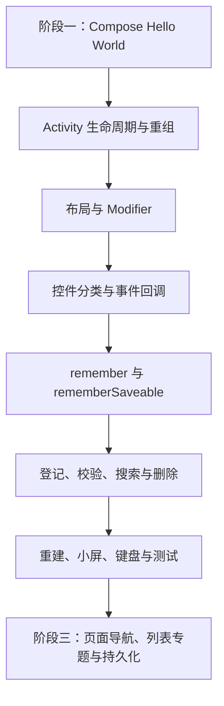
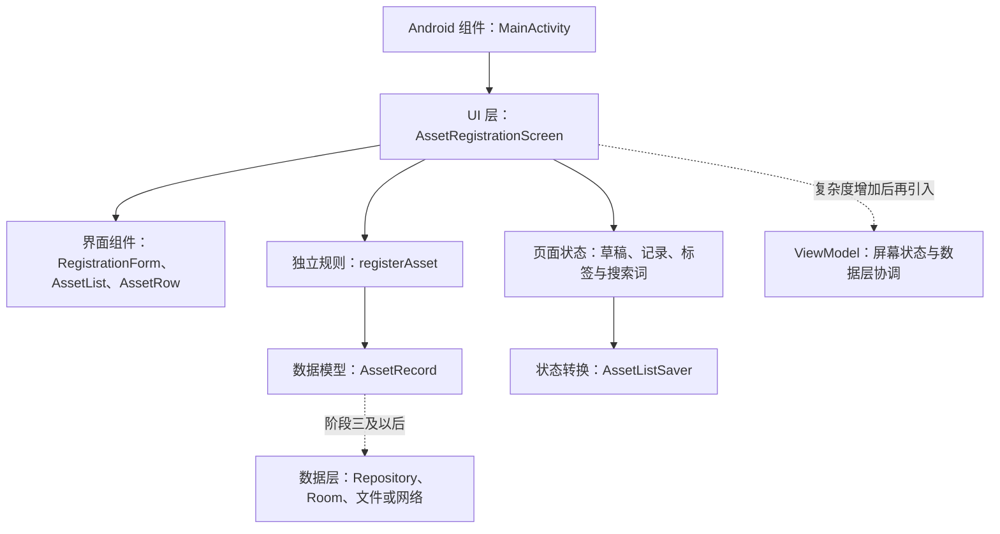
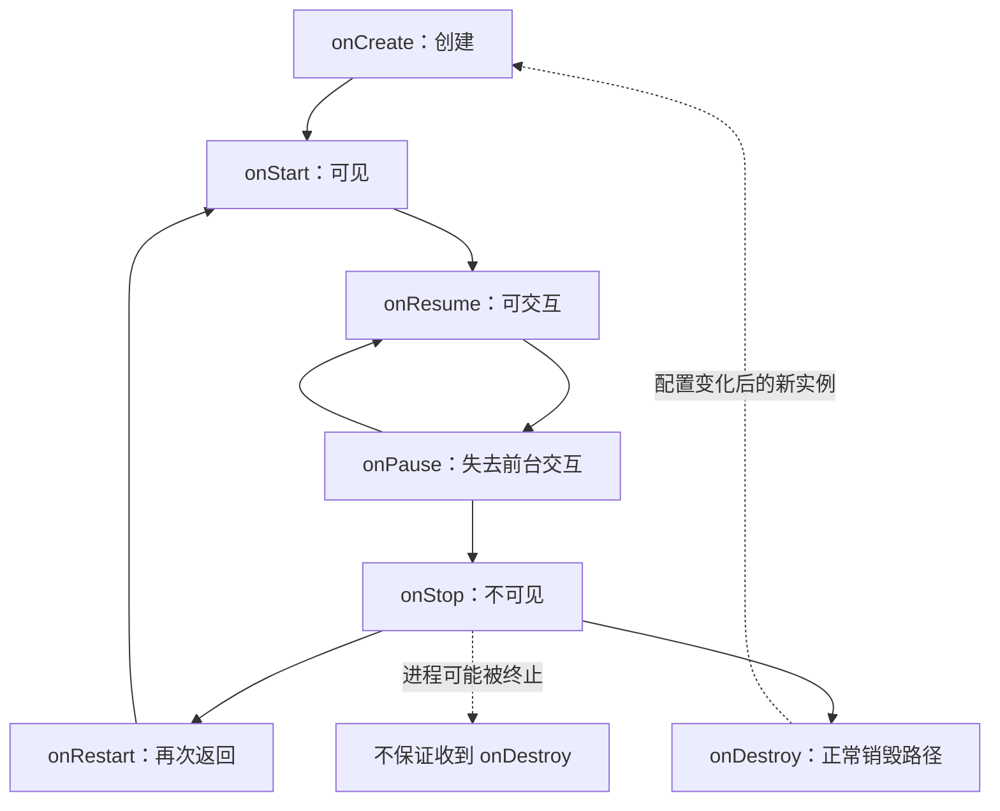
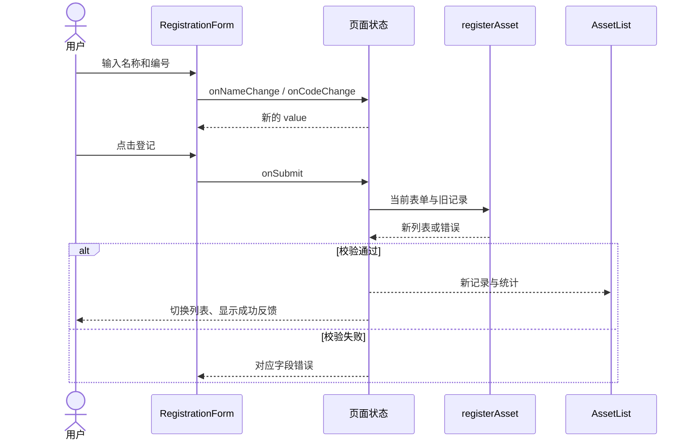
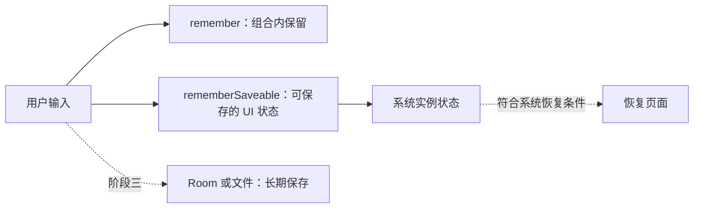

# 阶段二：界面与布局——Compose 资产登记页

> 所属阶段：2 / 8  
> 前置要求：完成阶段一；能运行现有 `My_Application` 工程，认识 `ComponentActivity`、`setContent`、`@Composable`、主题与 Preview。  
> 开发路线：Kotlin + Jetpack Compose + Material 3；包名 `com.example.my_application`。  
> 建议课时：知识讲解与演示 4 小时，项目实践和验证 4～6 小时，可拆为两次课。  
> 资料核对日期：2026-11-13。依赖沿用本工程已有版本，不要求在学习过程中整体升级工具链。  
> 本阶段范围：界面交互与少量可恢复的页面状态；没有实际网络上报、后台任务、BLE 或数据库。

> 后续版本说明：当前工程已推进到阶段三，资产记录迁入 Room，入口接线和 Screen 参数随之变化，AssetListSaver 已移除。本篇保留阶段二教学过程；学习当前源码时结合 `03-数据与交互.md`，不要把阶段二摘录直接覆盖到阶段三工程。阶段二代码尚未形成独立 Git 提交，不提供可直接 checkout 的阶段二版本。

打开应用后，你将看到「资产登记」页面。输入名称和编号，选择上报偏好，点击登记后进入资产列表；列表支持搜索、删除确认和数量统计。

本篇与项目实际源码对应。阶段一的 Hello World 是历史学习起点，当前入口已经切换为 `AssetRegistrationScreen()`；不需要为了继续学习恢复 `Greeting()`。

课堂业务规则：

| 项目 | 规则 |
|---|---|
| 名称 | 去掉两端空白后必填，最多 40 个 Kotlin `Char`；不是按用户感知字形计数 |
| 编号 | 去掉两端空白、统一大写；1～24 位，以 ASCII 字母或数字开头，后续可含横线和下划线 |
| 唯一性 | 编号不区分大小写；名称可以相同 |
| 上报开关 | 保存每项资产的偏好，不会在本阶段真的发出网络消息 |
| 记录数量 | 最多 50 项，限制课堂状态保存的数据量 |
| 保存边界 | 在系统保存并恢复页面状态的条件下，可恢复表单和记录；不等于 Room 或文件持久化 |

---

## 1. 🎓 阶段目标

完成后，你应该能够：

1. 观察 Activity 生命周期，区分页面回调、Compose 重组和系统状态恢复。
2. 用 Column、Row、Box、Modifier 与 Scaffold 组织适应小屏和键盘的页面。
3. 使用文字、输入、按钮、选择、列表、图标、标签页与反馈组件。
4. 解释“事件 → 状态 → 界面”的更新过程，完成输入校验、登记、搜索和删除。
5. 查阅官方文档，完成自动化验收与设备实验，知道页面状态不能代替长期存储。

### 本阶段学习路线



这张图在讲什么：先理解页面何时存在、如何排列，再加入交互状态，最后验证在设备变化时是否仍然正确。

### Android 应用分层架构：本阶段放在哪里



这张图在讲什么：Activity 负责接入页面，UI 负责展示和交互，独立规则负责校验；持久化数据层和 ViewModel 尚未引入，避免把后续架构提前堆进入门代码。

分层是职责安排，不是要求每个简单函数都新增接口或模块。当前纯 Kotlin 规则可独立测试，下一阶段再根据数据来源引入新的层次。[查阅：架构建议][D1]

---

## 2. 📚 核心知识点逐条讲解

### 2.1 Activity 生命周期

**是什么：** Android 在创建、显示、暂停、不可见和销毁 Activity 时，调用 `onCreate`、`onStart`、`onResume`、`onPause`、`onStop`、`onDestroy` 等回调；从停止状态重新进入可见状态还可能经过 `onRestart`。

**为什么需要：** 页面不是一直在前台。按 Home、切换应用和配置变化都会影响它；后续扫描、通知和网络任务必须理解运行环境，不能把所有逻辑都塞在 `onCreate`。

**怎么用：** 本项目在 `MainActivity` 中输出 `AssetLifecycle` 日志。首次启动、按 Home 后返回、旋转或重建时分别观察记录。

**注意什么：** 进程被系统直接终止时，不保证调用 `onDestroy`。锁屏时的回调受窗口可见性等条件影响，不能背成固定序列。Activity 重建也不等于 Compose 的一次重组。[D2]



这张图在讲什么：Activity 会随系统状态变化进入不同回调，正常销毁路径与进程被直接终止的情况不能混为一谈。

### 2.2 声明式 UI 与重组

**是什么：** 可组合函数读取当前参数和可观察状态，描述这一刻界面应当是什么样子；状态变化后，Compose 可能重新执行相关界面函数，这叫重组。

**为什么需要：** 输入一段名称后，输入框、校验信息和统计都可能变化。如果每次都手动定位控件再逐个改值，会更容易漏更新。

**怎么用：** 表单把输入事件交给上层；上层更新 `name` 或资产列表；读取这些状态的组件得到新参数并重新展示。

**注意什么：** 重组可能发生多次、跳过部分函数或取消一次组合。不要在可组合函数体里直接登记资产、写文件或发 MQTT；登记逻辑放在用户事件回调中。[D3]

### 2.3 布局容器与 Modifier

**是什么：** `Column` 纵向排列，`Row` 横向排列，`Box` 叠放或对齐内容；`Modifier` 组合尺寸、留白、绘制和交互等规则。

**为什么需要：** 资产名称、编号要上下排列，记录文字与删除按钮要左右排列，空列表提示要对齐到可用区域中间。

**怎么用：** 本项目表单用 Column、列表项用 Row，页面根部用 Box 限制最大内容宽度并居中；`weight(1f)` 分配剩余空间。

**注意什么：** `weight` 依赖 RowScope／ColumnScope，不能随便拿到任意位置使用。Modifier 顺序有意义，padding 与绘制、点击范围的先后可能改变结果；子控件尺寸仍受父级约束。[D4] [D5]

### 2.4 控件与 Material 3

**是什么：** Text、OutlinedTextField、Button、Switch、Tab 等是可组合 UI 单元；Material 3 提供它们的视觉和交互约定。

**为什么需要：** 标准控件有成熟的语义、焦点和状态处理，适合反复操作的登记页面，不需要自己用普通文字模拟输入框或开关。

**怎么用：** 文字用 Text，输入用 OutlinedTextField，提交用 Button，上报偏好用 Switch；所有用户可见文字集中在字符串资源中。

**注意什么：** 当前项目使用 `androidx.compose.material3`，不要误导入另一套 `androidx.compose.material` 中的同名组件。控件状态由传入的数据决定，不会自动替你保存业务数据。[D6]

### 2.5 状态提升与事件监听

**是什么：** 状态提升就是把共享状态放到共同的上层，子组件接收“当前值”和“事件回调”；例如 `name` 与 `onNameChange`。

**为什么需要：** 名称、编号、统计和列表都与同一登记结果有关，若每个组件各存一份资产数据，容易出现不同步。

**怎么用：** `AssetRegistrationScreen` 保存页面状态；`RegistrationForm` 接收值并上报事件；`registerAsset` 返回结果，页面再决定如何更新和反馈。

**注意什么：** 给 `onClick` 传函数，而不是在组合时立即调用业务函数。普通 List 发生原地变更不一定触发所需更新，本项目通过赋予一个新列表来更新状态。[D7]



这张图在讲什么：用户事件向上送，状态和展示数据向下传，登记规则不会自己去操作屏幕控件。

### 2.6 remember、rememberSaveable 与长期存储

**是什么：** `remember` 在当前组合中保留值；`rememberSaveable` 还参与系统的实例状态保存与恢复；Room、文件等才是后续长期数据存储方案。

**为什么需要：** 用户旋转设备时，不希望刚输入的草稿立刻消失；但也不能把页面状态误当作完整资产数据库。

**怎么用：** 草稿、开关、标签、搜索词和最多 50 项记录用 `rememberSaveable`。SnackbarHostState 用 `remember`，配套协程 scope 跟随组合生命周期。

**注意什么：** 恢复依赖系统确实保存了状态并沿相应恢复路径重建页面。用户结束任务、强制停止、重新启动或清除数据时，不能保证恢复。保存状态共享有限 Bundle 空间，禁止把大量数据、图片或完整数据库塞进去。[D8]

| 比较维度 | remember | rememberSaveable | Room／文件 |
|---|---|---|---|
| 普通重组中保留 | 是，位置和生命周期条件满足时 | 是，条件满足时 | 数据独立于重组 |
| Activity 配置重建 | 不负责恢复 | 支持符合保存规则的状态 | 重新读取已保存数据 |
| 系统回收进程后恢复 | 不负责 | 依赖系统实例状态恢复条件 | 数据成功写入后按存储方案读取 |
| 用户结束任务后重新打开 | 不承诺 | 不承诺 | 适合长期保存 |
| 本阶段用途 | SnackbarHostState 等临时对象 | 小型课堂表单和记录 | 阶段三学习 |



这张图在讲什么：内存记忆、系统实例状态和长期存储承担不同职责，不能用某一种方案替代全部需求。

### 2.7 数据类、校验与不可变列表

**是什么：** `AssetRecord` 表达一条资产，`RegistrationError` 表达失败原因，`registerAsset` 接收输入和现有记录，返回 `RegistrationResult`。

**为什么需要：** 页面只负责收集和展示，校验单独写成普通 Kotlin 函数，就可以在不启动模拟器的情况下验证边界条件。

**怎么用：** 先 trim 名称和编号，再把编号统一大写，检查格式、重复和上限；成功返回 `listOf(record) + assets`，让新记录排在前面。

**注意什么：** 输入长度限制是交互帮助，业务规则仍要独立校验。使用 `Locale.ROOT` 统一编号大小写，避免因设备语言影响机器编号规则。失败应保留原列表，不能展示失败却已经修改数据。

### 2.8 LazyColumn 与稳定 key

**是什么：** LazyColumn 是 Compose 的纵向惰性列表；`items` 把数据转换为可组合列表项，`key` 标识每一项的稳定身份。

**为什么需要：** 资产记录数量增长时，不适合把所有行都堆进一个普通 Column。删除和插入记录时，稳定身份也有助于保持列表项状态对应正确。

**怎么用：** `items(filtered, key = { it.code })` 展示筛选后的记录。编号唯一，因此适合作为 key。

**注意什么：** key 不是行号；重复 key 会出问题。不要给 LazyColumn 外面再套同方向的无限高度滚动容器。普通表单的 verticalScroll 与惰性列表在本页两个标签中分别使用。[D9]

### 2.9 屏幕边衬、键盘与可访问性

**是什么：** 系统栏、屏幕缺口与输入法占据屏幕区域；可访问性语义为读屏和自动化测试提供组件名称、角色及状态。

**为什么需要：** 即使宽屏截图正常，小屏弹出键盘后也可能无法点击按钮；删除图标没有说明时，读屏用户可能无法知道它的作用。

**怎么用：** 根内容应用 Scaffold 留白，消费已处理的边衬，再使用 imePadding；表单可滚动。删除图标的 contentDescription 包含资产编号，开关语义包含“上报偏好”。

**注意什么：** 不要随意重复叠加导航栏留白；testTag 只用于测试定位，不能代替用户可读的标签。字体放大时允许文本换行，不用把字号随屏幕宽度任意缩小。[D10] [D11]

### 2.10 Preview、单元测试与设备测试

**是什么：** Preview 用于设计时观察局部界面；单元测试验证纯规则；Compose 设备测试通过语义树操作实际界面。

**为什么需要：** 截图无法证明重复编号被拒绝，纯规则测试也无法证明按钮真的连接到正确回调。

**怎么用：** 先写登记规则测试和页面验收，再实现功能；运行 `testDebugUnitTest` 和模拟器上的 `AssetRegistrationScreenTest`。

**注意什么：** 测试包安装失败代表测试没有执行。`ActivityScenario.recreate()` 验证的是页面重建场景，不等于已经验证了强制停止后的恢复。[D12] [D13]

---

## 3. 常用控件分类全貌

Compose 组件常被称为“可组合函数”，不全是传统 View 对象。这里按用户任务分类，而不是要求把每一个 API 背下来。

| 类别 | 本阶段代表与例子位置 | 其余查文档自学 |
|---|---|---|
| 文本与输入 | Text、OutlinedTextField，4.2 | TextField、BasicText、BasicTextField、富文本与选择 |
| 按钮与命令 | Button、IconButton，4.3 | TextButton、OutlinedButton、FloatingActionButton |
| 选择与开关 | Switch、Checkbox，4.4 | RadioButton、Slider、RangeSlider、FilterChip |
| 列表与网格 | LazyColumn，4.5 | LazyRow、LazyVerticalGrid、LazyHorizontalGrid |
| 布局与容器 | Column、Row、Box，4.6 | FlowRow、Surface、Scaffold、Spacer、ConstraintLayout |
| 图像与图标 | Icon、Image，4.7 | Painter、图片缩放与网络图片库 |
| 反馈与对话框 | AlertDialog、SnackbarHost，4.8 | ModalBottomSheet、TooltipBox |
| 导航与分组 | Tab、TabRow，4.9 | NavigationBar、NavigationRail、ModalNavigationDrawer |
| 进度 | LinearProgressIndicator，4.10 | CircularProgressIndicator、确定进度与不确定进度 |
| 日期与时间 | 本阶段不接入 | DatePicker、DatePickerDialog、TimePicker |
| 分隔与视觉表面 | HorizontalDivider、Surface，结合源码 | VerticalDivider、Card、ElevatedCard |

本项目只用其中必要部分；Checkbox、Image、进度条等是独立练习示例，不要全部粘到资产页面里。每个给出的官方链接均在第 6 节说明查阅时机和重点。

---

## 4. 💻 代码逐行／逐块讲解

### 4.1 项目入口与生命周期日志

文件：`app/src/main/java/com/example/my_application/MainActivity.kt`。以下是核心入口摘录；完整文件还实现了其他生命周期日志，不要用摘录覆盖整个文件。

```kotlin
// 入口摘录：使用现有 import 与 class MainActivity : ComponentActivity()
override fun onCreate(savedInstanceState: Bundle?) {
    super.onCreate(savedInstanceState) // 先完成父类初始化
    Log.d("AssetLifecycle", "onCreate") // 固定标签，便于观察页面创建
    enableEdgeToEdge() // 保留边缘到边缘显示
    setContent {
        My_ApplicationTheme(dynamicColor = false) { // 本课固定主题，方便比较实验画面
            AssetRegistrationScreen() // 阶段二页面取代原 Greeting
        }
    }
}
```

| 代码块 | 作用 | 为什么这样写 |
|---|---|---|
| `override fun onCreate` | 实现系统创建回调 | Activity 的入口仍然和阶段一一致 |
| `super.onCreate` | 调用父类初始化 | 不能跳过基础组件的生命周期流程 |
| `Log.d(tag, msg)` | 输出生命周期信息 | 返回 Int 日志结果，本课不使用；标签用于过滤 |
| `enableEdgeToEdge()` | 配置窗口 | 内容避让交给页面处理 |
| `setContent {}` | 提供可组合内容 | 无需新增 XML 布局 |
| `My_ApplicationTheme(dynamicColor = false)` | 暂用工程固定配色 | 不影响主题函数在别处使用动态配色 |
| `AssetRegistrationScreen()` | 进入实际练习页面 | Activity 不再塞入完整表单逻辑 |

### 4.2 文本与输入：Text、OutlinedTextField

文件：`ui/asset/AssetRegistrationScreen.kt` 的 RegistrationForm。下面是适合先练习的简化片段，放在已有可组合函数中，使用相应 import：

```kotlin
// 练习片段：状态保存在调用位置，示例文字为教学演示
var name by rememberSaveable { mutableStateOf("") }
Text(text = "资产信息") // 只显示标题，不负责保存表单
OutlinedTextField(
    value = name, // 当前显示内容
    onValueChange = { newValue -> name = newValue.take(40) }, // 输入事件更新上层状态
    label = { Text("资产名称") }, // 提供字段标签
    singleLine = true, // 单行输入
    modifier = Modifier.fillMaxWidth() // 按父级约束使用可用宽度
)
```

| 代码块 | 作用 | 为什么这样写 |
|---|---|---|
| `rememberSaveable { mutableStateOf("") }` | 保存可观察字符串状态 | 普通局部变量不会自动形成正确的界面状态 |
| `by` | 使用状态委托 | 可以写 `name`，不用每次写 `name.value` |
| `Text(text)` | 显示文字 | `text` 是字符串，函数返回 Unit，不返回控件引用 |
| `value` | 控制输入框显示值 | 单向展示当前状态 |
| `onValueChange: (String) -> Unit` | 接收输入后的新值 | 回调需更新状态，输入框才会显示变化 |
| `label: @Composable () -> Unit` | 提供标签内容 | 标签本身也可以是可组合内容 |
| `singleLine`、`fillMaxWidth` | 配置输入与尺寸 | 文本内容不能决定页面全部布局 |

实际项目把中文放到 strings.xml，并加入 isError、supportingText、键盘 Next／Done 等设置。KeyboardOptions 是输入法提示，不是数据校验器。

**导入提示：** `getValue`、`setValue` 来自 `androidx.compose.runtime`；`rememberSaveable` 来自 `runtime.saveable`；`OutlinedTextField` 来自 material3；`fillMaxWidth` 来自 foundation.layout。需要时对照源码完整导入区。

### 4.3 按钮：Button 与 IconButton

```kotlin
// 片段：放在可组合上下文，onSubmit、onDelete、asset 来自组件参数
Button(onClick = onSubmit) { // 传入回调，不在组合时立即执行
    Icon(Icons.Default.Add, contentDescription = null) // 文字已表达动作，图标作辅助
    Text("登记资产") // 清楚的命令文字
}
IconButton(onClick = { onDelete(asset) }) { // 图标按钮产生删除请求，先弹确认框
    Icon(
        Icons.Default.Delete,
        contentDescription = "删除资产 ${asset.code}" // 图标本身需要可读名称
    )
}
```

| 代码块 | 作用 | 为什么这样写 |
|---|---|---|
| `Button(onClick = onSubmit)` | 绑定无参点击回调 | `onClick` 类型是 `() -> Unit`，不是登记结果 |
| `Icon(..., null)` + Text | 图标辅助文字 | 避免读屏重复朗读同一动作 |
| `IconButton` | 提供标准图标点击区域 | 不用很小的普通图片模拟可点击按钮 |
| `{ onDelete(asset) }` | 点击时向上层传资产 | 回调内执行，而不是组合时删除 |
| `contentDescription` | 描述图标功能 | 不同资产的删除按钮可区分 |

实际字符串使用 `stringResource`；核心图标来自现有 Material 图标依赖链，不必新增另一套图标库。

### 4.4 选择类：Switch 与 Checkbox

项目 Switch 的简化逻辑：

```kotlin
// 片段：放在可组合函数内，开关值是表单状态
var enabled by rememberSaveable { mutableStateOf(true) }
Switch(
    checked = enabled, // 当前是否开启
    onCheckedChange = { enabled = it }, // 接收新的 Boolean
    modifier = Modifier.semantics { contentDescription = "上报偏好" } // 为读屏命名
)
```

| 代码块 | 作用 | 为什么这样写 |
|---|---|---|
| Boolean 状态 | 表示二元选项 | 不用“开／关”字符串承担逻辑判断 |
| `checked` | 提供当前状态 | 控件不会自动成为业务状态来源 |
| `onCheckedChange: (Boolean) -> Unit` | 事件传入新的状态 | 与 checked 配对形成可控组件 |
| `semantics` | 提供语义信息 | 邻近文字不一定自动成为开关名称 |

Checkbox 练习，可放入独立 Preview，不接入登记业务：

```kotlin
// 独立练习：复用同一套“值 + 回调”思想
var selected by rememberSaveable { mutableStateOf(false) }
Row(verticalAlignment = Alignment.CenterVertically) {
    Checkbox(
        checked = selected, // 当前是否选中
        onCheckedChange = { selected = it } // 接收复选事件
    )
    Text("选择此资产") // 解释复选项的含义
}
```

| 代码块 | 作用 | 为什么这样写 |
|---|---|---|
| Row + 对齐 | 横排复选框和文字 | 控件和标签在视觉上属于同一选项 |
| Checkbox 参数 | 读取和更新 Boolean | 与 Switch 状态机制相似，语义用途不同 |
| Text | 展示选项名称 | 实际产品还应完善整行 toggleable 语义与点击行为 |

Switch 常表示启用某种设置；Checkbox 常表示选择项目。多个互斥选项使用 RadioButton 等，不要用一组互不约束的 Switch 模拟互斥选择。[D14]

### 4.5 列表：LazyColumn

下例与 AssetList 中的关键结构对应，assets 的过滤结果与 onDelete 由上层提供：

```kotlin
// 片段：使用 androidx.compose.foundation.lazy.items
LazyColumn(
    contentPadding = PaddingValues(bottom = 20.dp) // 为列表末端留出空间
) {
    items(filtered, key = { it.code }) { asset -> // 以唯一编号标识记录
        AssetRow(asset, onDelete) // 一条数据生成一个列表项
        HorizontalDivider() // 视觉分隔，不额外包多层卡片
    }
}
```

| 代码块 | 作用 | 为什么这样写 |
|---|---|---|
| `LazyColumn` | 提供纵向惰性列表 | 适合重复项与滚动 |
| `contentPadding` | 设置列表内容边缘留白 | 不是把每行独立加一个相同底边距 |
| `items(List<T>, key, itemContent)` | 建立数据到行内容的映射 | content lambda 接收当前 asset |
| `key = { it.code }` | 指定稳定唯一身份 | 新增、删除和排序后仍能识别同一记录 |
| `AssetRow`、分隔线 | 展示行内容与边界 | 简单列表不需要卡片套卡片 |

`items` 的内容回调返回 Unit；列表滚动及布局由 Compose 管理。RecyclerView 的 Adapter／ViewHolder 机制将在阶段三的 Views 对照专题介绍。[D9]

### 4.6 容器：Column、Row 与 Box

```kotlin
// 布局练习：在现有可组合函数或 Preview 中观察排列效果
Column(verticalArrangement = Arrangement.spacedBy(12.dp)) {
    Text("资产信息") // 第一行
    Row(verticalAlignment = Alignment.CenterVertically) {
        Text("允许上报", modifier = Modifier.weight(1f)) // 占用剩余横向空间
        Text("3 项") // 保留自身内容宽度
    }
    Box(
        modifier = Modifier.fillMaxWidth().height(120.dp), // 给对齐提供明确空间
        contentAlignment = Alignment.Center // 对齐内部内容
    ) {
        Text("暂无登记资产") // 在 Box 区域中央显示
    }
}
```

| 代码块 | 作用 | 为什么这样写 |
|---|---|---|
| Column + spacedBy | 纵向排列并设置统一间距 | 减少重复 Spacer，但不排斥必要 Spacer |
| Row | 横向排列 | 两段信息需要并列 |
| `Modifier.weight(1f)` | 分配 Row 剩余宽度 | 一侧伸展，另一侧保持内容宽度 |
| Box 的尺寸约束 | 为内容对齐提供区域 | 没有足够尺寸，center 不会凭空扩大容器 |
| `contentAlignment` | 设置子内容对齐 | 与控件自身 textAlign 不是同一概念 |

布局函数的 content 参数都是可组合内容，返回 Unit；`height(120.dp)` 是教学固定区域，实际资产页使用剩余空间与可滚动内容。

### 4.7 图标与图片：Icon、Image

项目已有 Icon。Image 代表静态图片展示，下面使用本工程现存的矢量资源作独立练习，不用于资产空列表装饰：

```kotlin
// 图片练习：所需资源已经存在于 res/drawable
Image(
    painter = painterResource(R.drawable.ic_launcher_foreground), // 读取本地可绘制资源
    contentDescription = "应用图标示例", // 有意义图片需要描述，纯装饰图片可以是 null
    modifier = Modifier.size(64.dp) // 固定示例尺寸，不让资源决定整页大小
)
```

| 代码块 | 作用 | 为什么这样写 |
|---|---|---|
| `painterResource(id)` | 返回 Painter | 根据 Android 资源加载本地绘制内容 |
| `Image(painter, contentDescription, modifier)` | 展示图片 | 图片展示与图标动作应区别处理 |
| `size(64.dp)` | 限定尺寸 | 避免布局因为资源原始尺寸而失控 |

`Image` 返回 Unit。需导入 foundation.Image、ui.res.painterResource、foundation.layout.size 和 ui.unit.dp。网络图片加载留待网络阶段，不能把 URL 直接当成本地资源编号。[D15]

### 4.8 反馈：AlertDialog 与 SnackbarHost

删除确认的教学摘录：

```kotlin
// 片段：showDelete 与 onConfirmDelete 是上层状态或回调
if (showDelete) {
    AlertDialog(
        onDismissRequest = { showDelete = false }, // 返回或点击外部时关闭
        title = { Text("删除资产") }, // 说明即将执行的动作
        text = { Text("确定删除这项资产？") },
        confirmButton = {
            TextButton(onClick = onConfirmDelete) { Text("删除") } // 确认才执行
        },
        dismissButton = {
            TextButton(onClick = { showDelete = false }) { Text("取消") }
        }
    )
}
```

| 代码块 | 作用 | 为什么这样写 |
|---|---|---|
| `if (showDelete)` | 由状态决定弹窗是否存在 | 不需要持有对话框对象再手工 show |
| `onDismissRequest` | 响应系统返回或外部关闭请求 | 不响应会导致用户难以退出 |
| confirm／dismiss 内容槽 | 定义确认与取消动作 | 取消不得意外删除记录 |
| `onConfirmDelete` | 真正修改列表 | 业务动作应发生在明确事件中 |

Snackbar 的最小配合方式：

```kotlin
// 片段：放在可组合页面，字符串这里只作语法演示
val host = remember { SnackbarHostState() } // 在当前组合中保留反馈状态
val scope = rememberCoroutineScope() // 随组合生命周期管理协程
Scaffold(snackbarHost = { SnackbarHost(host) }) { padding ->
    Button(
        modifier = Modifier.padding(padding), // 使用 Scaffold 提供的内容留白
        onClick = { scope.launch { host.showSnackbar("资产已登记") } } // 点击后异步展示
    ) {
        Text("显示反馈")
    }
}
```

| 代码块 | 作用 | 为什么这样写 |
|---|---|---|
| remember + SnackbarHostState | 保留反馈状态 | 不能每次重组都建立不相关的新状态 |
| rememberCoroutineScope | 获得组合关联 scope | showSnackbar 是挂起函数 |
| SnackbarHost | 真正展示反馈 | 只有状态对象而没有 host，用户看不到消息 |
| `showSnackbar(message)` | 挂起并等待交互或消失 | 返回 SnackbarResult，本例不使用；不能在函数体任意直接执行 |

Snackbar 是短暂结果反馈，字段错误应靠输入框 supportingText 持续提示，不能只闪一下消息就让用户猜哪里错。[D16] [D17]

### 4.9 导航与分组：TabRow、Tab

```kotlin
// 片段：页面内切换两个内容区域，不是跨 Activity 导航
var selected by rememberSaveable { mutableIntStateOf(0) }
TabRow(selectedTabIndex = selected) {
    Tab(
        selected = selected == 0, // 是否处于当前标签
        onClick = { selected = 0 }, // 点击改变上层状态
        text = { Text("登记资产") }
    )
    Tab(
        selected = selected == 1,
        onClick = { selected = 1 },
        text = { Text("资产列表") }
    )
}
```

| 代码块 | 作用 | 为什么这样写 |
|---|---|---|
| mutableIntStateOf | 保存整数索引 | 避免非空 Int 的泛型装箱 |
| TabRow 的 selectedTabIndex | 控制指示条位置 | 必须是当前标签集合的有效索引 |
| Tab 的 selected | 控制选中语义和样式 | 与索引状态一致 |
| onClick | 改变索引 | 外部再根据索引选择展示内容 |

当前 API 取决于工程所用 Material 3 版本。阅读新文档看到新的标签页替代 API 时，先确认版本，不要在本章同时做依赖迁移。[D18]

### 4.10 进度：LinearProgressIndicator

```kotlin
// 独立练习：模拟加载中的界面，不代表本项目已经有网络请求
if (loading) {
    LinearProgressIndicator(modifier = Modifier.fillMaxWidth()) // 不确定进度，尚不知道完成比例
}
```

| 代码块 | 作用 | 为什么这样写 |
|---|---|---|
| `loading` | 由上层提供的 Boolean | 加载是否存在应该有真实状态来源 |
| 无 progress 参数的 LinearProgressIndicator | 显示不确定进度 | 不伪造百分比 |
| fillMaxWidth | 按容器宽度显示 | 尺寸仍受父级约束 |

该可组合函数返回 Unit。有真实完成比例时查“确定进度”对应签名；不同 Material 3 版本的 progress 参数形式可能不同。[D19]

### 4.11 独立业务规则：登记成功或失败

文件：`asset/AssetRegistration.kt`。下面为原函数的关键片段，错误分支完整顺序以源码为准：

```kotlin
// 片段：输入名称、编号、开关和原列表，由普通 Kotlin 函数处理
val normalizedName = name.trim() // 去除两端空白
val normalizedCode = code.trim().uppercase(Locale.ROOT) // 固定机器编号的大写规则
val result = registerAsset(name, code, reportingEnabled, assets) // 不访问任何界面控件
if (result.error != null) {
    error = result.error // 页面显示失败原因，列表保持不变
} else {
    assets = result.assets // 赋予新列表，触发读取该状态的界面更新
}
```

| 代码块 | 作用 | 为什么这样写 |
|---|---|---|
| trim 与 uppercase | 规范化输入 | 避免同一编号因大小写和两端空白重复 |
| `registerAsset(...)` | 执行完整校验并建立结果 | 无 Android 依赖，便于单元测试 |
| error 分支 | 保存错误 | 不吞掉失败，也不修改原记录 |
| assets 赋值 | 更新列表状态 | 不通过原地修改普通 List 的内部内容更新 |

**参数与返回值：** `registerAsset(name: String, code: String, reportingEnabled: Boolean, assets: List<AssetRecord>)` 返回 `RegistrationResult`。`error == null` 表示成功；失败时返回原列表和枚举错误。示例前两行用于解释规范化，实际页面无需再重复执行，因为函数内部已经做了。

### 4.12 自定义 Saver：记录如何恢复

文件：`ui/asset/AssetListSaver.kt`：

```kotlin
// AssetRecord 不是 Bundle 可自动保存的类型，因此明确转换格式
internal val AssetListSaver = listSaver<List<AssetRecord>, String>(
    save = { records ->
        records.flatMap { listOf(it.name, it.code, it.reportingEnabled.toString()) } // 每项按三字段顺序展平
    },
    restore = { values ->
        values.chunked(3).map { fields -> // 按相同顺序还原
            AssetRecord(fields[0], fields[1], fields[2].toBoolean())
        }
    }
)
```

| 代码块 | 作用 | 为什么这样写 |
|---|---|---|
| `listSaver<Original, Saveable>` | 定义原类型和可保存元素类型 | 返回 Saver，供 rememberSaveable 使用 |
| save | 将记录转成字符串列表 | 不依赖任意对象自动序列化 |
| flatMap + listOf | 固定每项三字段的顺序 | 没用分隔符拼接，所以名称中含逗号不会破坏格式 |
| restore + chunked(3) | 还原每条记录 | 输入来自同一个 Saver 结构，不是外部文件格式 |
| toBoolean | 恢复偏好 | 对称还原本例保存的数据 |

使用位置：

```kotlin
// 片段：页面保存可观察资产列表，初始为空
var assets by rememberSaveable(stateSaver = AssetListSaver) {
    mutableStateOf(emptyList<AssetRecord>())
}
```

| 代码块 | 作用 | 为什么这样写 |
|---|---|---|
| stateSaver | 转换 MutableState 内保存的值 | 这里保存的是 state 里的 List，不是把 MutableState 本身转成字符串 |
| emptyList | 初始没有登记记录 | 页面不伪造已经存在的资产 |

Saver 格式没有承担版本化数据库职责；升级后继续维护大量长期数据应使用阶段三的存储方案。[D8]

---

## 5. 📄 配置文件／清单文件逐项讲解

### 5.1 Manifest：没有新增系统权限

本阶段不需要网络、蓝牙、位置或通知权限。实际清单继续注册 MainActivity，下面是与界面有关的摘录，不是完整清单：

```xml
<!-- 摘录：应用标签、窗口主题与 Activity 入口，保留原文件其他节点 -->
<application
    android:label="@string/app_name"
    android:theme="@style/Theme.My_Application">
    <!-- 完整文件中的 MAIN / LAUNCHER 过滤器继续保留 -->
    <activity
        android:name=".MainActivity"
        android:exported="true"
        android:theme="@style/Theme.My_Application" />
</application>
```

摘录省略了根 manifest 的命名空间和 intent-filter，不能整体复制覆盖。

| 配置项 | 作用 | 不写会怎样 |
|---|---|---|
| application.label | 使用 app_name 显示应用名 | 失去预期可读名称 |
| application.theme | 提供默认 Android 窗口主题 | 不保证当前窗口外观 |
| activity.name | 注册入口类 | 无法按本例启动 |
| activity.exported | 明确启动组件是否对外开放 | 当前带 intent-filter、面向 API 31+ 的入口不能省略 |
| Activity 的重复 theme | 为 Activity 再次指定同一窗口主题 | 可继承 application 的主题，不是必须重复写 |
| 原有 MAIN + LAUNCHER | 提供桌面入口 | 省略后不能按本例从桌面启动 |
| 权限节点 | 本阶段无需增加 | 不写不会影响离线表单和列表 |

`rememberSaveable` 不要求通过 `configChanges` 阻止重建。不要为了让数据看起来不丢就取消正常配置重建流程。[D2] [D20]

### 5.2 strings.xml：正式文案资源

```xml
<?xml version="1.0" encoding="utf-8"?>
<!-- 摘录：原文件还含表单、校验、对话框等其他字符串 -->
<resources>
    <string name="app_name">资产登记</string>
    <string name="asset_total">%1$d 项资产</string>
    <string name="reporting_total">%1$d 项允许上报</string>
    <string name="delete_asset_message">确定删除“%1$s”（%2$s）？</string>
    <string name="asset_code_duplicate">该资产编号已存在</string>
</resources>
```

| 配置项 | 作用 | 不写会怎样 |
|---|---|---|
| resources | 字符串资源根节点 | 无法按资源文件正确解析 |
| name | 提供 R.string 中的资源名称 | 代码无法按这个名称引用 |
| `%1$d` | 第一个整数格式参数 | 失去按数量格式化文案的能力 |
| `%1$s`、`%2$s` | 第一、第二个字符串格式参数 | 无法按模板分别插入名称和编号 |
| app_name | 将系统可见名称改成资产登记 | 仍显示旧名称，不影响包名 |
| 错误资源 | 为校验结果提供稳定提示 | 代码引用缺失会导致资源编译错误 |

正式页面使用资源，前面的独立语法练习为了便于阅读使用了部分字面量；加入实际项目时要完成资源化。[D21]

### 5.3 build.gradle.kts：Compose 与测试

```kotlin
// 片段：新增到现有 buildTypes，不要覆盖 release 等原配置
buildTypes {
    debug {
        enableUnitTestCoverage = true // 生成本地单元测试的覆盖率数据
    }
}
```

| 配置项 | 作用 | 不写会怎样 |
|---|---|---|
| debug | 为调试变体配置选项 | 沿用默认调试配置 |
| enableUnitTestCoverage | 启用单元测试覆盖率收集 | 不会按此方式生成覆盖率证据；不影响常规登记逻辑 |
| 现有 Compose 插件与 compose=true | 编译可组合函数 | 缺少必要配置时无法构建 |
| 现有 compose.material3 | 提供表单、标签和弹窗等 | 组件无法解析 |
| 现有 ui.test.junit4 | 提供 Compose 设备测试规则 | 页面测试无法按本例执行 |
| 现有 ui.test.manifest 与 tooling | debug 测试和预览支持 | 缺少对应工具能力 |
| testImplementation(libs.junit) | 支持本地规则测试 | 无法运行对应 JUnit 测试 |

没有新增 app 运行时网络依赖。启用覆盖率可能需要构建工具解析测试工具依赖，不代表应用增加了联网功能。[D22]

### 5.4 主题与网络安全配置

| 文件／配置 | 本阶段处理 | 不写或误解会怎样 |
|---|---|---|
| ui/theme/Color.kt | 使用绿、陶土色与金色定义主辅色 | 继续使用其他有效配色也能运行；这是视觉选择 |
| Theme.kt 的浅深配色 | 明确主色及文字色，页面调用 dynamicColor=false | 只改 primary 不改 onPrimary 等可能造成文字对比异常 |
| Theme.kt 的 shapes | 常规表面圆角限制到 4～8dp | 使用 Material 默认形状，不影响业务结果 |
| Type.kt 的字距 | 本阶段设为 0sp | 不决定状态机制和业务逻辑 |
| res/values/themes.xml | 保留现有 Android 窗口主题 | 与 Compose 主题函数职责不同，不能随意删 |
| network_security_config.xml | 本阶段未创建 | 采用适用平台默认网络策略；阶段四再讲 |

---

## 6. 📖 官方文档查阅指引与控件速查索引

**不要背 API，要学会查文档。** 先找到任务指南，再核对项目版本对应的 API 签名。项目自定义的 AssetRow、registerAsset 不在官方参考中，应跳转源码。

### 6.1 本阶段指南

| 文档 | 这个文档讲什么 | 什么时候查 | 重点小节 |
|---|---|---|---|
| [D1：应用架构建议][D1] | UI、数据层及状态职责 | 代码是否该放 Activity 中拿不准时 | UI layer、Data layer、状态管理建议 |
| [D2：Activity 生命周期][D2] | 创建、可见、暂停与销毁 | 实测 Home、返回和重建时 | 六个主要回调、状态保存 |
| [D3：Thinking in Compose][D3] | 声明式模型与重组 | 担心函数重复执行时 | Recomposition、避免副作用 |
| [D4：布局基础][D4] | Row、Column、Box 与约束 | 控件为何这样排列时 | 标准布局组件、布局模型 |
| [D5：Modifier][D5] | 顺序、传递与布局修饰 | 留白或点击范围不对时 | Order、modifier 参数约定、weight |
| [D6：Material 3][D6] | 组件与主题体系 | 混入 material 和 material3 时 | 组件、主题、颜色与排版 |
| [D7：Compose 状态][D7] | 可观察状态与状态提升 | 输入不更新或多处不同步时 | State in composables、State hoisting |
| [D8：状态保存][D8] | rememberSaveable、Saver 和限制 | 重建后草稿丢失时 | UI logic、custom saver、Bundle 大小注意事项 |
| [D9：列表与网格][D9] | 惰性列表、网格、key 和留白 | 新增删除后行身份不对时 | Lazy lists、Item keys、Content padding |
| [D10：Material 边衬][D10] | Scaffold 的 inset 处理 | 内容被系统栏遮挡时 | Scaffold；留白需要应用到正文 |
| [D11：可访问性语义][D11] | 标签、角色与合并语义 | 图标没有可读名称或测试定位困难时 | Semantics、contentDescription |
| [D12：Compose 测试][D12] | 测试规则、查找器和动作 | 编写页面验收时 | Setup、Finders、Actions、Assertions |
| [D13：常见测试模式][D13] | 状态恢复等测试实践 | 扩展状态恢复验证时 | State restoration，区分模拟恢复与真实进程结束 |
| [D14：Checkbox][D14] | 复选交互与相关组件 | 学习多个选择项时 | Basic implementation、状态参数 |
| [D15：Image][D15] | 本地图片与内容缩放 | 需要展示实际资产照片时 | 加载资源、缩放和 contentDescription |
| [D16：Dialog][D16] | AlertDialog 和自定义对话框 | 加删除确认时 | AlertDialog、确认和取消回调 |
| [D17：Snackbar][D17] | 短暂消息和 Host 配合 | 登记成功但没有反馈时 | SnackbarHost、showSnackbar |
| [D18：Tabs][D18] | 标签页分组与选择 | 切换表单和列表时 | Tabs 类型与选中状态，留意库版本 |
| [D19：Progress][D19] | 确定与不确定进度 | 网络阶段加入加载态时 | 两种进度、参数语义 |
| [D20：activity 清单元素][D20] | 组件属性 | 启动入口和 exported 有疑问时 | name、exported、theme |
| [D21：字符串资源][D21] | 声明、引用与格式化 | 数量与参数插值时 | String、Formatting |
| [D22：Android 测试覆盖率][D22] | 覆盖率开关与报告任务 | 核对测试是否覆盖关键分支时 | 本地单元测试覆盖率、报告生成 |

### 6.2 控件速查索引表

以下链接都指向 Android 官方 API 参考。表中“何时查／重点”同时说明查阅用途；未在项目中使用的控件按文档自学。

| 控件／布局 | 一句话作用 | 官方文档 | 何时查／重点 |
|---|---|---|---|
| Text | 展示文字 | [Material 3 API][A1] | 搜索 Text，核对 text、style、maxLines、overflow |
| OutlinedTextField／TextField | 编辑文字 | [Material 3 API][A1] | 查 value／onValueChange、标签、错误和键盘参数 |
| Button／TextButton／OutlinedButton | 执行明确命令 | [Material 3 API][A1] | 查 onClick、enabled、content |
| IconButton | 图标命令 | [Material 3 API][A1] | 查点击区域与内容语义 |
| FloatingActionButton | 突出主要动作 | [Material 3 API][A1] | 页面需要常驻主要操作时查 |
| Switch | 启用或关闭设置 | [Material 3 API][A1] | 查 checked 与 onCheckedChange |
| Checkbox／RadioButton | 多选或互斥选项 | [Material 3 API][A1] | 选择任务时查状态及整行选择语义 |
| Slider／RangeSlider | 选择数值或区间 | [Material 3 API][A1] | 数值范围输入时查 valueRange、steps |
| FilterChip | 选择筛选条件 | [Material 3 API][A1] | 多种列表筛选时查 selected、onClick |
| LazyColumn／LazyRow | 惰性列表 | [Lazy API][A2] | 查 items、key、state 与 contentPadding |
| LazyVerticalGrid | 惰性网格 | [Lazy grid API][A3] | 图像或资产网格时查 columns 与 span |
| Column／Row／Box | 基础排列和叠放 | [Layout API][A4] | 查 arrangement、alignment、约束和 weight |
| Spacer | 占据留白尺寸 | [Layout API][A4] | 需要明确尺寸空白时查 |
| Surface／Card | 表面与独立重复内容容器 | [Material 3 API][A1] | 查 color、shape、elevation；不要卡片层层套用 |
| Scaffold | 页面结构与内容槽 | [Material 3 API][A1] | 查 topBar、snackbarHost、content 的 PaddingValues |
| Icon | 展示图标 | [Material 3 API][A1] | 查 imageVector／painter 与 contentDescription |
| Image | 展示图片 | [Foundation API][A5] | 查 painter、contentScale 和语义 |
| AlertDialog | 需要确认的对话 | [Material 3 API][A1] | 查 dismiss、confirm 内容槽与关闭逻辑 |
| SnackbarHost | 显示短暂反馈 | [Material 3 API][A1] | 配合 SnackbarHostState 的挂起方法查 |
| Tab／TabRow | 页内内容分组 | [Material 3 API][A1] | 查选中索引；按工程版本识别替代 API |
| NavigationBar／NavigationRail | 主要区域导航 | [Material 3 API][A1] | 多页面后选择底部或侧边导航时查 |
| HorizontalDivider | 分隔相邻内容 | [Material 3 API][A1] | 查厚度、颜色和 Modifier |
| Linear／CircularProgressIndicator | 展示处理进度 | [Material 3 API][A1] | 查 progress 重载与版本，不伪造百分比 |
| DatePicker／TimePicker | 选择日期与时间 | [Material 3 API][A1] | 查状态对象、确认流程与 Experimental 标注 |

### 6.3 XML Views 对照：认识旧工程，不混用语法

| Compose | Views 中常见对应 | 用途与何时查 | 官方文档 |
|---|---|---|---|
| Text | TextView | 维护 XML 文本时，查 text、字号和布局参数 | [TextView][V1] |
| TextField | EditText | 维护旧输入表单时，查 inputType 和文字监听 | [EditText][V2] |
| Button | Button | 维护按钮时，查 setOnClickListener | [Button][V3] |
| Switch／Checkbox | Switch／CheckBox | 维护二元选择时，查 checked 状态和监听 | [CompoundButton][V4] |
| LazyColumn | RecyclerView | 阶段三对照 Adapter、ViewHolder 与 LayoutManager | [RecyclerView][V5] |
| Column／Row | LinearLayout | 维护线性排列时，查 orientation 与 weight | [LinearLayout][V6] |
| Box | FrameLayout 等 | 维护叠放布局时，查子项布局参数 | [FrameLayout][V7] |
| Image | ImageView | 旧界面图片展示时，查 drawable 与 scaleType | [ImageView][V8] |

这是任务层面的对应，不表示 API、测量规则或生命周期一一相同。Views 控件的逐行示例作为阶段三的互操作准备继续展开，本阶段主项目不额外引入第二套 UI 实现。

---

## 7. ✍️ 动手练习

### 练习一：布局与输入

**目标：** 独立解释并调整表单布局。

**操作：** 把字段间距由 20dp 调整为 12dp，再恢复；用独立 Preview 试验 Column／Row／Box，解释为何 weight 只能在对应作用域使用。

**验收：**

- 能找到真实 RegistrationForm，而不是修改已经不再调用的 Greeting。
- 输入名称与编号时界面同步更新。
- 小屏弹出键盘后能滚动到提交按钮。
- 没有通过固定超大高度“解决”截断。

### 练习二：业务与列表

**目标：** 验证状态向下传、事件向上传。

**操作：** 登记两项资产，其中一项关闭上报；尝试空名称、空编号、中文编号和相同编号；搜索名称、编号及不存在的内容；取消一次删除，再确认删除。

**验收：**

- 合法登记后新增记录在前，表单文字清空，开关保留当前偏好。
- 错误输入不增加记录；编号按大写显示，重复判断不区分大小写。
- 总数与允许上报数正确，删除后同时更新。
- 搜索为空时显示全部，查无结果和完全没有资产的提示不同。
- 取消确认不改变数据。

### 练习三：生命周期与重建

**目标：** 明确状态恢复和长期存储的边界。

**操作：** 先登记一项，再保留未提交草稿；按 Home 返回并观察日志；旋转或通过测试重建 Activity；最后在了解数据会丢失的前提下结束课堂任务重新打开，比较结果。

**验收：**

- 能从 AssetLifecycle 标签记录实际回调，不把预想的顺序当结果。
- 符合实例状态恢复路径时，记录、草稿和开关恢复。
- 能说明为何上述结果不代表“应用已接入数据库”。
- 不把 `onDestroy` 未出现理解成 Android 没有正常运行。

### 学员实测表

| 场景 | 操作前状态 | 实际回调／结果 | 是否通过 | 设备、系统与备注 |
|---|---|---|---|---|
| 首次启动 | 空列表 | 待填写 | 待填写 | 待填写 |
| 切后台返回 | 已输入草稿 | 待填写 | 待填写 | 待填写 |
| Activity 重建 | 已登记 + 草稿 | 待填写 | 待填写 | 待填写 |
| 结束任务后重开 | 有记录 | 待填写 | 不把恢复当必然要求 | 待填写 |
| 小屏与键盘 | 字段输入中 | 待填写 | 待填写 | 待填写 |
| 横屏 | 表单或列表 | 待填写 | 待填写 | 待填写 |
| 大字体 | 相同内容 | 待填写 | 待填写 | 待填写 |
| 深色模式 | 相同内容 | 待填写 | 待填写 | 待填写 |

源码附有单元测试和设备测试；具体执行结果见项目 `docs/阶段二验证记录.md`。该记录属于开发验证，不替代学员自己的课堂实验。

---

## 8. ✅ 阶段检验

能做到以下事项才算过关：

- [ ] 能解释主要 Activity 回调，并说明 onDestroy 不是任何情况下都必达。
- [ ] 能区分 Activity 重建、Compose 重组与 Preview 刷新。
- [ ] 能用 Column、Row、Box 组织页面，说明父级约束和 weight 的作用。
- [ ] 能从 Modifier 链追踪 Scaffold 留白和键盘避让。
- [ ] 能按任务选择文本、输入、按钮、选择、列表和反馈组件。
- [ ] 能解释 value／onValueChange 与 checked／onCheckedChange。
- [ ] 能完成状态提升，不在多个组件里各保存一份相同资产列表。
- [ ] 能解释 remember、rememberSaveable 和长期存储的差异。
- [ ] 能说明 Saver 三字段转换与 50 项课堂上限的原因。
- [ ] 能写出至少一个失败规则测试和一个成功登记测试。
- [ ] 能完成登记、重复编号、搜索、删除确认与重建验收。
- [ ] 能通过官方页面核对一个组件的参数、返回值和版本。
- [ ] 能指出当前“允许上报”只是偏好，没有实际网络发送。

---

## 本阶段小结

你已经把静态 Hello World 改成一个由输入驱动的页面：组件发出事件，上层更新状态，界面重新读取并展示。页面不必持有传统控件对象才能更新，也不应把生命周期、重组和业务动作混在一起。

本阶段的项目成果是资产登记、校验、列表、搜索、删除和小型状态恢复。学习成果应包括一份生命周期记录、输入边界实验和文档查阅记录。

## 下一阶段预告

阶段三学习页面导航与传参、Compose 列表和 RecyclerView 对照、SharedPreferences／文件／Room 的存储选型；把本阶段临时资产记录迁移到可长期保存的数据来源。

下一阶段仍以当前工程为基础，不重新创建另一份教程工程。后台保活、HTTP／HTTPS、BLE、iBeacon 与 MQTT 留到各自阶段按真实系统限制实现。

**阶段二文档结束。本次停在阶段二，不继续实现阶段三。**

---

<!-- 每份笔记独立保存资料定义，方便移动文件后查阅。 -->
[D1]: https://developer.android.com/topic/architecture/recommendations
[D2]: https://developer.android.com/guide/components/activities/activity-lifecycle
[D3]: https://developer.android.com/develop/ui/compose/mental-model
[D4]: https://developer.android.com/develop/ui/compose/layouts/basics
[D5]: https://developer.android.com/develop/ui/compose/modifiers
[D6]: https://developer.android.com/develop/ui/compose/designsystems/material3
[D7]: https://developer.android.com/develop/ui/compose/state
[D8]: https://developer.android.com/develop/ui/compose/state-saving
[D9]: https://developer.android.com/develop/ui/compose/lists
[D10]: https://developer.android.com/develop/ui/compose/system/material-insets
[D11]: https://developer.android.com/develop/ui/compose/accessibility/semantics
[D12]: https://developer.android.com/develop/ui/compose/testing
[D13]: https://developer.android.com/develop/ui/compose/testing/common-patterns
[D14]: https://developer.android.com/develop/ui/compose/components/checkbox
[D15]: https://developer.android.com/develop/ui/compose/graphics/images/loading
[D16]: https://developer.android.com/develop/ui/compose/components/dialog
[D17]: https://developer.android.com/develop/ui/compose/components/snackbar
[D18]: https://developer.android.com/develop/ui/compose/components/tabs
[D19]: https://developer.android.com/develop/ui/compose/components/progress
[D20]: https://developer.android.com/guide/topics/manifest/activity-element
[D21]: https://developer.android.com/guide/topics/resources/string-resource
[D22]: https://developer.android.com/studio/test/command-line
[A1]: https://developer.android.com/reference/kotlin/androidx/compose/material3/package-summary
[A2]: https://developer.android.com/reference/kotlin/androidx/compose/foundation/lazy/package-summary
[A3]: https://developer.android.com/reference/kotlin/androidx/compose/foundation/lazy/grid/package-summary
[A4]: https://developer.android.com/reference/kotlin/androidx/compose/foundation/layout/package-summary
[A5]: https://developer.android.com/reference/kotlin/androidx/compose/foundation/package-summary
[V1]: https://developer.android.com/reference/android/widget/TextView
[V2]: https://developer.android.com/reference/android/widget/EditText
[V3]: https://developer.android.com/reference/android/widget/Button
[V4]: https://developer.android.com/reference/android/widget/CompoundButton
[V5]: https://developer.android.com/reference/androidx/recyclerview/widget/RecyclerView
[V6]: https://developer.android.com/reference/android/widget/LinearLayout
[V7]: https://developer.android.com/reference/android/widget/FrameLayout
[V8]: https://developer.android.com/reference/android/widget/ImageView
