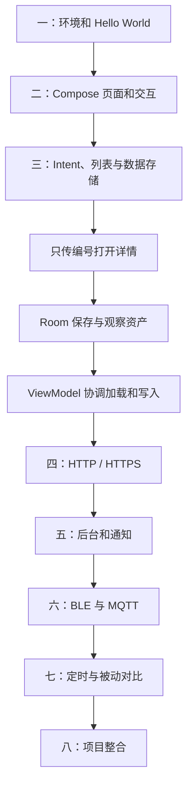
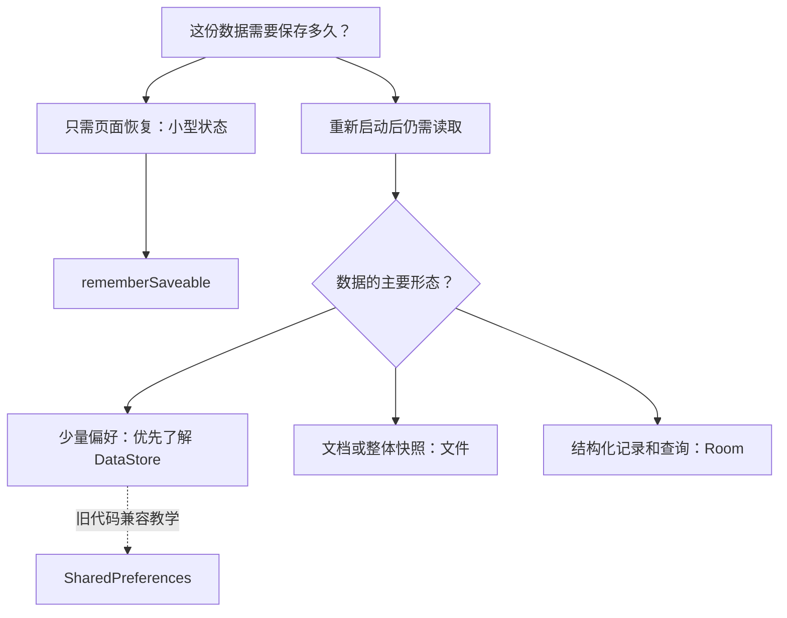
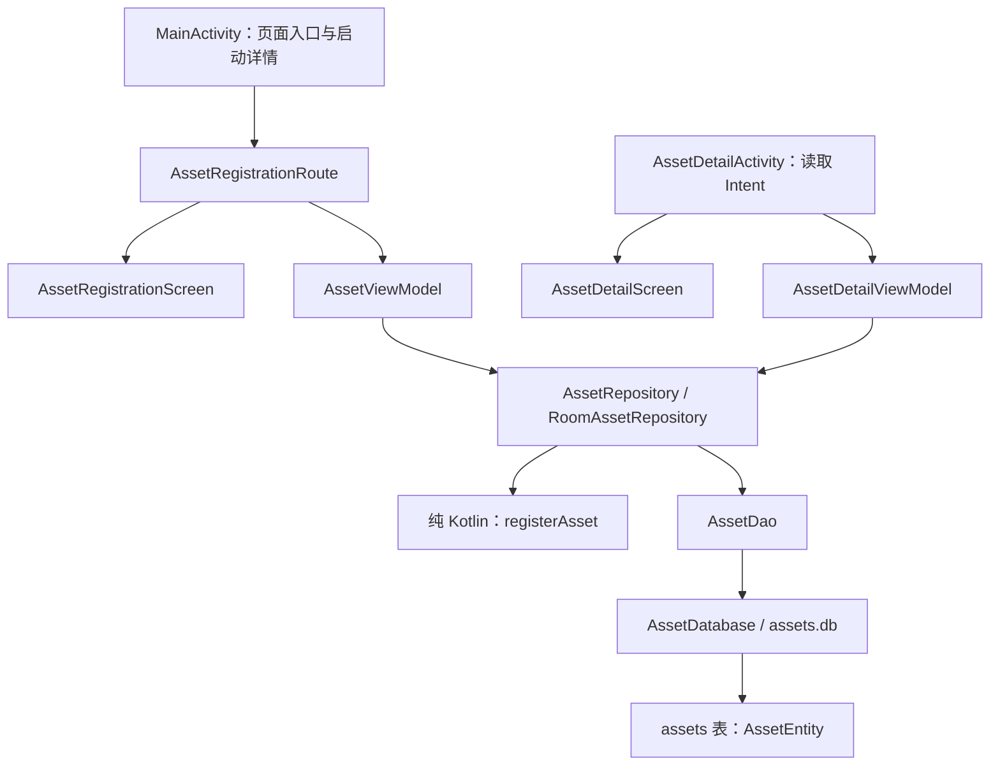
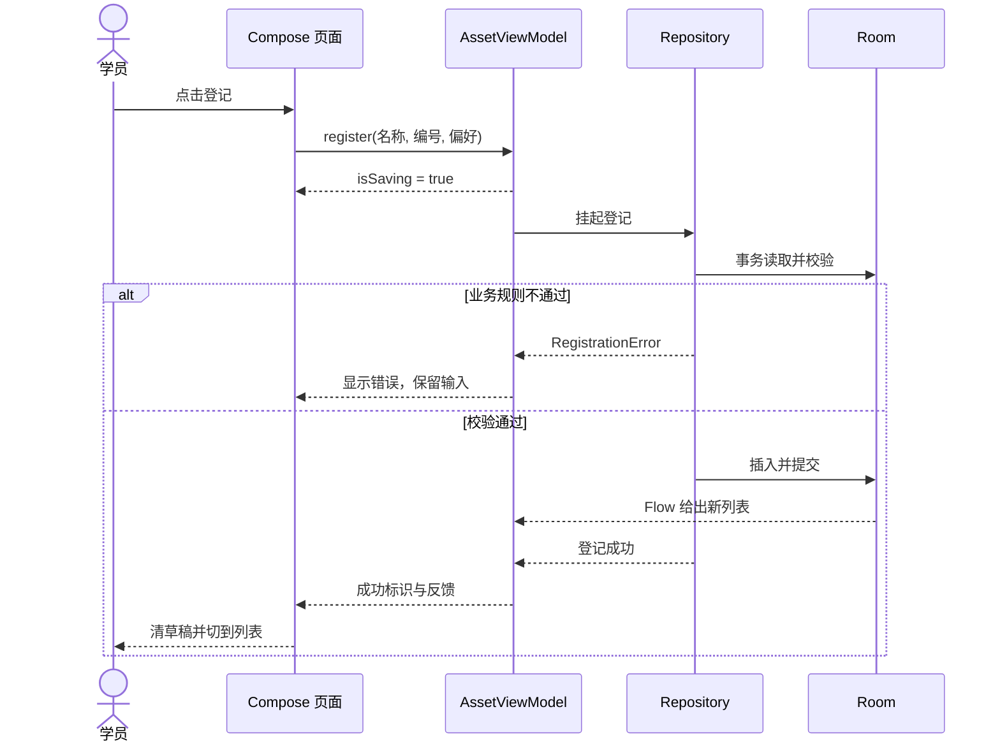
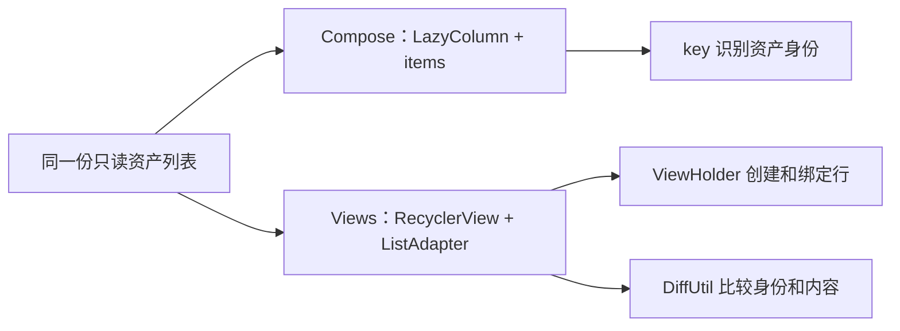
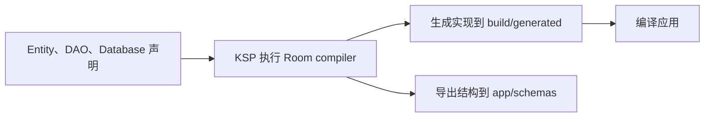
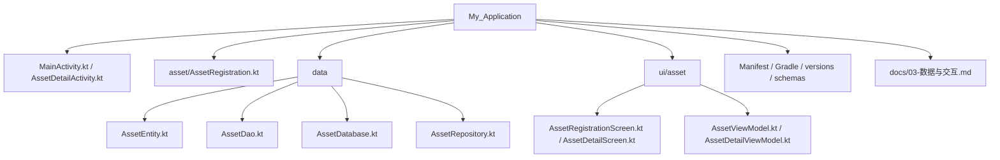

# 阶段三：数据与交互，从页面状态到长期存储

> 所属阶段：3 / 8  
> 前置要求：已完成阶段二，能操作 Compose 资产登记页；认识 Kotlin 类、函数、可空类型、集合与事件回调。  
> 工程：`/Users/wl/AndroidStudioProjects/My_Application`  
> 主线：Kotlin + Compose + Material 3；保留 `ComponentActivity + setContent`。  
> 建议课时：讲解 4 小时、分步练习 4～6 小时，可分两次课。  
> 资料核对日期：2026-11-13。  
> 交付状态：代码及教案已编写；按用户要求，没有执行 Gradle 同步、构建、测试或设备运行，不宣称已验收通过。

本阶段完成后的目标体验：登记一项资产，在列表中打开详情，返回后继续搜索；记录写入数据库，应用重新启动后可重新读取。上报开关仍只是每项资产的偏好，不会真的发送消息。

**先分清三类内容：**

| 标记 | 含义 |
|---|---|
| 工程代码 | 已写入当前项目，与下文给出的文件名对应 |
| 教学摘录 | 从工程抽取重点，可能省略 import 或外围类；不能整段替换完整文件 |
| 对照练习 | SharedPreferences、文件、RecyclerView 示例；尚未接入主页面，不能声称已实现这些入口 |

阶段二中 `AssetListSaver` 保存的是小型页面快照，不是磁盘数据库。阶段三删除该 Saver，资产记录只从 Room 读取。旧版临时记录没有已有数据库可迁移，不保证升级后自动转存；重要课堂记录请先记录内容，再在新版本重新登记。数据库未来的版本升级则需要单独设计迁移。

---

## 1. 🎓 阶段目标

1. 使用显式 Intent 启动详情 Activity，传入唯一编号并处理参数缺失或无效。
2. 解释 LazyColumn 的稳定 key，以及 RecyclerView、Adapter、ViewHolder、DiffUtil 的职责。
3. 根据数据形态选择偏好存储、文件或 Room，区分页面恢复与长期保存。
4. 看懂 Entity → DAO → Database → Repository → ViewModel → Compose 的数据通路。
5. 处理加载、校验失败、保存失败、删除失败和空态，写出可复现的验收记录。

### 学习路线



这张图在讲什么：本阶段补齐页面之间传递标识和本地数据保存，为后续网络与物联网数据接入提供基础。

---

## 2. 📚 核心知识点逐条讲解

### 2.1 Intent 与 Activity 跳转

**是什么：** Intent 是组件之间表达操作请求的消息对象；显式 Intent 指定目标类，隐式 Intent 描述希望完成的动作。

**为什么需要：** 列表与详情属于不同页面，本课用两个 Activity 展示 Android 组件跳转，避免把传参机制藏在导航框架里。

**怎么用：** MainActivity 调用 `startActivity(AssetDetailActivity.createIntent(this, code))`；详情页读取 extra，点击返回调用 `finish()`。

**注意什么：** 本课不是在 Compose 的同一个页面中切换 Tab，也不是一次网络请求。详情 Activity 要在 Manifest 注册；不需要向外开放的组件设为 `exported="false"`。参阅 [Intent 指南][D1]、[Activity 配置][D2]。

### 2.2 传标识，而不是传整个数据集合

**是什么：** extra 是 Intent 携带的附加数据，本课只携带资产编号字符串。

**为什么需要：** 传整个列表会扩大组件间消息，也容易让详情拿到过期快照。编号可以作为查询入口，资产内容仍由数据库提供。

**怎么用：** 用统一的 `EXTRA_ASSET_CODE` 常量写入和读取；`parseAssetCode` 将编号去除两端空格、转大写并验证格式；无效时显示参数错误。

**注意什么：** 编号不是列表下标，也不等于数据库自增 id。本课不允许修改编号；记录若被删除，详情显示不存在。不能对可空参数直接 `!!`；不把传参当作授权机制。参阅 [Intent API][A1]。

### 2.3 LazyColumn 的数据更新与稳定 key

**是什么：** LazyColumn 根据需要组合列表项，`items(..., key = ...)` 给每条记录稳定身份。

**为什么需要：** 删除第一行后，后续资产仍是原来的资产。使用位置作为身份，可能让行内状态与另一条记录错误对应。

**怎么用：** 本工程沿用 `items(filtered, key = { it.code })`；收到数据库的新列表后重新筛选并显示，不手动维护另一份可写资产列表。

**注意什么：** key 必须在列表中唯一且稳定。它既不创建数据库索引，也不替代去重逻辑。本课最多 50 项，内存筛选足够；大量记录应再学习分页和查询优化。参阅 [Lazy lists：Item keys][D3]。

### 2.4 RecyclerView 对照

**是什么：** RecyclerView 是 Views 体系的列表容器；Adapter 负责创建和绑定行，ViewHolder 持有行控件，LayoutManager 管理排列。

**为什么需要：** 学员需要能阅读既有 Views 项目，而不把 Compose 的 `items` 错认成 Adapter API。

**怎么用：** 本课用 ListAdapter 与 DiffUtil 对照同一份 `AssetRecord`。它们接收新列表，再计算必要的更新；例子在第 3.10 节。

**注意什么：** 主工程继续用 LazyColumn，不为了练习改成 AppCompat。RecyclerView 依赖只在做对照练习时添加。不要原地修改已经提交给 ListAdapter 的列表或对象。参阅 [RecyclerView 指南][D4]、[ListAdapter API][A2]。

### 2.5 存储选型：偏好、文件与 Room

**是什么：** 偏好保存少量键值；文件保存文档、快照等整体内容；Room 管理结构化记录和查询。

**为什么需要：** “保存一项开关”和“按编号查询、增删 50 项资产”不是同一种需求，用一个大 JSON 偏好值承担所有记录会增加更新和一致性负担。

**怎么用：** 本课资产主数据用 Room；SharedPreferences 与私有文件作为对照练习。新项目的小型偏好优先了解 DataStore，不把 SharedPreferences 当作新项目默认最佳实践。

**注意什么：** 应用私有目录通常随卸载或清除数据而失去内容；备份恢复另有条件。持久化不是跨设备同步，也不自动代表已经加密到满足所有业务安全要求。参阅 [存储总览][D5]、[偏好指南][D6]、[DataStore][D7]、[私有文件][D8]。

| 方案 | 适合什么 | 不适合什么 | 本阶段安排 |
|---|---|---|---|
| `rememberSaveable` | 小型表单草稿、标签和搜索词 | 长期资产档案、大列表 | 主页面继续使用 |
| SharedPreferences | 读取旧项目中的简单键值偏好 | 关系、复杂查询、记录级并发更新 | 对照示例 |
| DataStore | 新需求中的小型异步偏好或对象 | 复杂关联与局部查询 | 查文档拓展 |
| 应用私有文件 | 快照、导出中间文件、文档 | 高频局部修改和关系查询 | 对照示例 |
| Room | 结构化资产、唯一性、增删查 | 自动云同步、任意大文件内容 | 当前实际方案 |



这张图在讲什么：按保存期限和数据形态选方案，不因为某个 API 容易记就让它保存全部数据。

### 2.6 Room 的三个基本角色

**是什么：** Entity 描述表和列；DAO 声明访问操作；Database 提供数据库入口和 DAO。

**为什么需要：** 业务代码不用反复编写游标和字段转换，SQL 与模型也能在代码生成阶段得到检查。

**怎么用：** `AssetEntity` 对应 `assets` 表，`AssetDao` 声明查、增、删，`AssetDatabase` 以固定文件名 `assets.db` 打开数据库。

**注意什么：** Room 不是云数据库；DAO 接口需要代码生成器生成实现。不要添加 `allowMainThreadQueries()` 来回避异步问题。本课明确使用 Room **2.7.2** 的 `androidx.room` API；如果官方指南展示 Room 3 的 `androidx.room3`，不能混用坐标与 API。参阅 [Room 概览][D9]、[Entity][D10]、[DAO][D11]、[版本记录][D12]。

### 2.7 唯一性、事务和失败边界

**是什么：** 唯一索引阻止重复编号；事务将相关的读与写作为一个整体执行。

**为什么需要：** 只在页面上检查“还没到 50 项”并不可靠，另一个登记操作可能在检查后抢先写入。

**怎么用：** Repository 在 `withTransaction` 中读已有记录、复用 `registerAsset` 校验，再插入一条 Entity；同时保留数据库唯一索引和 `ABORT` 冲突策略。

**注意什么：** 业务错误返回 `RegistrationError`；磁盘、数据库等异常向 ViewModel 传播。不能将任何异常都伪装成编号重复，也不使用 REPLACE 覆盖原资产。参阅 [DAO 写入][D11]、[Room 事务 API][A3]。

### 2.8 suspend、Flow 与线程

**是什么：** `suspend` 函数可挂起；Flow 表达随时间变化的数据；协程负责组织异步执行。

**为什么需要：** 数据库或文件操作不能阻塞页面绘制；新增和删除后，列表还需要得到新结果。

**怎么用：** DAO 写入用 `suspend`，观察查询返回 `Flow`；Room 安排其数据库工作。普通文件示例显式切换 `Dispatchers.IO`，不因为加了 suspend 就认为它自动移到后台。

**注意什么：** `Flow` 不是一个已经查好的 List，也不等于持续联网；`collect` 通常持续到取消或失败。协程取消异常必须继续抛出，不能作为普通保存失败吞掉。参阅 [异步 DAO][D13]、[Android 协程][D14]。

### 2.9 Repository、ViewModel 和 UI 状态

**是什么：** Repository 暴露数据访问和规则入口；ViewModel 协调页面操作；Compose 接收状态并发出事件。

**为什么需要：** 页面不再同时管理磁盘记录、提交顺序和错误翻译。详情和列表也能读取同一份资产库。

**怎么用：** `AssetViewModel.uiState` 暴露只读 StateFlow；`AssetRegistrationRoute` 用 `collectAsStateWithLifecycle` 接入页面。主页面通过回调登记、删除与重试。

**注意什么：** ViewModel 不等于长期存储，也不负责保活。当前实现的数据库观察由 ViewModel 主动收集，直到其销毁；UI 的生命周期感知收集不会自动取消这条上游任务，不要误写成“所有查询都随页面后台停止”。参阅 [数据层][D15]、[ViewModel][D16]、[Compose 状态][D17]、[生命周期收集 API][A4]。

### 2.10 草稿恢复、磁盘保存与迁移

**是什么：** 页面恢复重建少量交互状态；Room 从磁盘重新加载资产；数据库迁移则处理旧表结构变成新表结构。

**为什么需要：** 旋转后草稿还在，不能证明应用重开后的数据库持久化；数据库关闭重开成功，也不能证明升级迁移正确。

**怎么用：** 草稿、标签、搜索词仍用 `rememberSaveable`；资产不再用 Saver。未来更改表结构时提高 schema 版本、保留导出的 schema 并编写迁移。

**注意什么：** 本课没有启用破坏性迁移兜底。清除数据或卸载不是“模拟 Activity 重建”。不要通过删库解决正式用户的升级错误。参阅 [保存 UI 状态][D18]、[数据库迁移][D19]。

### 当前应用分层



这张图在讲什么：两个页面共享本地数据来源，界面不直接写 SQL，也不让 Intent 携带整份资产列表。

---

## 3. 💻 代码逐行讲解

以下工程路径均相对 `app/src/main/java/com/example/my_application/`。先在 IDE 打开对应完整文件，再阅读摘录，不要将省略的外围代码当作已经不存在。

### 3.1 显式 Intent：把编号交给详情

工程文件：`AssetDetailActivity.kt`、`MainActivity.kt`。

```kotlin
// 放在 AssetDetailActivity 的 companion object 中。
const val EXTRA_ASSET_CODE = "com.example.my_application.extra.ASSET_CODE"

fun createIntent(context: Context, code: String): Intent =
    Intent(context, AssetDetailActivity::class.java) // 明确目标组件。
        .putExtra(EXTRA_ASSET_CODE, code) // 只附带唯一编号。

// 放在 MainActivity 的打开详情回调中，不是顶层可执行语句。
startActivity(AssetDetailActivity.createIntent(this, code)) // 交给系统启动页面。
```

| 代码行或块 | 作用 | 为什么这样写 |
|---|---|---|
| `EXTRA_ASSET_CODE` | 约定附加数据的键 | 写入和读取共用一个常量，减少拼写不一致 |
| `context: Context` | 提供创建 Intent 的上下文 | 当前调用者是 Activity；不能据此假定任意 Context 都能无 flag 启动页面 |
| `code: String` | 要查询的稳定编号 | 不传列表位置或整个对象 |
| `Intent(context, ...::class.java)` | 构建显式 Intent | 目标明确，不需要 intent-filter 来匹配 |
| `putExtra(key, value)` | 写入一个 String extra；返回同一个 Intent | 可继续链式配置 |
| `createIntent(...): Intent` | 返回准备好的请求对象 | 构建和启动分开，方便查阅与验证 |
| `startActivity(intent)` | 请求启动；Kotlin 返回 Unit | 需要 Manifest 中存在目标 Activity，返回值不是详情内容 |

本课调用来自 MainActivity，不需要 `FLAG_ACTIVITY_NEW_TASK`。只有从非 Activity Context 启动等具体场景才考虑相应 flag，不要一开始就无差别添加。

### 3.2 读取参数、校验、返回

工程文件：`asset/AssetRegistration.kt`、`AssetDetailActivity.kt`。

```kotlin
// 位于 asset 包；与登记规则共用同一个编号格式。
private val assetCodePattern = Regex("[A-Z0-9][A-Z0-9_-]{0,23}")
fun parseAssetCode(raw: String?): String? =
    raw?.trim()?.uppercase(Locale.ROOT) // 处理缺失、空白和大小写。
        ?.takeIf { assetCodePattern.matches(it) } // 不合法则返回 null。

// 以下为 AssetDetailActivity.onCreate 中的教学摘录。
val code = parseAssetCode(intent.getStringExtra(EXTRA_ASSET_CODE)) // 缺失也可安全处理。
val viewModel = ViewModelProvider(
    this,
    AssetDetailViewModel.factory(applicationContext, code) // 只传应用上下文与校验结果。
)[AssetDetailViewModel::class.java]

// 位于 setContent 中；不是让读取数据库在 Composable 函数体内直接执行。
val state by viewModel.uiState.collectAsStateWithLifecycle()
AssetDetailScreen(state, onBack = { finish() }, onRetry = viewModel::reload)
```

| 代码行或块 | 作用 | 为什么这样写 |
|---|---|---|
| `raw: String?` | 接受缺失参数 | Android 组件不能假设调用者永远带对参数 |
| 正则表达式 | 1～24 位，以字母数字开头 | 与阶段二规则一致，不临时创造另一套格式 |
| `uppercase(Locale.ROOT)` | 使用稳定区域规则规范化 | 编号不是面向特定语言显示的自然文本 |
| `takeIf { ... }` | 满足条件返回原字符串，否则 null | 不需要异常控制普通参数错误 |
| `getStringExtra(key): String?` | 读取字符串 | 缺失不使用 `!!` 强拆 |
| `ViewModelProvider(...)[class]` | 获取或创建当前 Activity 范围的 ViewModel | 不直接在每次重组时 new 一个状态管理器 |
| `factory(applicationContext, code)` | 提供仓库依赖和编号 | 不把 Activity 长期存到 ViewModel 中 |
| `collectAsStateWithLifecycle()` | 把 StateFlow 转为 Compose State | UI 按生命周期接收状态 |
| `finish(): Unit` | 结束当前详情 Activity | 正常返回已有列表，不重新创建一份 MainActivity |

源码已包含相关 import；教学摘录中的 `assetCodePattern` 是对原声明的展示，**不要在同一文件再次定义一份**。

### 3.3 Entity：把资产映射成表

工程文件：`data/AssetEntity.kt`。

```kotlin
@Entity(tableName = "assets", indices = [Index(value = ["code"], unique = true)])
data class AssetEntity(
    @PrimaryKey(autoGenerate = true) val id: Long = 0, // 插入时由数据库生成排序标识。
    val name: String, // 资产名称，不能为空值。
    val code: String, // 规范化后的唯一编号。
    val reportingEnabled: Boolean // 每条资产自己的上报偏好。
)

// 页面仍使用原有业务模型，不需要知道数据库的 id。
fun AssetEntity.toRecord() = AssetRecord(name, code, reportingEnabled)
```

| 代码行或块 | 作用 | 为什么这样写 |
|---|---|---|
| `@Entity(tableName = "assets")` | 指定表名 | SQL 与模型名称分开，便于说明 |
| `Index(value = ["code"], unique = true)` | 编号唯一索引 | 数据库层也阻止重复，不只靠按钮禁用 |
| `@PrimaryKey(autoGenerate = true)` | 自动生成行标识 | 按 `id DESC` 显示新登记记录；不依赖手机时钟 |
| `id: Long = 0` | 新记录的未分配 id | 本例由 Room 插入处理，不能把 0 当成已生成 id |
| 非空 String / Boolean | 描述列数据形态 | 不需要本课尚未涉及的可空字段和类型转换器 |
| `toRecord()` | 将存储模型转为业务模型 | 保留阶段二规则和 UI 的接口 |

自增 id 仅用于本地记录和排序，不是资产编号，也不是未来的 iBeacon UUID。

### 3.4 DAO：一次查询与持续观察

工程文件：`data/AssetDao.kt`。

```kotlin
@Dao
interface AssetDao {
    @Query("SELECT * FROM assets ORDER BY id DESC")
    fun observeAll(): Flow<List<AssetEntity>> // 表变化后重新给出列表。

    @Query("SELECT * FROM assets WHERE code = :code LIMIT 1")
    fun observeByCode(code: String): Flow<AssetEntity?> // 查不到时发出 null。

    @Query("SELECT * FROM assets ORDER BY id DESC")
    suspend fun getAll(): List<AssetEntity> // 只取当前这一次快照，供事务校验。

    @Insert(onConflict = OnConflictStrategy.ABORT)
    suspend fun insert(asset: AssetEntity): Long // 成功返回插入行的标识。

    @Query("DELETE FROM assets WHERE code = :code")
    suspend fun deleteByCode(code: String): Int // 返回受影响行数。
}
```

| 代码行或块 | 作用 | 为什么这样写 |
|---|---|---|
| `@Dao interface` | 声明访问契约 | 实现由 Room 生成，不手写同名 `_Impl` |
| `ORDER BY id DESC` | 明确新记录排前面 | 数据库默认返回顺序不能当作稳定排序保证 |
| `:code` | 绑定函数参数 | 不拼接用户输入到 SQL 字符串 |
| `Flow<List<...>>` | 持续列表结果流 | 新增删除后由查询更新 UI |
| `Flow<AssetEntity?>` | 持续详情结果流 | 记录不存在与数据库失败是不同状态 |
| `suspend getAll()` | 一次性快照 | 不把一个持续 Flow 的 collect 塞进事务 |
| `ABORT` | 冲突时使写入失败 | 不静默替换已有资产 |
| `insert(...): Long` | 返回新行 id | 本例登记返回值不向 UI 暴露 id |
| `deleteByCode(...): Int` | 返回删除数量 | 0 行意味着已不存在，不假装删除了一项 |

### 3.5 Database：应用级实例与文件名

工程文件：`data/AssetDatabase.kt`。

```kotlin
@Database(entities = [AssetEntity::class], version = 1, exportSchema = true)
abstract class AssetDatabase : RoomDatabase() {
    abstract fun assetDao(): AssetDao // 提供本库的 DAO。

    companion object {
        @Volatile private var instance: AssetDatabase? = null // 跨线程看见已发布实例。

        fun getInstance(context: Context): AssetDatabase =
            instance ?: synchronized(this) { // 尚未创建才进入同步区域。
                instance ?: Room.databaseBuilder(
                    context.applicationContext, // 不持有 Activity。
                    AssetDatabase::class.java,
                    "assets.db" // 固定文件名；改名会打开另一个库。
                ).build().also { instance = it }
            }
    }
}
```

| 代码行或块 | 作用 | 为什么这样写 |
|---|---|---|
| `entities` | 指定包含的表 | 只写 Entity 而不加入 Database 不会自动成为该库的表 |
| `version = 1` | 第一个磁盘 schema 版本 | 不是应用 versionCode，也不是课程阶段号 |
| `exportSchema = true` | 允许导出结构描述 | 为后续迁移与版本审阅留依据 |
| 继承 `RoomDatabase` | 声明 Room 数据库 | Room 代码生成器据此生成实现 |
| `instance ?: synchronized(...)` | 避免同时创建多个实例 | 多页面共享同一库入口；同步保护创建过程，不是包住全部 SQL |
| `applicationContext` | 使用应用生命周期上下文 | 不让数据库持有已退出的页面 |
| `databaseBuilder(context, class, name)` | 创建建造器 | 三个参数分别是上下文、数据库类和文件名 |
| `build(): AssetDatabase` | 返回数据库对象 | 打开和查询仍可能失败，不能当作所有 I/O 已验证成功 |

本课没有 `fallbackToDestructiveMigration()`；未来改表结构时不能用它直接丢弃资产。

### 3.6 Repository：在事务中登记

工程文件：`data/AssetRepository.kt`。以下为该类的核心摘录。

```kotlin
override suspend fun register(
    name: String,
    code: String,
    reportingEnabled: Boolean
): RegistrationError? = database.withTransaction {
    val records = dao.getAll().map { it.toRecord() } // 在事务中取得当前记录。
    val result = registerAsset(name, code, reportingEnabled, records) // 复用原有规则。
    if (result.error != null) return@withTransaction result.error // 业务错误不写库。
    val asset = result.assets.first() // 原规则将新记录放在第一项。
    dao.insert(
        AssetEntity(name = asset.name, code = asset.code, reportingEnabled = asset.reportingEnabled)
    ) // 只写这一条，不重写整张表。
    null // 本接口约定 null 表示登记成功。
}

override suspend fun delete(code: String): Boolean =
    dao.deleteByCode(code) > 0 // 明确是否真的删到了记录。
```

| 代码行或块 | 作用 | 为什么这样写 |
|---|---|---|
| `withTransaction { ... }` | 事务执行挂起代码块，返回块的结果 | 将“检查”和“写入”组合，不留读写间隙 |
| `getAll().map` | 转换数据库快照 | 最多 50 项的教学规则可直接复用，未来放量再优化查询 |
| `registerAsset(...)` | 规范化、必填、格式、重复和数量校验 | 与阶段二保持一致 |
| `return@withTransaction result.error` | 返回业务错误 | 此路径没有发生 insert |
| `result.assets.first()` | 提取规范化后的新记录 | 只依赖原规则的明确契约 |
| `dao.insert(...)` | 写入新 Entity | SQL 异常仍向上传递，不伪造成功 |
| `null` | 成功结果 | 与返回 `RegistrationError` 的失败路径区分 |
| `> 0` | 将删除行数转为 Boolean | 不存在时可显示“已被删除” |

保留 50 项是课程业务限制，不再是“Bundle 装不下”的补丁；若将来取消限制，应同步修改规则、UI、性能策略与测试。

### 数据写入链路



这张图在讲什么：先持久化成功再清空草稿，列表由数据库观察结果刷新，而不是页面提前猜测保存成功。

数据库结果流与登记完成通知是两条异步路径，具体到达先后不作为 UI 的业务保证；测试也不能用固定睡眠时间猜测已完成。

### 3.7 ViewModel：状态、错误与重复提交

工程文件：`ui/asset/AssetViewModel.kt`。摘录省略工厂和其他操作。

```kotlin
private val mutableState = MutableStateFlow(AssetUiState()) // 内部可修改。
val uiState = mutableState.asStateFlow() // 页面只能读取。

fun register(name: String, code: String, reportingEnabled: Boolean) {
    if (!canWrite()) return // 加载中、读取失败或写入中不再发起写操作。
    mutableState.update { it.copy(isSaving = true, registrationError = null) }
    viewModelScope.launch { // 任务归当前 ViewModel 所有，不是后台保活。
        try {
            val error = repository.register(name, code, reportingEnabled)
            val registrationId = if (error == null) UUID.randomUUID().toString() else null
            mutableState.update {
                if (error != null) it.copy(isSaving = false, registrationError = error)
                else it.copy(
                    isSaving = false,
                    registrationId = registrationId, // 每次成功的标识，供页面确认处理。
                    notice = AssetNotice.REGISTERED,
                    noticeVersion = it.noticeVersion + 1
                )
            }
        } catch (cancelled: CancellationException) {
            throw cancelled // 保持协程取消语义。
        } catch (exception: Exception) {
            Log.e("AssetStorage", "Unable to register asset", exception)
            showFailure(AssetNotice.SAVE_FAILED) // 解除写入状态，显示错误，不清草稿。
        }
    }
}
```

| 代码行或块 | 作用 | 为什么这样写 |
|---|---|---|
| `MutableStateFlow(AssetUiState())` | 创建当前状态容器 | 默认是加载中，不把尚未读取误显示成零项 |
| `asStateFlow()` | 暴露只读 StateFlow | UI 不直接修改记录或写入标志 |
| `canWrite()` | 防止页面操作重入 | 这是 UI 协调；数据库事务仍是数据一致性的保障 |
| `update { it.copy(...) }` | 生成新状态 | 不原地修改旧对象 |
| `viewModelScope.launch` | 启动协程，返回 Job | 当前方法整体返回 Unit，不同步返回保存结果 |
| `repository.register` | 执行异步登记 | 页面不能因为点击已发生就宣称成功 |
| `registrationId` | 识别一次成功 | 使用新的字符串标识，避免进程重建后整数计数重置造成误判 |
| `noticeVersion` | 区分连续的同类反馈 | 消费提示时核对版本，避免清掉更新的提示 |
| 两个 catch | 区分取消与业务外异常 | 取消不是一般 I/O 错误，不吞掉 |

源码 `reload()` 同样处理读取失败；`delete()` 只在实际删除后发出成功反馈。读取错误单独显示重试入口；空列表不等于读取失败。

### 3.8 页面：接收状态，不维护第二份资产

工程文件：`ui/asset/AssetRegistrationScreen.kt`。

```kotlin
@Composable
fun AssetRegistrationRoute(viewModel: AssetViewModel, onOpenAsset: (String) -> Unit) {
    val state by viewModel.uiState.collectAsStateWithLifecycle() // UI 观察状态。
    AssetRegistrationScreen(
        uiState = state,
        onRegister = viewModel::register, // 只传事件入口。
        onDelete = viewModel::delete,
        onClearRegistrationError = viewModel::clearRegistrationError,
        onRetry = viewModel::reload,
        onNoticeConsumed = viewModel::consumeNotice,
        onOpenAsset = onOpenAsset
    )
}
```

| 代码行或块 | 作用 | 为什么这样写 |
|---|---|---|
| `AssetRegistrationRoute` | 把状态管理接到可组合页面 | 预览可以绕开数据库，直接传固定状态 |
| `collectAsStateWithLifecycle()` | 返回 Compose State，默认按 STARTED 等生命周期条件收集 | 不在函数体中手工启动无主协程 |
| `uiState = state` | 传入展示所需数据 | 页面只有一份只读资产来源 |
| `viewModel::register` 等 | 传函数引用 | 页面无需知道数据库类 |
| `onOpenAsset` | 向 Activity 交出跳转意图 | Composable 不绑定 Android Intent 细节 |

对应的局部状态摘录：

```kotlin
var name by rememberSaveable { mutableStateOf("") } // 小型未提交草稿。
var query by rememberSaveable { mutableStateOf("") } // 搜索词，不写资产表。
var handledRegistrationId by rememberSaveable { mutableStateOf<String?>(null) }
val assets = uiState.assets // 注意：这里不是 mutableStateOf，也没有 AssetListSaver。

LaunchedEffect(uiState.registrationId) { // 只有成功标识变化才处理。
    if (uiState.registrationId != null && uiState.registrationId != handledRegistrationId) {
        handledRegistrationId = uiState.registrationId // 记住已经处理的这次成功。
        name = ""
        code = ""
        query = ""
        selectedTab = 1 // 成功后进入资产列表。
        focus.clearFocus()
    }
}
```

| 代码行或块 | 作用 | 为什么这样写 |
|---|---|---|
| `rememberSaveable` 草稿 | 支持系统状态保存恢复 | 不承诺强制停止后草稿还在 |
| `val assets = uiState.assets` | 读取观察结果 | 删除资产时不再 `assets = assets.filterNot { ... }` 假装写库 |
| `LaunchedEffect(key)` | 为成功事件执行页面副作用 | 不在每次重组时清空表单 |
| 已处理标识 | 避免旋转重建后再次清空新草稿 | 与真正的资产唯一编号不是一回事 |
| `focus.clearFocus()` | 结束当前输入焦点 | 成功提交后切页更自然 |

此摘录位于完整 Screen 内；`code`、`selectedTab` 与 `focus` 的声明见源码。

### 3.9 列表打开详情

工程文件：`ui/asset/AssetRegistrationScreen.kt`。教学摘录：

```kotlin
LazyColumn(modifier = Modifier.weight(1f)) { // 在有界 Column 中占剩余高度。
    items(filtered, key = { it.code }) { asset -> // 编号提供稳定身份。
        AssetRow(
            asset = asset,
            onDelete = onDelete,
            onOpen = onOpen,
            deletionEnabled = deletionEnabled
        )
    }
}

// 位于 AssetRow 中；contentDescription 为图标提供可访问名称。
IconButton(onClick = { onOpen(asset.code) }) {
    Icon(
        Icons.AutoMirrored.Filled.ArrowForward,
        contentDescription = stringResource(R.string.open_asset_description, asset.code)
    )
}
```

| 代码行或块 | 作用 | 为什么这样写 |
|---|---|---|
| `weight(1f)` | 在父 Column 约束下使用剩余高度 | 不把无界竖向滚动容器任意叠套 |
| `filtered` | 当前搜索结果 | 原始 Room 列表不被搜索操作修改 |
| `key = { it.code }` | 每项的唯一身份 | 新增与删除不改变其他资产身份 |
| `onOpen(asset.code)` | 传出编号 | 不是 `onOpen(index)` |
| `AutoMirrored` 图标 | 随布局方向镜像 | 与方向性导航图标的含义相符 |
| `contentDescription` | 说明“查看资产 编号” | 仅有箭头图形不足以让读屏用户区分每项操作 |

### 3.10 RecyclerView：独立对照练习

**本节没有替换主界面，也没有在工程中启用 RecyclerView 依赖。** 练习时可新建 `ui/asset/AssetRecyclerExample.kt`，补齐以下 import 并添加第 4.4 节的可选依赖。

先看 Adapter 与 ViewHolder：

```kotlin
package com.example.my_application.ui.asset

import android.view.ViewGroup
import android.widget.TextView
import androidx.recyclerview.widget.DiffUtil
import androidx.recyclerview.widget.ListAdapter
import androidx.recyclerview.widget.RecyclerView
import com.example.my_application.asset.AssetRecord

class AssetAdapter(private val onOpen: (String) -> Unit) :
    ListAdapter<AssetRecord, AssetAdapter.Holder>(Diff) {

    class Holder(val text: TextView) : RecyclerView.ViewHolder(text) // 持有行控件。

    override fun onCreateViewHolder(parent: ViewGroup, viewType: Int): Holder {
        val text = TextView(parent.context).apply {
            layoutParams = RecyclerView.LayoutParams(
                ViewGroup.LayoutParams.MATCH_PARENT, ViewGroup.LayoutParams.WRAP_CONTENT
            )
            val padding = (16 * resources.displayMetrics.density).toInt() // dp 转为像素。
            setPadding(padding, padding, padding, padding)
        }
        return Holder(text) // 创建行时还没有绑定具体资产。
    }

    override fun onBindViewHolder(holder: Holder, position: Int) {
        val asset = getItem(position) // 每次绑定都取当前位置对应的数据。
        holder.text.text = "${asset.name}\n${asset.code}"
        holder.text.setOnClickListener { onOpen(asset.code) } // 捕获资产编号，不保留旧 position。
    }

    private object Diff : DiffUtil.ItemCallback<AssetRecord>() {
        override fun areItemsTheSame(old: AssetRecord, new: AssetRecord) =
            old.code == new.code // 同一条资产的身份是否相同。

        override fun areContentsTheSame(old: AssetRecord, new: AssetRecord) =
            old == new // data class 比较展示内容。
    }
}
```

| 代码行或块 | 作用 | 为什么这样写 |
|---|---|---|
| `ListAdapter<T, VH>(Diff)` | 接收列表并计算更新 | 避免每次都 `notifyDataSetChanged()` |
| `Holder(text)` | 包装行 View | ViewHolder 不负责查数据库 |
| `onCreateViewHolder(parent, viewType)` | 返回新建 Holder；viewType 表示行类型 | 本例只有一种行，先不引入多类型 |
| LayoutParams | 指定行宽高 | 不把像素值误当布局语义 |
| dp 转 px | 给程序创建的 View 设置内边距 | Views 的 `setPadding` 参数单位是像素 |
| `onBindViewHolder(holder, position)` | 绑定当前数据；返回 Unit | 回收复用后仍要重设文字与事件 |
| `getItem(position)` | 返回当前位置 AssetRecord | 列表更新由 ListAdapter 管理 |
| `areItemsTheSame` | 返回身份是否相同的 Boolean | 对照 LazyColumn 的稳定 key |
| `areContentsTheSame` | 返回内容是否一致的 Boolean | 名称或偏好变化时可以重新绑定 |

再将 RecyclerView 临时嵌入一个有界 Compose 布局，以免改写入口。本例只用于理解互操作；生产主界面保持 LazyColumn。

```kotlin
// 补充 import：Composable、remember、rememberUpdatedState、getValue、Modifier、
// AndroidView，以及 RecyclerView、LinearLayoutManager。
@Composable
fun AssetRecyclerExample(
    assets: List<AssetRecord>,
    onOpen: (String) -> Unit,
    modifier: Modifier = Modifier
) {
    val currentOnOpen by rememberUpdatedState(onOpen) // 适配器回调使用最新函数。
    val adapter = remember { AssetAdapter { code -> currentOnOpen(code) } }
    AndroidView(
        modifier = modifier, // 调用方应提供 fillMaxSize 或有界 height。
        factory = { context ->
            RecyclerView(context).apply {
                layoutManager = LinearLayoutManager(context) // 指定垂直排列。
                this.adapter = adapter
            }
        },
        update = { adapter.submitList(assets.toList()) } // 传新快照，不原地改旧列表。
    )
}
```

| 代码行或块 | 作用 | 为什么这样写 |
|---|---|---|
| `rememberUpdatedState(onOpen)` | 保留最新回调引用 | remember 的 Adapter 不捕获过期页面行为 |
| `remember { AssetAdapter(...) }` | 保留适配器实例 | 不在每次重组重新创建 |
| `AndroidView(factory, update)` | 创建并更新一个 View；返回 Unit | 说明 Compose 与 Views 可互操作，不代表应该混用所有控件 |
| `LinearLayoutManager(context)` | 线性排列 | 没有 LayoutManager 就没有正常的行布局 |
| `submitList(newList): Unit` | 提交新列表快照 | 不修改 Diff 正在比较的旧列表 |

正式使用前还需要完成样式、可访问性和异常状态处理。本节省略的是外观与容器接线，不是让 Adapter 自动获得数据库。

### 列表机制对照



这张图在讲什么：两套 UI 都需要稳定数据身份，但创建与更新行的 API 不同。

### 3.11 SharedPreferences：读懂旧式偏好代码

**对照练习，未接入主页面。** 在 Android 环境中调用以下函数；不是本课资产表的替代实现。

```kotlin
// 需要 import：Context、Dispatchers、withContext。
suspend fun saveLegacyDefault(context: Context, enabled: Boolean): Boolean =
    withContext(Dispatchers.IO) { // commit 是同步写入，不能阻塞主线程。
        context.applicationContext
            .getSharedPreferences("com.example.my_application.lesson_preferences", Context.MODE_PRIVATE)
            .edit()
            .putBoolean("default_reporting_enabled", enabled) // 这是“新资产默认值”，不是修改全部资产。
            .commit() // 返回 Boolean，允许调用方判断本次写入结果。
    }

fun readLegacyDefault(context: Context): Boolean =
    context.getSharedPreferences(
        "com.example.my_application.lesson_preferences", Context.MODE_PRIVATE
    ).getBoolean("default_reporting_enabled", true) // 无此键时使用默认 true。
```

| 代码行或块 | 作用 | 为什么这样写 |
|---|---|---|
| `getSharedPreferences(name, MODE_PRIVATE)` | 返回指定私有偏好文件的访问对象 | 文件名与键名分别代表容器和数据项 |
| `edit()` | 返回 Editor | 通过 Editor 组织修改 |
| `putBoolean(key, enabled)` | 准备保存布尔值，返回 Editor | 不把布尔值手工转为字符串 |
| `commit(): Boolean` | 同步提交并返回结果 | 本例在 IO 调度器执行，展示可以检查结果的写法 |
| `getBoolean(key, true): Boolean` | 读取值或默认值 | 字段不存在不是异常 |
| `withContext(IO)` | 在 IO 上执行并返回块结果 | suspend 本身不自动换线程 |

`apply()` 返回 Unit，先更新内存，再异步安排磁盘写入，不提供本次落盘成功的 Boolean。同一个键若过去存的不是 Boolean，`getBoolean` 可能抛出类型异常，需要迁移处理。SharedPreferences 首次读取及待完成写入也可能影响响应，因此本例只是旧 API 教学；新偏好需求应读 DataStore 指南。

### 3.12 文件：写入一个私有 JSON 快照

**对照练习，未接入主页面。** 使用固定文件名，不接收未经校验的外部路径。这里的快照只用于学习整体文件写入，不会自动恢复到资产表。

```kotlin
// 需要 import：Context、AtomicFile、File、FileOutputStream、IOException、
// JSONArray、JSONObject、AssetRecord、Dispatchers、withContext。
suspend fun writeLessonSnapshot(context: Context, assets: List<AssetRecord>) =
    withContext(Dispatchers.IO) {
        val json = JSONArray() // 使用 JSON API 编码，不能用字符串拼接字段。
        assets.forEach { asset ->
            json.put(JSONObject().apply {
                put("name", asset.name)
                put("code", asset.code)
                put("reportingEnabled", asset.reportingEnabled)
            })
        }
        val file = AtomicFile(File(context.filesDir, "lesson-assets.json"))
        var output: FileOutputStream? = null
        try {
            output = file.startWrite() // 开始写入流程。
            output.write(json.toString().toByteArray(Charsets.UTF_8))
            file.finishWrite(output) // 成功完成；由 AtomicFile 关闭流。
        } catch (exception: IOException) {
            file.failWrite(output) // 回滚未完成写入；不把失败文件当作有效快照。
            throw exception // 让调用方显示失败，而不是返回一个空列表掩盖错误。
        }
    }
```

| 代码行或块 | 作用 | 为什么这样写 |
|---|---|---|
| `JSONArray` / `JSONObject.put` | 编码列表与字段，put 返回 JSON 容器 | 名称含引号、换行时仍能正确编码 |
| `context.filesDir` | 获取应用内部持久文件目录 | 不申请广泛文件权限，也不硬编码 `/sdcard` |
| `AtomicFile(File(...))` | 原子文件更新辅助对象 | 减少写到一半覆盖原快照的风险 |
| `startWrite(): FileOutputStream` | 返回写入流 | 与 finishWrite / failWrite 成对使用 |
| `UTF_8` | 明确文字编码 | 不依赖默认字符集 |
| `finishWrite(...)` | 完成成功写入，返回 Unit | 不能只 close 流却不完成 AtomicFile 协议 |
| `failWrite(...)` | 失败时收尾，返回 Unit | 尽量保留此前有效内容 |
| `throw exception` | 将 I/O 错误交还调用方 | “保存失败”不能显示“保存成功” |

读取时用 `AtomicFile.openRead()`，在 IO 上按 UTF-8 读取，再以 `JSONArray(text)` 解析。处理文件不存在、JSON 无效、字段类型错误、超限与重复编号，**不要未经校验就批量导入数据库**。AtomicFile 不负责多写者互斥，也不替代 Room 事务。参阅 [私有文件][D8]、[AtomicFile API][A5]。

---

## 4. 📄 配置文件/清单文件逐项讲解

### 4.1 AndroidManifest.xml

以下是**结构摘录**，不是替换模板；原来的图标、备份规则和主题属性继续保留。

```xml
<manifest xmlns:android="http://schemas.android.com/apk/res/android">
    <application android:theme="@style/Theme.My_Application">
        <!-- 内部详情组件不允许其他普通应用直接启动。 -->
        <activity
            android:name=".AssetDetailActivity"
            android:exported="false" />
        <!-- 主入口已有启动过滤器，必须保留。 -->
        <activity android:name=".MainActivity" android:exported="true">
            <intent-filter>
                <action android:name="android.intent.action.MAIN" />
                <category android:name="android.intent.category.LAUNCHER" />
            </intent-filter>
        </activity>
    </application>
</manifest>
```

| 配置项 | 作用 | 不写会怎样 |
|---|---|---|
| `xmlns:android` | 声明 Android 属性命名空间 | 带前缀属性的 XML 无法正确解析 |
| `<application>` | 应用级组件容器 | 不能把 Activity 随意放到 manifest 根层 |
| `android:theme` | 指定 Android 窗口主题 | 可能继承非预期主题；它不等于 Compose Theme 函数 |
| `.AssetDetailActivity` | 注册内部详情页 | `startActivity` 不能正常找到未声明组件 |
| `exported="false"` | 禁止其他普通应用直接访问 | 不应依赖历史默认值来保护内部组件 |
| 主 Activity `exported="true"` | 允许启动器访问主入口 | 设 false 后启动器无法正常进入该组件 |
| `MAIN` / `LAUNCHER` | 声明启动入口 | 缺少时应用可能没有正常启动器图标入口 |
| 没有详情 intent-filter | 详情使用显式启动 | 本课无需额外过滤器；不写不会阻止内部显式 Intent |
| 没有存储权限 | Room 与本例私有文件不需要广泛存储权限 | 不写是正确做法；不要添加 READ/WRITE_EXTERNAL_STORAGE 来修复数据库错误 |
| 没有 INTERNET | 本阶段完全本地 | 不影响 Room、Intent 和列表；网络权限到阶段四再讲 |

保留模板中的备份设置，不承诺卸载后数据必然消失或必然恢复；涉及系统备份、设备迁移与业务隐私时需单独审查备份规则。

### 4.2 版本目录和插件

工程文件：`gradle/libs.versions.toml`，新增项如下，其余保留。

```toml
[versions]
# 教学兼容性选择，不声称它们是最新版本。
room = "2.7.2"
ksp = "2.0.21-1.0.28"

[libraries]
# Room 运行时与协程支持使用同一个版本。
androidx-room-runtime = { group = "androidx.room", name = "room-runtime", version.ref = "room" }
androidx-room-ktx = { group = "androidx.room", name = "room-ktx", version.ref = "room" }
androidx-room-compiler = { group = "androidx.room", name = "room-compiler", version.ref = "room" }
# 复用现有 lifecycleRuntimeKtx 版本，不整体升级工具链。
androidx-lifecycle-runtime-compose = { group = "androidx.lifecycle", name = "lifecycle-runtime-compose", version.ref = "lifecycleRuntimeKtx" }
androidx-lifecycle-viewmodel-ktx = { group = "androidx.lifecycle", name = "lifecycle-viewmodel-ktx", version.ref = "lifecycleRuntimeKtx" }

[plugins]
# 当前工程 Kotlin 2.0.21 对应的历史 KSP 插件版本。
ksp = { id = "com.google.devtools.ksp", version.ref = "ksp" }
```

| 配置项 | 作用 | 不写会怎样 |
|---|---|---|
| `room` | 统一 Room 构件版本 | 容易误把运行库和处理器配成不同版本 |
| `ksp` 版本 | 声明代码生成插件版本 | 不能只写 Room compiler 就自动获得正确处理器配置 |
| `room-runtime` | Entity、DAO、Database 的运行支持 | 相关类型或运行实现缺失 |
| `room-ktx` | 本课 Room 2.x 协程 API 配套 | 不按该版本依赖配置可能缺少预期扩展；不要照抄 Room 3 的依赖结论 |
| `room-compiler` | 构建时生成 DAO / Database 实现 | 注解类存在但实现不会按本课方案生成 |
| lifecycle 新增两项 | lifecycle-runtime-compose 提供状态收集；viewmodel-ktx 提供 viewModel 协程配套 | 不应假定仅有 runtime-ktx 就自动覆盖全部使用点 |
| `version.ref` | 指向已有版本键 | 拼错时 Gradle 无法解析目录 |

Room 2.7 系列要求 Kotlin 2.0 或更高，本工程保留 Kotlin 2.0.21。KSP 的该历史版本提供的 KSP2 在其文档中仍标为 Beta，本课明确开启它以配合这套工具链。**这些是依据官方发布记录选定的配置，不是本轮构建验证通过的组合**；恢复构建后仍需检查实际解析与代码生成结果，不能宣称最新或已验证兼容。

### 4.3 build.gradle.kts、gradle.properties 与 schema

根项目 `build.gradle.kts` 的插件块新增：

```kotlin
plugins {
    // 在根项目声明可用插件；实际应用在 app 模块。
    alias(libs.plugins.ksp) apply false
}
```

app 模块的新增部分：

```kotlin
plugins {
    alias(libs.plugins.ksp) // 在 app 应用代码生成插件。
}

ksp {
    arg("room.schemaLocation", "$projectDir/schemas") // 将版本结构导出到 app/schemas。
}

dependencies {
    implementation(libs.androidx.room.runtime)
    implementation(libs.androidx.room.ktx)
    ksp(libs.androidx.room.compiler) // 处理器不作为普通运行时依赖。
    implementation(libs.androidx.lifecycle.runtime.compose)
    implementation(libs.androidx.lifecycle.viewmodel.ktx)
}
```

`gradle.properties`：

```properties
# 当前历史 KSP 插件需要显式开启 KSP2。
ksp.useKSP2=true
```

| 配置项 | 作用 | 不写会怎样 |
|---|---|---|
| 根插件 `apply false` | 统一声明，不在根模块执行 | 独立模块也可自行声明版本，但本工程沿用版本目录模式 |
| app `alias(libs.plugins.ksp)` | 注册该模块 KSP 任务与配置 | `ksp(...)` 依赖配置或生成流程无法按本课工作 |
| `implementation(...)` | 添加运行与编译需要的库 | 无法解析对应类或缺少运行依赖 |
| `ksp(room.compiler)` | 以注解处理器方式执行 compiler | 用 implementation 替代不会获得正确生成流程 |
| `room.schemaLocation` | 导出 schema 的目录 | 本课 `exportSchema=true` 将缺少指定的版本记录位置，可能产生警告 |
| `ksp.useKSP2=true` | 在所选历史插件中使用 KSP2 | 会按该插件的默认处理方式执行，与本课配置不同 |
| 原有 Compose 插件与 BOM | 保留 UI 工具链 | 不因引入 Room 就移除，否则会影响现有界面 |
| SDK / Java 配置 | 沿用原工程 | 不为学习数据库顺手升级全部依赖 |

KSP 处理流程：



这张图在讲什么：注解本身不是数据库实现，构建时的代码生成是连接声明与可运行应用的必要环节。

当前没有执行构建，`app/schemas/` 只有说明文件，**尚没有生成的 1.json**。恢复构建后审查真实 schema，再纳入版本管理，不手写一个假生成文件充数。

### 4.4 RecyclerView 可选依赖

只在做第 3.10 节对照练习时添加到 app 依赖块，当前主工程未添加：

```kotlin
dependencies {
    // 对照练习使用 Views 列表；主界面继续用 Compose。
    implementation("androidx.recyclerview:recyclerview:1.4.0")
}
```

| 配置项 | 作用 | 不写会怎样 |
|---|---|---|
| `androidx.recyclerview:recyclerview` | 提供 RecyclerView、ListAdapter、DiffUtil | 对照代码无法解析相关类；不影响当前 LazyColumn |
| `1.4.0` | 此处核对的练习版本 | 使用其他版本要检查 SDK 和 API 要求 |
| 没有新增 Activity | 示例用 AndroidView 嵌入 Compose | 本例不需要为一个列表注册新组件 |
| 没有 XML 行布局 | 例子用 TextView 程序创建行 | 不是忘了创建 R.layout，而是有意展示最小 Adapter 结构 |

### 4.5 strings.xml 与本阶段不需要的配置

工程文件：`app/src/main/res/values/strings.xml`，以下为新增部分的教学摘录。

```xml
<resources>
    <!-- 错误提示区分参数错误、查无记录和存储失败。 -->
    <string name="asset_detail_title">资产详情</string>
    <string name="asset_argument_invalid">资产编号参数缺失或格式无效</string>
    <string name="asset_missing">资产不存在或已被删除</string>
    <string name="asset_save_failed">保存失败，草稿已保留，请重试</string>
    <string name="open_asset_description">查看资产 %1$s</string>
    <string name="retry">重试</string>
</resources>
```

| 配置项 | 作用 | 不写会怎样 |
|---|---|---|
| `<resources>` | 字符串资源根节点 | XML 不能成为正常资源集合 |
| `<string name="...">` | 为界面文本生成 R.string 标识 | 已引用标识将无法解析 |
| 三种错误资源 | 分别反馈参数、缺失与写入错误 | 全部使用“没有资产”会掩盖真实故障 |
| `%1$s` | 第一个字符串参数占位符 | 缺失参数会格式错误，硬编码编号又无法复用 |
| `network_security_config.xml` | 本阶段不创建 | 没有网络通信，不应为本地存储添加明文放行配置 |
| 通知与 BLE 权限 | 本阶段不添加 | 阶段五和阶段六再按真实需求逐项申请 |

---

## 5. 📖 官方文档查阅指引

**不要背 API，要学会查文档。** 先判断问题属于平台组件、UI 库还是数据层，再读指南建立模型，最后查 API 的参数、返回类型、版本和异常。

下面每个链接都给出用途。官方页面可能随版本更新；本课 Room 固定为 2.7.2，看到 Room 3 或不同命名空间时先回到发布记录确认，不直接复制当前默认示例。

| 文档与具体入口 | 讲什么 | 什么时候查 | 重点看哪一节 |
|---|---|---|---|
| [D1 Intents and intent filters][D1] | 组件请求、显式与隐式 Intent | 不知道页面为什么没有打开 | Intent types、Building an intent |
| [A1 Intent API][A1] | 构造器与 extra API | 核对 String 参数和可空返回 | Constructors、putExtra、getStringExtra |
| [D2 activity 元素][D2] | 组件注册与属性 | ActivityNotFound 或导出问题 | name、exported、intent-filter |
| [D3 Lazy lists][D3] | Compose 列表与身份 | 删除后行状态错位 | Item keys、Content padding |
| [D4 RecyclerView 指南][D4] | Views 列表协作角色 | 阅读旧项目或做对照练习 | Key classes、Implement your adapter |
| [A2 ListAdapter API][A2] | 差异计算和提交列表 | 更新列表不生效 | submitList、getItem、DiffUtil 示例 |
| [D20 Views in Compose][D20] | AndroidView 互操作 | 把既有 View 放入 Compose | AndroidView 的 factory 与 update |
| [D21 RecyclerView 发布记录][D21] | 版本与构建要求 | 添加练习依赖前 | 1.4.0、Declaring dependencies |
| [D5 数据与文件存储总览][D5] | 私有文件、共享文件、偏好、数据库 | 不知道该选哪种存储 | 方案对照与权限 |
| [D6 SharedPreferences 指南][D6] | 旧式键值读写 | 维护偏好旧代码 | Read、Write、DataStore 提醒 |
| [D7 DataStore][D7] | 异步小型数据存储 | 为新偏好需求选型 | API、Preferences 与结构化数据边界 |
| [D8 私有文件][D8] | filesDir、流与应用文件生命周期 | 写快照、处理文件不存在 | Access from internal storage |
| [A5 AtomicFile API][A5] | 完成和回滚文件写入 | 避免半写入覆盖旧快照 | startWrite、finishWrite、failWrite、openRead |
| [D9 Room 概览][D9] | Entity、DAO、Database 协作 | 第一次接入数据库 | Primary components；注意默认版本变化 |
| [D10 Entity 指南][D10] | 表、主键与索引 | 新增字段或唯一约束 | Primary key、Index specific columns |
| [D11 DAO 指南][D11] | 增删改查与绑定参数 | 编写或排查 SQL | Insert、Query、返回类型 |
| [D12 Room 发布记录][D12] | 本课版本的要求和变化 | 配依赖与评估升级 | Version 2.7.2、2.7.0 重要变化 |
| [D13 异步 DAO][D13] | 一次性与观察式查询 | 主线程访问错误、理解 Flow | Kotlin with Flow and coroutines；区分 2.x / 3.x |
| [A3 Room 2.x 包参考][A3] | withTransaction 等 API | 核对事务参数与返回 | withTransaction |
| [D14 Android 协程][D14] | Scope、生命周期与挂起操作 | 不清楚任务何时取消 | viewModelScope、生命周期相关说明 |
| [D15 Data layer][D15] | 仓库与数据来源 | 两个页面各写一套存储逻辑 | Repositories、Single source of truth |
| [D16 ViewModel][D16] | 页面级状态和作用域 | 旋转后任务或状态丢失 | Scope、Lifecycle；不是磁盘保存 |
| [D22 ViewModel factories][D22] | 带依赖的创建方式 | 仓库构造参数无法自动提供 | Factory、CreationExtras |
| [D17 Compose state][D17] | 状态与重组、Flow 接入 | 状态改变 UI 不更新 | State hoisting、支持的状态类型 |
| [A4 lifecycle-compose API][A4] | 生命周期感知收集 | 核对收集的默认门槛 | collectAsStateWithLifecycle |
| [D18 Save UI state][D18] | 小型状态保存与恢复 | 把页面恢复误当长期保存 | rememberSaveable、最佳实践 |
| [D19 Room migration][D19] | 升级表结构与测试迁移 | 修改字段准备发新版本 | Export schemas、Manual / Auto migrations |
| [D23 Room testing][D23] | 隔离数据库测试与排错 | 恢复测试后验证 DAO | Test on a device、调试数据库 |
| [K1 KSP 快速开始][K1] | 插件、处理器与生成目录 | 找不到生成实现 | Add a KSP-based processor |
| [K2 本课 KSP 发布页][K2] | 所选历史插件的真实版本 | 检查版本拼写与变更 | Release 2.0.21-1.0.28 |
| [K3 对应版本 KSP2 说明][K3] | 该版本如何启用 KSP2 | 处理器行为与配置不符 | Using KSP 2 in Gradle、Known Issues |

课堂查阅方法：带着“我要验证一个参数或边界”的问题打开文档，记录结论与适用版本，而不是背完整类的方法列表。

---

## 6. ✍️ 动手练习

当前用户要求停止测试，本轮未执行以下操作。下列是**学员后续练习和验收步骤**，不是已经获得的设备结果。

### 练习一：详情跳转与空参数

**目标：** 解释 Intent 中只有编号时，详情为何仍能展示名称和偏好。

**步骤：** 准备一条已登记记录；点击行末查看箭头；返回列表；在专门的调试或测试入口分别传入空参数、无效编号、合法但不存在的编号。不要把内部详情改成 exported=true 来图省事。

**验收标准：**

- 正常详情显示正确名称、编号和偏好。
- 返回后没有重复创建或丢失列表记录。
- 缺参或格式错显示参数错误，查无记录显示不存在，二者不能混为一谈。
- 能指出 extra 的键在哪定义、数据内容在哪查询。

### 练习二：验证持久化与删除

**目标：** 区分草稿恢复与磁盘持久化。

**步骤：** 登记两项，保留第三项未提交草稿；分别做 Activity 重建和应用停止后重新打开的实验；随后删除一项，再重新打开观察。

**验收标准：**

- 数据库成功提交的记录可在重开后读取，删除的记录不再出现。
- 草稿的恢复结论按实际系统条件记录，不承诺与数据库相同。
- 加载中与空列表有不同状态，读取失败不能假装零项。
- 不用卸载、清除数据或随意改数据库文件名来测试普通重开。
- 能说明 App 私有数据生命周期与备份恢复的区别。

### 练习三：替换列表展示，或实现快照读取

**目标：** 能将展示层与数据来源分开，并处理非正常输入。

选择一项：在独立练习中用 RecyclerView 显示同样的数据；或补齐 JSON 快照读取与校验。

**验收标准：**

- RecyclerView 方案：使用 ListAdapter、正确判断身份和内容，点击对应正确编号；主界面源码不被无意替换。
- 文件方案：读写在 IO 上执行；编码一致；文件缺失或损坏有明确结果，不返回空列表掩盖异常。
- 两种练习都不得静默覆盖数据库原记录；导入应另设计校验、事务和冲突策略。

### 实测记录模板

| 环境 / 操作 | 预期 | 实际 | 是否通过 | 备注 |
|---|---|---|---|---|
| 已登记记录打开详情 | 展示对应编号 | 未测 | 待验收 | 记录设备和 API |
| 参数缺失 / 格式错误 | 参数错误页 | 未测 | 待验收 | 使用内部测试入口 |
| 合法编号不存在 | 不存在状态 | 未测 | 待验收 | 与读取失败区分 |
| Activity 重建 | 按规则恢复草稿，资产查库 | 未测 | 待验收 | 不等于进程死亡 |
| 停止应用后重新打开 | 已提交资产仍在 | 未测 | 待验收 | 不清除数据 |
| 删除后重开 | 已删除记录不出现 | 未测 | 待验收 | 以提交完成为前提 |
| 连续点击 / 重复编号 | 不超限、不覆盖 | 未测 | 待验收 | 检查数据库记录 |
| 小屏、横屏、较大字体 | 内容可读、可滚动 | 未测 | 待验收 | 本轮没有截图验证 |

---

## 7. ✅ 阶段检验

能做到以下事项才算过关；清单由学员实际演示后勾选，不因教案已输出自动打勾。

- [ ] 能说明显式与隐式 Intent 的区别，并成功打开详情。
- [ ] 能正确写入和读取 extra，安全处理 null 与无效格式。
- [ ] 知道详情只传编号，名称和偏好从 Room 查询。
- [ ] 能解释 LazyColumn key 与 RecyclerView DiffUtil 的关系与差异。
- [ ] 能按数据类型选择 SharedPreferences / DataStore、文件或 Room。
- [ ] 能指出 Entity、DAO、Database、Repository、ViewModel 的职责。
- [ ] 能解释 suspend 不等于自动切换线程，Flow 不等于普通 List。
- [ ] 知道业务失败与 I/O 异常要分开处理。
- [ ] 能验证登记、重开、删除后重开，不用清除数据混淆结果。
- [ ] 知道唯一索引与事务分别保护什么，且不使用 REPLACE 覆盖重复编号。
- [ ] 知道 schema 版本与应用版本不同，升级结构需迁移。
- [ ] 能找到相关官方页面并核对所用库版本，不机械复制不同主版本的示例。

### 当前代码与文档导航



这张图在讲什么：从入口找到页面和状态，再沿仓库找到数据库；不用在一个 Activity 中寻找所有实现。

本阶段新增了参数测试、仓库设备测试和详情 UI 测试，并改造了原页面测试的隔离方式。**测试只已编写，没有执行，也没有取得 RED / GREEN、覆盖率、APK 或运行截图证据。** 阶段二历史通过结果不能当作阶段三结果。详细交接见同目录 `阶段三验证记录.md`。

## 本阶段小结

页面传参只携带稳定编号，长期记录交给 Room，临时草稿保留为页面状态。Repository 在事务中复用规则，ViewModel 协调异步过程，Compose 只展示状态并发送事件。

学会的不是“多写了几个类”，而是能解释每份数据由谁保存、什么时候才算成功、发生失败后页面该如何呈现。

## 下一阶段预告

阶段四独立学习 HTTP / HTTPS：请求方法、状态码、头与 Content-Type，TLS 与证书，Android 网络安全配置，以及 Retrofit / OkHttp 的 GET、JSON 解析和错误处理。

后续在本地资产基础上增加可选云端查询，但不把“网络返回”误写成本地保存或后台可靠性保证。

**阶段三文档结束。本次暂停，不继续实现阶段四。**

---

[D1]: https://developer.android.com/guide/components/intents-filters
[D2]: https://developer.android.com/guide/topics/manifest/activity-element
[D3]: https://developer.android.com/develop/ui/compose/lists
[D4]: https://developer.android.com/develop/ui/views/layout/recyclerview
[D5]: https://developer.android.com/training/data-storage
[D6]: https://developer.android.com/training/data-storage/shared-preferences
[D7]: https://developer.android.com/topic/libraries/architecture/datastore
[D8]: https://developer.android.com/training/data-storage/app-specific
[D9]: https://developer.android.com/training/data-storage/room
[D10]: https://developer.android.com/training/data-storage/room/defining-data
[D11]: https://developer.android.com/training/data-storage/room/accessing-data
[D12]: https://developer.android.com/jetpack/androidx/releases/room#2.7.2
[D13]: https://developer.android.com/training/data-storage/room/async-queries
[D14]: https://developer.android.com/topic/libraries/architecture/coroutines
[D15]: https://developer.android.com/topic/architecture/data-layer
[D16]: https://developer.android.com/topic/libraries/architecture/viewmodel
[D17]: https://developer.android.com/develop/ui/compose/state
[D18]: https://developer.android.com/develop/ui/compose/state-saving
[D19]: https://developer.android.com/training/data-storage/room/migrating-db-versions
[D20]: https://developer.android.com/develop/ui/compose/migrate/interoperability-apis/views-in-compose
[D21]: https://developer.android.com/jetpack/androidx/releases/recyclerview
[D22]: https://developer.android.com/topic/libraries/architecture/viewmodel/viewmodel-factories
[D23]: https://developer.android.com/training/data-storage/room/testing-db
[A1]: https://developer.android.com/reference/android/content/Intent
[A2]: https://developer.android.com/reference/androidx/recyclerview/widget/ListAdapter
[A3]: https://developer.android.com/reference/kotlin/androidx/room/package-summary
[A4]: https://developer.android.com/reference/kotlin/androidx/lifecycle/compose/package-summary
[A5]: https://developer.android.com/reference/android/util/AtomicFile
[K1]: https://kotlinlang.org/docs/ksp-quickstart.html
[K2]: https://github.com/google/ksp/releases/tag/2.0.21-1.0.28
[K3]: https://github.com/google/ksp/blob/2.0.21-1.0.28/docs/ksp2.md
