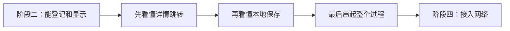
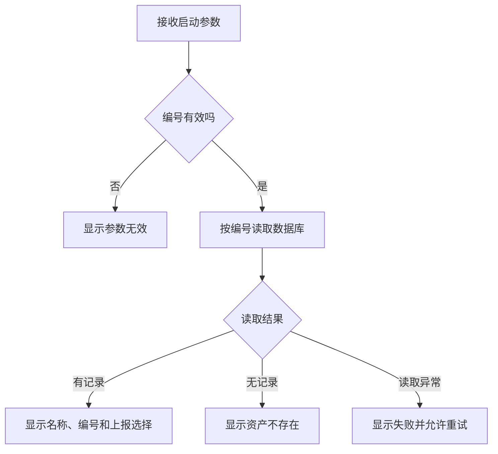
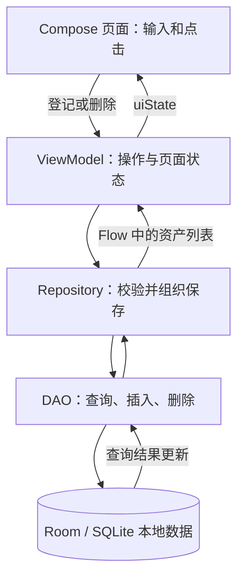
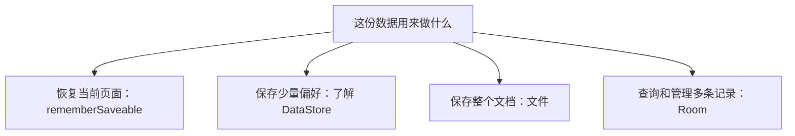
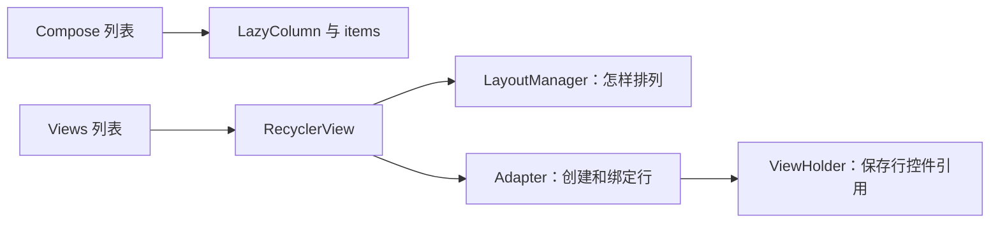

# 阶段三：点开资产详情，让登记的数据留下来

> 所属阶段：3 / 8  
> 前置要求：跟着阶段二做过资产登记页，认识 `Text`、`Button`、点击回调和 `rememberSaveable`。不要求提前学会数据库和协程。  
> 对应工程：`/Users/wl/AndroidStudioProjects/My_Application`  
> 写法：Kotlin + Jetpack Compose，沿用你项目里的 `ComponentActivity + setContent`。  
> 更新日期：2026-11-16

这一章围绕一条记录来学：名称是“温度计”，编号是 `TAG-001`，允许上报。

我们要让它做到两件事：在列表里点一下，可以看详情；应用关掉再打开，还能读到这条记录。“允许上报”现在仍然只是保存一个选择，真正发送消息要到后面的阶段。

**先说明怎么跟着看：当前工程已经写入了阶段三实现。** 本文带你按顺序看懂它，再做小改动。文件里已经有的代码，不需要重复粘贴。文中的代码块是加了中文注释的重点摘录，可能省略 import 和周围代码，不能拿来直接覆盖整个文件。

按此前要求，本次没有运行构建或测试。下面的“应该看到什么”是你之后操作时的核对目标，不是已经实测通过的报告。

## 🎓 学完这一章，你能做什么

- 找到点击资产后，打开详情页的那几行代码。
- 看懂资产编号怎样从列表页传到详情页。
- 看懂一条记录怎样写进本地数据库，又怎样显示回列表。
- 区分“暂存输入框内容”和“长期保存资产记录”。

不必一次读完。建议先看完第 1～3 步，弄清页面跳转；休息一下，再看第 4～7 步的数据保存。



这张图在讲什么：本章先解决“打开哪条资产”，再解决“这条资产存在哪里”。

## 第 1 步：先找到我们要看的文件

在 Android Studio 左边的项目面板，找到 `app/src/main/java/com/example/my_application`。

如果面板显示的是 Android 视图，目录可能被合并成一个包名，展开 `com.example.my_application` 就可以。下面出现的 Kotlin 文件，都以这个目录为起点。

| 先看哪些文件 | 你现在只需要知道什么 |
|---|---|
| `MainActivity.kt` | 资产登记和列表所在页面的入口 |
| `AssetDetailActivity.kt` | 资产详情页面的入口 |
| `ui/asset/AssetRegistrationScreen.kt` | 登记表单、列表和点击操作 |
| `data/` 下的文件 | 把资产保存到手机本地，稍后再看 |

先别逐个打开所有文件。**现在只打开 `MainActivity.kt`，找到 `AssetRegistrationRoute`。**

## 第 2 步：点击一条资产，为什么能打开另一个页面

### 2.1 从你已经认识的点击回调开始

`MainActivity.kt` 里有这一段：

```kotlin
AssetRegistrationRoute(viewModel) { code -> // 列表把被点击资产的编号交给这里
    startActivity(AssetDetailActivity.createIntent(this, code)) // 请求打开详情页
}
```

| 代码 | 用日常语言怎么理解 |
|---|---|
| `{ code -> ... }` | 页面告诉我们：“用户选中了这个编号。”这里给收到的编号起名叫 `code` |
| `createIntent(this, code)` | 准备一份打开详情页的请求，并放入编号 |
| `startActivity(...)` | 把请求交给 Android，请系统打开页面；它不返回资产内容 |

例如，你点了温度计这一行，`code` 就是字符串 `"TAG-001"`。

这里的 `this` 指当前的 `MainActivity`。它提供启动页面需要的环境信息，这类参数在 Android 中叫 `Context`。现在把它理解成“从当前页面发起请求”就够了。

**停一下：** 这一段还没有读取数据库，也没有发送网络请求。它只负责打开页面。

### 2.2 Intent 里到底放了什么

打开 `AssetDetailActivity.kt`，在文件靠下的位置找到 `companion object`：

```kotlin
companion object { // 把与这个页面相关的常量、创建方法放在一起
    const val EXTRA_ASSET_CODE = "com.example.my_application.extra.ASSET_CODE" // 附加数据的名称

    fun createIntent(context: Context, code: String): Intent = // 接收环境和编号，返回一个 Intent
        Intent(context, AssetDetailActivity::class.java) // 指定要打开的页面
            .putExtra(EXTRA_ASSET_CODE, code) // 把编号装进请求
}
```

| 代码 | 作用与写法原因 |
|---|---|
| `Intent(context, AssetDetailActivity::class.java)` | 第一个参数提供环境，第二个参数指定目标页面类；构造出一个明确目标的 Intent |
| `::class.java` | 将 Kotlin 类交给需要 Java 类对象的 Android API；这里记住它是在指定目标页面即可 |
| `putExtra(名称, 值)` | 存放额外信息，返回这个 Intent，所以可以接在构造调用后面 |
| `EXTRA_ASSET_CODE` | 双方约定的数据名称，避免发送和读取时各写各的字符串 |

可以把这件事理解成：要打开的页面是 `AssetDetailActivity`，附带的数据是 `TAG-001`。Intent 是 Android 用来表达这个请求的对象。

为什么只放编号，不把整张资产列表都传过去？因为详情只需要知道“查谁”。名称和上报选择可以按编号从数据库读取，不必搬运一整份列表。

### 2.3 新页面还要在清单里登记

打开 `app/src/main/AndroidManifest.xml`，在 `<application>` 里面找到：

```xml
<!-- 这是 application 内的片段，当前工程已经声明过，不要重复添加 -->
<activity
    android:name=".AssetDetailActivity"
    android:exported="false" />
```

| 配置项 | 作用 | 不写会怎样 |
|---|---|---|
| `<activity>` | 告诉系统应用有这个 Activity | 未声明的 Activity 无法按这里的方式正常启动 |
| `android:name` | 指定具体类；这里的前导点是包名简写 | 系统无法据此找到我们要登记的页面 |
| `android:exported="false"` | 详情是应用内部页面，不开放给其他应用直接启动 | 省略时的规则还与 intent-filter 等条件有关；内部页面明确写出更清楚 |

不要照着详情页把主入口也改成 `false`。现有 `MainActivity` 带有 `MAIN / LAUNCHER` 配置，要由桌面启动器打开，职责不同。

## 第 3 步：详情页怎样知道你选的是 TAG-001

### 3.1 从同一个名称下取出编号

还在 `AssetDetailActivity.kt`，找到 `onCreate` 里的这一行：

```kotlin
// 先取出传来的编号，再检查它是否符合本项目规则
val code = parseAssetCode(intent.getStringExtra(EXTRA_ASSET_CODE))
```

| 代码 | 作用 |
|---|---|
| `intent` | Android 交给当前 Activity 的启动请求 |
| `getStringExtra(EXTRA_ASSET_CODE)` | 按名称取出字符串，返回 `String?`，也就是“可能有字符串，也可能没有” |
| `parseAssetCode(...)` | 返回整理过的合法编号；缺失或不合法时返回 `null` |

发送时用了哪个名称，读取时就用哪个名称。换一个名称，通常就取不到这份数据。

`String?` 后面的问号表示允许为空。空值 `null` 表示“没有值”，与空字符串 `""` 不是一回事。

### 3.2 不要让缺少参数变成崩溃

打开 `asset/AssetRegistration.kt`，找到 `parseAssetCode`。它依次做这些事：去掉两端空格、转成大写、检查格式。

你可以用下面的输入核对它的意思：

| 输入 | 结果 | 原因 |
|---|---|---|
| `" tag-001 "` | `"TAG-001"` | 去掉两端空格并转大写 |
| `null` | `null` | 没有传编号 |
| `"温度计"` | `null` | 这是名称，不符合本项目的编号格式 |

本项目的编号以英文字母或数字开头，后续允许英文字母、数字、下划线和短横线，总长度不超过 24 个字符。名称另存，可以写“温度计”。

源码里的 `?.` 是“有值才继续做”，所以缺少编号不会因为调用字符串方法而直接崩溃。不要为了消除问号而改成 `!!`，那会把空值变成异常。

### 3.3 拿到编号以后才查内容

详情还可能出现不同情况：传来的编号不对；编号合法但没有这条资产；数据库读取失败；正常读到温度计。



这张图在讲什么：没有参数、查不到资产、读取出错，是三种不同的问题，页面应分别说明。

这些情况在 `ui/asset/AssetDetailViewModel.kt` 中分别叫 `InvalidArgument`、`Missing`、`LoadFailed`；正常内容叫 `Content`，读取中叫 `Loading`。先认识它们对应的界面含义，不必先记住类型写法。

返回也很简单。详情入口给页面传了 `onBack = { finish() }`：用户按返回按钮时，执行 `finish()` 结束当前详情 Activity，通常就会回到下面的列表页。

**读到这里，你应该能说清：** 列表传的是编号，详情用编号查内容，返回会结束详情页。接下来才轮到“内容存在哪里”。

## 第 4 步：把资产存进手机，为什么需要 Room

### 4.1 先分清输入框和正式记录

输入框里还没提交的“温度计”是草稿；登记成功后的“温度计 / TAG-001”是正式资产。

`rememberSaveable` 适合恢复少量界面状态，比如输入内容、搜索词和选中的标签。它的主要任务是页面恢复，不能作为资产长期存储的保证。

本阶段把正式资产写入本地数据库。Room 是 Android 上帮助我们使用 SQLite 数据库的库。你先把数据库理解成手机里的结构化记录表：可以增加一行、按编号查一行、删除一行。

| id | name | code | reportingEnabled |
|---|---|---|---|
| 1 | 温度计 | TAG-001 | true |
| 2 | 工具箱 | TAG-002 | false |

数据库文件叫 `assets.db`，保存位置由应用管理。它不是云端服务，也不会自动把记录同步到另一台手机。通常清除应用数据或卸载会移除本地数据；备份恢复是另一套机制，不要把它当作必然保证。

当前代码已经移除了阶段二临时保存资产列表的 `AssetListSaver`。正式资产从数据库读取，草稿仍交给 `rememberSaveable`。旧版临时记录不保证自动转存，需要时重新登记。

### 4.2 先看“一行记录长什么样”

打开 `data/AssetEntity.kt`：

```kotlin
@Entity( // 告诉 Room：这个类描述一张表
    tableName = "assets", // 表名是 assets
    indices = [Index(value = ["code"], unique = true)] // 编号不能重复
)
data class AssetEntity(
    @PrimaryKey(autoGenerate = true) val id: Long = 0, // 插入时让数据库生成本地编号
    val name: String, // 资产名称，例如温度计
    val code: String, // 业务编号，例如 TAG-001
    val reportingEnabled: Boolean // 是否允许将来上报
)
```

| 代码 | 作用与写法原因 |
|---|---|
| `@Entity` | 把这个类与数据库表对应起来；这类说明代码用途的标记叫注解 |
| `data class` | 用于承载数据的 Kotlin 类，Room 中的一行对应一个对象 |
| `id` 与 `@PrimaryKey` | 为每行提供数据库内部标识；`autoGenerate` 让数据库分配它，插入前用默认值 `0` |
| `Index(..., unique = true)` | 数据库再守一道规则，阻止同一个 `code` 出现两次 |
| 三个业务字段 | 保存你在登记页填写的内容，分别是字符串、字符串和布尔值 |

为什么既有 `id` 又有 `code`？`id` 是本地数据库管理记录用的；`code` 是你登记资产时使用的编号。当前详情按 `code` 查找，列表按 `id` 倒序显示。

`TAG-001` 也不是 iBeacon 的 UUID。真正的蓝牙广播字段要到阶段六再学。

### 4.3 再看“能对这张表做什么”

打开 `data/AssetDao.kt`。DAO 可以先理解成“数据库操作清单”，本课只做查询、添加、删除。

```kotlin
@Dao // 告诉 Room：这是数据库操作接口
interface AssetDao {
    @Query("SELECT * FROM assets ORDER BY id DESC") // 按 id 从大到小查全部资产
    fun observeAll(): Flow<List<AssetEntity>> // 持续提供最新列表

    @Query("SELECT * FROM assets WHERE code = :code LIMIT 1") // 按参数 code 查一条
    fun observeByCode(code: String): Flow<AssetEntity?> // 找不到时提供 null

    @Query("SELECT * FROM assets ORDER BY id DESC") // 取当前全部资产
    suspend fun getAll(): List<AssetEntity> // 只取这一次，供登记前校验

    @Insert(onConflict = OnConflictStrategy.ABORT) // 冲突时失败，不覆盖旧资产
    suspend fun insert(asset: AssetEntity): Long // 成功时返回插入的行 ID

    @Query("DELETE FROM assets WHERE code = :code") // 删除指定编号
    suspend fun deleteByCode(code: String): Int // 返回实际删除的行数
}
```

| 方法或写法 | 读代码时怎么理解 |
|---|---|
| `SELECT * FROM assets` | 读取资产表的全部列 |
| `WHERE code = :code` | 只要编号匹配的记录；`:code` 绑定函数参数，不自己拼接 SQL 字符串 |
| `ORDER BY id DESC` | id 大的排前面，所以后登记的资产通常在前面 |
| `Flow<...>` | 提供会继续更新的数据，数据库相关表变化后可以再次收到结果 |
| `suspend fun` | 需要从协程等允许挂起的环境调用；这里由 Room 配合处理异步数据库访问 |
| `insert(asset)` / `deleteByCode(code)` | 参数分别是一条记录、一个编号；返回行 ID、删除行数 |

先记住两个区别就够了：`getAll()` 取一次，`observeAll()` 可以持续收到列表；`insert()` 写入，`deleteByCode()` 删除。

不要看到 `suspend` 就认为“所有代码自动跑到了后台线程”。它表示函数可以挂起，具体在哪执行还取决于实现。此处使用的是 Room 的异步访问方式，不要添加 `allowMainThreadQueries()` 来绕开限制。

### 4.4 谁负责打开 assets.db

打开 `data/AssetDatabase.kt`，先看文件中间的这一小段：

```kotlin
Room.databaseBuilder(
    context.applicationContext, // 用应用环境，避免让数据库持有某个页面
    AssetDatabase::class.java, // 指定数据库定义类
    "assets.db" // 本地数据库文件名
).build() // 返回数据库对象；后续通过它取得 DAO
```

| 代码 | 作用与写法原因 |
|---|---|
| `databaseBuilder(...)` | 用环境、数据库类和文件名创建构建器 |
| `"assets.db"` | 固定文件名，使后续启动仍能打开同一份本地数据 |
| `.build()` | 得到 `AssetDatabase` 对象，不是得到资产列表 |

文件顶部还有 `@Database(entities = [AssetEntity::class], version = 1, exportSchema = true)`：它说明这份数据库包含哪张表、当前结构版本为 1，并要求导出结构描述。

周围的 `instance`、`synchronized` 是为了让应用复用一个数据库实例。第一次阅读只需知道 `AssetDatabase.getInstance(context)` 能拿到数据库，`assetDao()` 能拿到操作接口。这一段的并发写法可以回头细读。

## 第 5 步：按下登记，数据怎样真正写进去

### 5.1 先复用阶段二的登记规则

打开 `data/AssetRepository.kt`，找到 `register` 方法。

Repository 是这份代码里的“资产数据入口”。页面只说“我要登记温度计”，它负责组织检查和保存，页面不需要直接写 SQL。

```kotlin
override suspend fun register(
    name: String, // 用户填的名称
    code: String, // 用户填的编号
    reportingEnabled: Boolean // 用户选的上报偏好
): RegistrationError? = database.withTransaction { // 成功返回 null，否则返回业务错误
    val records = dao.getAll().map { it.toRecord() } // 先读取已有资产，转换为业务记录
    val result = registerAsset(name, code, reportingEnabled, records) // 复用阶段二校验
    if (result.error != null) return@withTransaction result.error // 校验失败就结束本次操作
    val asset = result.assets.first() // 校验成功后，新资产位于结果列表最前面
    dao.insert( // 只把新资产写进数据库
        AssetEntity(name = asset.name, code = asset.code, reportingEnabled = asset.reportingEnabled)
    )
    null // 执行到这里，表示登记成功，没有业务错误
}
```

| 代码块 | 作用与写法原因 |
|---|---|
| `registerAsset(...)` | 继续检查必填、格式、重复编号和数量上限；原规则仍在 `asset/AssetRegistration.kt` |
| `return@withTransaction result.error` | 结束这次事务代码块并返回错误，不继续插入 |
| `dao.insert(...)` | 发生真正的数据库写入；之前只是读数据和做检查 |
| `withTransaction { ... }` | 将相关的检查与写入组织成一次事务，避免并发操作轻易绕过规则；异常时不保留半次写入 |

这里出现的 `it` 是 Kotlin 对单个参数的默认名字。`map { it.toRecord() }` 就是“把列表里的每条数据库记录，转换成页面使用的记录”。`toRecord()` 定义在 `AssetEntity.kt`，只保留名称、编号和上报选择，不把本地 `id` 带到页面。

还要分清两种失败：编号重复属于业务错误，返回 `RegistrationError`；数据库读写异常会抛出，由下一步的 ViewModel 处理。不能把磁盘或数据库异常都显示成“编号重复”。

### 5.2 写完以后，为什么列表会更新

同一个文件里有这段：

```kotlin
override fun observeAssets(): Flow<List<AssetRecord>> = // 向页面一侧提供资产列表
    dao.observeAll().map { entities -> // 每次数据库给出一个列表
        entities.map { it.toRecord() } // 将列表中的每条记录转成页面使用的类型
    }
```

| 代码 | 作用 |
|---|---|
| 外层 `.map { entities -> ... }` | 转换 Flow 每次给出的整个列表 |
| 内层 `entities.map { ... }` | 转换这个列表里的每个元素 |
| 返回 `Flow<List<AssetRecord>>` | 调用方可以持续接收资产列表，不只是拿到某一次的快照 |

两层 `map` 初看容易绕。用温度计来想：数据库先给一张表的查询结果，程序再把每一行整理成页面认识的样子。

**这里没有额外维护一份“刚刚登记的本地列表”。** 写入完成后，数据库查询提供更新结果，页面跟着结果显示。否则，一份列表说登记了，另一份说没有，排错会很困难。

## 第 6 步：数据库结果怎样交给 Compose

### 6.1 为什么又多了 ViewModel

页面需要知道的不只是“有哪些资产”，还包括“是否正在加载”“是否正在保存”“失败后显示什么”。

这些事情由 `ui/asset/AssetViewModel.kt` 协调。ViewModel 管理页面所需的数据和操作状态；它不是数据库，进程结束后不能靠它保住正式记录。

先找到文件顶部的 `AssetUiState`：其中 `assets` 是列表，`isLoading` 是读取中，`isSaving` 是写入中，`loadFailed` 是读取失败。其余字段先不急着背。

再看 ViewModel 内部：

```kotlin
private val mutableState = MutableStateFlow(AssetUiState()) // 内部可以修改的当前页面状态
val uiState = mutableState.asStateFlow() // 对外只提供读取和观察
```

| 代码 | 作用与写法原因 |
|---|---|
| `MutableStateFlow(AssetUiState())` | 保存一份有初始值的页面状态 |
| `private` | 页面不能直接拿它随意修改状态 |
| `asStateFlow()` | 提供只读视角；页面发出“登记”等请求，由 ViewModel 决定怎样更新 |

前面说的 Flow 泛指持续提供数据；这里的 StateFlow 还保留一个当前状态值。现阶段先理解为“页面可以观察到最新状态”。

### 6.2 先看读取，再看写入

在 `reload()` 中找到下面这部分。为便于阅读，这里省略外围的加载标记和旧任务取消，完整逻辑仍以源码为准：

```kotlin
observation = viewModelScope.launch { // 在 ViewModel 管理的协程中等待数据
    try {
        repository.observeAssets().collect { assets -> // 每收到一份资产列表，执行一次这里
            mutableState.update {
                it.copy(assets = assets, isLoading = false, loadFailed = false) // 更新页面状态
            }
        }
    } catch (cancelled: CancellationException) {
        throw cancelled // 取消任务时继续传递取消，不把它当作读取失败
    } catch (exception: Exception) {
        Log.e("AssetStorage", "Unable to read assets", exception) // 留下排错信息
        mutableState.update { it.copy(isLoading = false, loadFailed = true) } // 让界面显示失败
    }
}
```

| 代码 | 作用与写法原因 |
|---|---|
| `viewModelScope.launch { ... }` | 启动受 ViewModel 生命周期管理的协程，返回任务 Job；这里把任务保存在 `observation` 中 |
| `collect { assets -> ... }` | 接收 Flow 提供的数据；`assets` 是本次收到的列表 |
| `update { it.copy(...) }` | `it` 是原状态，`copy` 创建修改了指定字段的新状态，其他字段保留 |
| 两种 `catch` | 任务取消继续取消；实际读取异常才更新为失败并记录日志 |

协程先理解成一种组织“需要等待的工作”的写法。数据库读取还没结束时，界面不应该一直卡住等它。现在不用急着学习所有协程调度器。

完整的 `reload()` 开头会取消上一次观察，避免重试时叠加多份监听。`init { reload() }` 表示 ViewModel 创建后就开始读取。

### 6.3 页面只接状态和操作

打开 `ui/asset/AssetRegistrationScreen.kt`，找到顶部的 `AssetRegistrationRoute`：

```kotlin
val state by viewModel.uiState.collectAsStateWithLifecycle() // 让 Compose 随生命周期观察状态
AssetRegistrationScreen(
    uiState = state, // 把当前状态交给页面显示
    onRegister = viewModel::register, // 点击登记时调用 ViewModel 的 register 方法
    onDelete = viewModel::delete, // 确认删除时调用 ViewModel 的 delete 方法
    onClearRegistrationError = viewModel::clearRegistrationError, // 输入变化时清除旧校验提示
    onRetry = viewModel::reload, // 点击重试时重新读取
    onNoticeConsumed = viewModel::consumeNotice, // 提示显示后告诉 ViewModel 已处理
    onOpenAsset = onOpenAsset // 把打开详情的操作继续交给页面
)
```

| 代码 | 作用与写法原因 |
|---|---|
| `collectAsStateWithLifecycle()` | 返回 Compose 可观察的状态，默认在生命周期至少 STARTED 时收集；页面不活跃时可以停止这部分收集 |
| `val state by ...` | `by` 让这里读取到的是状态中的值，避免每次写 `.value`；源码需要相应的 `getValue` 导入 |
| `viewModel::register` | 将方法本身作为回调传进去；此时还没有调用登记 |
| `uiState = state` | 页面照当前数据绘制，数据变化后 Compose 可以更新显示 |

这里的生命周期收集不等于“数据库监听在整个应用后台都自动停止”。ViewModel 内部的观察任务由它自己的作用域管理，两层不要混为一谈。

回到 `MainActivity.kt` 还会看到 `ViewModelProvider(this, AssetViewModel.factory(applicationContext))[AssetViewModel::class.java]`。先读成一句话：**为当前 Activity 获取列表 ViewModel；需要新建时，用工厂装配它依赖的数据库和 Repository。** 它不是每次 Compose 重画时都重新建一个。

### 6.4 按下登记后，输入框为什么没有立刻清空

沿源码看一遍就能理解：

1. 页面把名称、编号和开关交给 `register(...)`。
2. ViewModel 先把 `isSaving` 设为 `true`，页面暂时不接受重复写入。
3. Repository 检查并写数据库。
4. 业务错误会显示校验提示；异常会显示保存失败。两种情况下都保留草稿。
5. 成功后，ViewModel 产生一次新的 `registrationId`。
6. 页面用 `LaunchedEffect(uiState.registrationId)` 处理这次成功，才清空草稿、切到列表。

`registrationId` 是识别“这一次登记成功”的标记，不是资产编号，也不是数据库的 `id`。它配合 `handledRegistrationId`，避免页面恢复时重复处理同一次成功。

`LaunchedEffect` 用来在指定的 key 变化时执行这类工作。不要把清空输入框、弹提示或写数据库直接放在普通页面绘制代码里，否则重组时可能重复执行。

## 第 7 步：列表、详情和删除，回到同一份数据

### 7.1 列表中的 key 在解决什么问题

在 `AssetRegistrationScreen.kt` 的列表部分找到 `items(filtered, key = { it.code })`。

`filtered` 是按搜索词筛出来的列表；`key` 告诉 Compose 每一行是谁。删除第一行后，`TAG-002` 仍然是工具箱，不应该因为位置变了就变成另一个身份。

所以这里用唯一且稳定的资产编号。它与数据库唯一索引不是一回事：key 帮 UI 识别行，索引约束数据库记录，两者各管各的事。

### 7.2 详情为什么不直接显示收到的名字

因为 Intent 只带编号。详情 ViewModel 调用 `repository.observeAsset(code)`，Repository 再调用 `dao.observeByCode(code)`。

有记录就显示内容，没有记录就显示不存在，异常就显示读取失败。这是第 3 步里几种页面状态的真正来源。

删除也遵守同样原则：ViewModel 请求 Repository 删除；DAO 返回删除行数；列表再接收数据库的新结果。返回 0 表示没有删到记录，不能假装删除成功。

### 7.3 现在再看完整路线，就没那么抽象了



这张图在讲什么：用户操作向下传到数据库，查询结果向上传回页面；正式记录以数据库为准。

不用背这五层名字。读代码时每次问一个问题就行：“这行是在画页面、管理操作，还是读写数据？”

## 配置补课：为什么加了类，还要加依赖

Room 的注解需要代码生成工具处理，页面观察状态也用到了额外的 Lifecycle 库。所以除了 Kotlin 文件，本章还改了 Gradle 配置。

**当前项目已经配过。下面是核对表，不是让你把同一份配置再加一遍。**

先看 `app/build.gradle.kts` 中的相关片段：

```kotlin
// plugins 块内：启用项目版本目录中声明的 KSP 插件
alias(libs.plugins.ksp)

// 顶层配置：指定 Room 数据库结构描述的导出位置
ksp {
    arg("room.schemaLocation", "$projectDir/schemas") // 导出到 app/schemas
}

// dependencies 块内：加入运行时库与生成器
implementation(libs.androidx.room.runtime) // Room 基础功能
implementation(libs.androidx.room.ktx) // 本项目使用的协程、事务相关支持
ksp(libs.androidx.room.compiler) // 构建时根据注解生成数据库访问实现
implementation(libs.androidx.lifecycle.runtime.compose) // Compose 观察生命周期状态
implementation(libs.androidx.lifecycle.viewmodel.ktx) // 使用 viewModelScope
```

| 配置项 | 作用 | 缺少或不一致时会怎样 |
|---|---|---|
| `libs.versions.toml` 中的版本和别名 | 将库名称、坐标、版本集中管理 | `libs.xxx` 找不到，或库版本不一致 |
| 根 `build.gradle.kts` 中 KSP 的 `apply false` 声明 | 先声明插件，具体在 app 模块使用 | 本项目的插件集中管理约定不完整；插件解析也取决于其他声明方式 |
| app 的 `alias(libs.plugins.ksp)` | 在应用模块启用生成工具 | KSP 无法按当前配置处理 Room 注解 |
| Room runtime / ktx / compiler | 分别提供运行支持、相关扩展和代码生成 | 对应 API 或生成实现不可用；三者应保持匹配 |
| `room.schemaLocation` | 告诉 Room 把结构描述放在哪里 | 失去本课约定的结构文件输出路径，影响后续版本审查 |
| `ksp.useKSP2=true` | 在当前历史 KSP 配置中启用 KSP2 | 改变当前方案使用的处理器模式 |
| Lifecycle 两个依赖 | 提供本章使用的观察状态和 ViewModel 协程 API | 对应 API 可能无法解析 |

本项目沿用 Kotlin `2.0.21`，配置的是 Room `2.7.2`、KSP `2.0.21-1.0.28`。这是当前源码组合，不是“最新版本推荐”；该历史 KSP2 当时仍标为 Beta，组合尚未经过本项目构建验证。这里不要一边学业务一边随意升级某一个版本。

`app/schemas` 目前只有说明文件，未构建就还没有生成数据库版本 JSON。以后改表结构需要学习迁移，不能遇到问题就加“删除旧库重建”的配置来丢弃资产。

本章本地数据库不需要新增网络或外部存储权限，也不需要 `network_security_config.xml`。网络配置留到阶段四。

## 选读：另外几种存储方式，什么时候用

主线做到这里就可以去做练习。下面解决的是“为什么不用另一个方案”，不要求把所有方案都接入同一个应用。

### 一个开关、一个文件、一批资产

| 你要保存什么 | 可以从哪里入手 |
|---|---|
| 未提交的输入内容、页面选择 | `rememberSaveable`，用于小型页面状态恢复 |
| 一个全局默认开关 | 新需求了解 DataStore；旧代码里经常遇到 SharedPreferences |
| 一份完整说明、导出内容或快照 | 应用私有文件 |
| 多条资产，需要增删和按编号查询 | 本章的 Room |



这张图在讲什么：先看数据怎么使用，再选择保存方式，不要求所有数据都塞进同一个 API。

### 认识旧项目里的 SharedPreferences

下面是**独立学习示例，未接入当前页面**。如果以后练习，应从点击回调等合适位置使用；不要在 Composable 绘制过程中反复执行写入。

```kotlin
val preferences = context.getSharedPreferences("settings", Context.MODE_PRIVATE) // 打开应用私有的偏好文件
preferences.edit().putBoolean("default_reporting", true).apply() // 保存默认允许上报
val enabled = preferences.getBoolean("default_reporting", false) // 没有保存过时使用 false
```

| 代码 | 参数、返回结果与用途 |
|---|---|
| `getSharedPreferences("settings", MODE_PRIVATE)` | 名称决定打开哪份偏好，模式为应用私有，返回偏好对象 |
| `putBoolean(名称, 值).apply()` | 修改这个键；`apply()` 更新内存并安排异步落盘，不返回磁盘写入成功结果 |
| `getBoolean(名称, 默认值)` | 返回保存的布尔值；键不存在时返回默认值 |

这里保存的是“新登记时默认是否勾选”的全局偏好。正式资产各自的 `reportingEnabled` 仍保存在 Room，它们不是同一个东西。

### 认识应用私有文件

同样是**未接入主页面的独立示例**。文件 IO 要放在适合的执行环境中，例如由协程切到 IO 调度器后调用，不直接塞进按钮回调阻塞主线程。

```kotlin
val file = File(context.filesDir, "asset-note.txt") // 在应用私有目录定位固定文件
file.writeText("温度计 TAG-001", Charsets.UTF_8) // 写入整段文字，覆盖原内容
val text = file.readText(Charsets.UTF_8) // 读取整段文字，返回 String
```

| 代码 | 作用与边界 |
|---|---|
| `File(context.filesDir, "asset-note.txt")` | 构造文件路径对象；这一步本身还没有创建文件，需要 `java.io.File` |
| `writeText(...)` | 按指定编码写整个文件；会覆盖旧内容，也可能失败 |
| `readText(...)` | 读整个文件；文件不存在或读取异常需要由调用方处理 |

当你只想留一段说明，文件很直接；当你要“查 TAG-001、删 TAG-002、阻止重复编号”，Room 更适合这一章的工作。

### RecyclerView 为什么没有出现在我的页面里

你现在用 Compose，所以列表是 `LazyColumn`。RecyclerView 属于另一套 Views 界面体系，是以后读旧项目时需要认识的列表控件。



这张图在讲什么：两套 UI 都能显示列表，但组织方式不同，Compose 项目里不必为了列表再造一套 Adapter。

如果选择深入 RecyclerView，就在单独的 Views 练习页中依次学习 LayoutManager、ViewHolder、Adapter，然后学习用 ListAdapter 和 DiffUtil 更新数据。重点区分“是不是同一条记录”和“内容有没有变化”。不要直接把这套代码混进当前 Compose 页面。

## 📖 遇到问题，再去查这些文档

**不要背 API，要学会带着具体问题查文档。** 先知道自己要解决什么，再看对应的一小节，暂时不需要从头通读所有页面。

| 你遇到的问题 | 官方入口 | 先看哪里 |
|---|---|---|
| 怎么指定打开哪个页面，怎样传 extra | [Intent 与过滤器](https://developer.android.com/guide/components/intents-filters) | Building an intent，关注 component name 和 extras |
| 页面类写好了，为什么还要清单 | [activity 配置](https://developer.android.com/guide/topics/manifest/activity-element) | `android:name`、`android:exported` |
| 表、DAO、数据库三个文件是什么关系 | [Room 入门](https://developer.android.com/training/data-storage/room) | Primary components；先对照本章三个文件 |
| 字段、主键和索引怎么声明 | [定义 Room 数据](https://developer.android.com/training/data-storage/room/defining-data) | Entity、primary key、index |
| 查询和插入如何写 | [DAO 数据访问](https://developer.android.com/training/data-storage/room/accessing-data) | Query、Insert；按当前方法查对应小节 |
| 为什么查询返回 Flow，写入带 suspend | [Room 异步查询](https://developer.android.com/training/data-storage/room/async-queries) | Observable reads 与 one-shot operations |
| 页面状态为什么交给 ViewModel | [ViewModel](https://developer.android.com/topic/libraries/architecture/viewmodel) | Benefits 与 lifecycle；区分它和持久化存储 |
| rememberSaveable、状态和重组是什么 | [Compose 状态](https://developer.android.com/develop/ui/compose/state) | State in composables、其他状态转为 Compose State |
| LazyColumn 的 key 有什么要求 | [Compose 列表](https://developer.android.com/develop/ui/compose/lists) | Item keys |
| 选读的几种存储怎么选 | [数据存储总览](https://developer.android.com/training/data-storage) | 先按数据用途找类别 |

做选读练习时，再看 [SharedPreferences](https://developer.android.com/training/data-storage/shared-preferences) 的写入与读取、[应用私有文件](https://developer.android.com/training/data-storage/app-specific) 的内部存储、[DataStore](https://developer.android.com/topic/libraries/architecture/datastore) 的概览，以及 [RecyclerView](https://developer.android.com/develop/ui/views/layout/recyclerview) 的关键类与实现步骤。

配置遇到问题时，看 [KSP 入门](https://kotlinlang.org/docs/ksp-quickstart.html) 理解插件与处理器的区别，再查 [Room 版本记录](https://developer.android.com/jetpack/androidx/releases/room#2.7.2) 对照项目实际版本。官方页面会更新，示例版本或包名与项目不同的时候，先确认自己正在使用哪一代 API，不整页照搬。

## ✍️ 动手练习：一次只改一件事

以下是你后续学习时的操作清单，本次文档改写没有代你运行这些步骤。

### 练习一：追踪 TAG-001 去了哪里

目标：不用背概念，沿着源码找到编号的发送、接收、查询。

从 `MainActivity.kt` 的 `startActivity` 出发，依次找到 `createIntent`、`getStringExtra`、`observeAsset` 和 `observeByCode`。把每一处所在文件记下来。

验收：能指着源码说出“这行装入编号，这行取出编号，这行按编号查库”。再解释不传编号和查不到记录为什么不是一回事。

### 练习二：只改详情页的一句话

目标：分清展示文字、传参名称和数据库字段，体验一个小改动。

打开 `ui/asset/AssetDetailScreen.kt`，找到一处 `stringResource(R.string.xxx)`，再到 `app/src/main/res/values/strings.xml` 找对应文案。只改显示文字，不改资源名称、不改 `EXTRA_ASSET_CODE`，也不改表字段。

验收：能说清自己改的是展示层。之后获准运行时，确认详情只改变了相应文字，仍然显示同一条资产。

### 练习三：列出“保存成功”的证据

目标：区分页面还在内存里和记录已经长期保存。

写下自己的操作顺序：登记温度计 `TAG-001`，查看详情，结束应用后重新打开，再找这条资产；删除它，再重新打开。分别记录预期结果和实际结果。

验收：重开后能重新读取已保存记录，删除的记录不重新出现。遇到构建或运行问题时如实记下问题，未执行的项目标“未测”，不要只凭旋转屏幕后还显示就认定持久化通过。不要用卸载应用来验证“关掉重开”，卸载会涉及本地数据清除。

## ✅ 阶段检验

能做到这些，再往下学：

- [ ] 能说明 Intent 只传了资产编号，详情内容来自数据库。
- [ ] 知道 `String?` 允许为空，能区分参数无效、资产不存在和读取失败。
- [ ] 能在源码中找到描述资产表、查询资产、插入资产的地方。
- [ ] 能说清 Repository 复用登记规则，ViewModel 管理操作和页面状态。
- [ ] 知道保存失败时为什么应该保留输入内容。
- [ ] 能区分草稿恢复和正式资产存储，知道 ViewModel 不替代数据库。
- [ ] 能沿着图说明“点击登记 → 写库 → 收到新列表 → 更新页面”。

这里的勾选由你的理解与实际记录决定，不因为文档写完就自动打勾。

## 本阶段小结

拿温度计这一条记录来说：列表用 `TAG-001` 打开详情，详情再按这个编号查数据。正式记录放进 Room，ViewModel 把查询结果整理成页面状态，Compose 按状态显示。

回看代码时，从一个按钮或一个显示结果出发，顺着它往下找。一次弄清一条路径，比同时记住所有类名更有用。

## 下一阶段预告

阶段四会给资产页面接入网络：先看懂一次 HTTP 请求，再用 HTTPS 获取 JSON 数据，处理请求失败和证书等常见问题。本章的本地数据库仍然负责保存资产；网络数据与本地数据如何配合，会在具体需求里再解释。

本阶段到这里暂停，等待你明确开始下一阶段。
